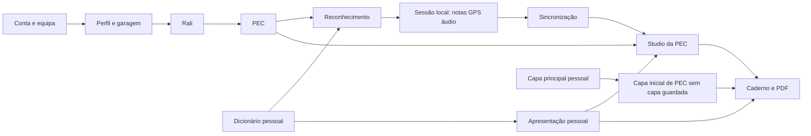

# Especificação funcional AS-IS — Recce Studio

**Data:** 30 de outubro de 2026. **Referência:** checkout local, commit `eb44ad4`; inclui a configuração de capa principal e por PEC presente no código nesta data. **Natureza:** análise e documentação, perfil FAST documental. Não é uma auditoria técnica, proposta de redesign ou declaração de aprovação para release.

## 1. Visão geral do produto

O Recce Studio apoia a preparação de notas de reconhecimento de ralis: organizar ralis e provas especiais de classificação (PECs), registar passagens com GPS, instantes e áudio, converter frases ditadas em notas compactas, rever notas com media e mapa e preparar um caderno impresso/PDF. O problema central é relacionar o que a tripulação observou na estrada com a nota, o instante da gravação e a posição geográfica, incluindo períodos sem rede.

O produto reúne uma área partilhada de equipa e uma área pessoal de linguagem/apresentação. O navegador também guarda trabalho local ainda não sincronizado. Não se encontrou gestão de inscrições em competições, classificações desportivas, cronometragem oficial, navegação curva a curva ou gestão comercial de clientes.

### Método e nível de confirmação

Foram analisadas rotas, menus, templates, componentes, serviços, controladores, validações e entidades dos 12 módulos inventariados. Documentação FEAT existente foi usada como contexto; o comportamento descrito foi confirmado nas implementações atuais. Os exemplos são genéricos, sem dados pessoais, credenciais ou tokens.

- **CONFIRMADO NO CÓDIGO:** existe implementação e foi seguido o respetivo caminho funcional. Não significa que se tenha usado a função num dispositivo real.
- **VALIDADO EM EXECUÇÃO:** requer observação identificada em execução. Nenhuma nova função recebe esta classificação neste levantamento; não se abriram sessões, não se alteraram dados e não se correram testes.
- **PARCIALMENTE IMPLEMENTADO:** há uma superfície ou parte do mecanismo, mas falta o percurso anunciado/esperado, conforme explicado na ficha.
- **INFERIDO / POR CONFIRMAR:** interpretação ou resultado dependente de condições não observadas; explicitado nas limitações e observações.

A evidência de execução histórica de FEAT-017 está no respetivo documento, mas não é apresentada como nova validação deste levantamento. Cobertura: módulos e ações principais das superfícies identificadas; não se afirma execução integral, cobertura de todos os ramos internos ou equivalência com uma instalação publicada.

## 2. Público-alvo, utilizadores e âmbitos

Piloto, copiloto/navegador e outros membros de uma equipa são os utilizadores funcionais previstos. Piloto e copiloto são campos do perfil, **não papéis de autorização**. No backend analisado, uma conta ativa está associada a uma equipa; não há hierarquia visível de administrador, editor ou leitor. Não se encontrou ecrã para convidar membros, trocar de equipa, gerir permissões, recuperar password ou eliminar a conta.

Há três contextos de uso: visitante na entrada; conta autenticada online; sessão local em modo offline. Uma conta online também pode escolher modo offline mantendo a sua identidade. Entrar offline a partir do login cria um contexto local sem autenticação de servidor; esse contexto não equivale a uma conta registada.

**Partilhado com a equipa:** perfil, tripulação, viaturas/seleção ativa, descrição textual do sistema base, ralis, PECs, notas, media, GPS, sincronizações e capas já guardadas por PEC. **Pessoal no servidor:** regras de voz, modelo visual/caderno e capa principal. **Neste navegador:** modos, temas, preferências de captura, sessão e reconhecimento local; não é uma cópia geral da aplicação online.

## 3. Arquitetura funcional e dependências

O frontend é a aplicação usada pela tripulação; o backend guarda e valida o trabalho online. IndexedDB guarda sessões locais e áudio; armazenamento local guarda preferências e referências. O PDF é produzido pelo diálogo de impressão do navegador, a partir da composição de páginas. O mapa pede imagens de satélite a um fornecedor externo. O reconhecimento de fala e os dispositivos dependem das capacidades/permissões do navegador.

O rali é necessário para criar uma PEC online. Uma captura sem PEC pode existir localmente e ganhar destino depois. O dicionário fornece símbolos à apresentação; a apresentação não cria novas definições de símbolos. Uma nota pode sobrepor o estilo do modelo apenas nessa ocorrência. Modelo de página e capa principal têm gravações separadas. A sincronização envia notas/GPS e, depois, áudio; sucesso parcial conserva a cópia local.

## 4. Mapa de navegação

| Caminho | Página/estado | Entradas e saídas principais |
| --- | --- | --- |
| `/login` | Acesso privado beta | Entrar online ou offline. Online abre lista de ralis ou fila local se houver trabalho próprio pendente; offline abre fila local. |
| `/` | Redirecionamento | Encaminha para `/pecs`, sujeito à sessão/modo. |
| `/pecs` | Ralis & PECs | Pesquisa, filtros, criar/editar/eliminar rali; abrir `/rally/:id`. |
| `/rally/:id` | Detalhes do rali | Métricas, PECs, criar/editar/eliminar PEC, concluir/reabrir rali; abrir `/recce/:id`. |
| `/recce/:id` | PEC | Vistas Visão geral, Reconhecimento e Studio; edição/estado da PEC. Não são rotas independentes. |
| `/new-recce` | Escolha de início | Escolher/criar PEC ou iniciar sem PEC em `/recce-mode`. Não abre uma PEC implícita. |
| `/recce-mode` | Captura sem destino ou retoma | Pode receber `offlineSessionId`; finalizar encaminha para fila local quando aplicável. |
| `/offline-recces` | Sessões deste navegador | Atualizar, novo, continuar rascunho, eliminar, escolher/criar destino e sincronizar online. |
| `/notes` | Configurar notas | Abas Dicionário, Apresentação, Caderno e exportação; ajuda guiada. Abas não alteram a rota. |
| `/team-profile` | Perfil da Equipa | Identidade, tripulação, garagem, estatísticas, atividade, unidades em edição. |
| `/settings` | Configurações locais | Tema geral, cor e modo de voz; idioma apenas informativo. |
| `/tutorial` | Catálogo de aprendizagem | Seis percursos por workflow e tutorial de notas. |
| `/notes/learn` e `/tutorial/notes` | Tutorial de notas | Aliases; `part=dictionary/presentation/notebook/studio` escolhe percurso parcial. |
| `/tutorial/learn/:workflow` | Tutorial de workflow | `rally`, `pec`, `recce`, `studio`, `team`, `offline`. Chave desconhecida mostra tutorial indisponível. |
| Outra rota | Fallback | Redireciona para raiz; não há página 404 específica no router. |

Menu principal: Ralis & PECs, Reconhecimentos Offline, Notas, Perfil da Equipa, Configurações, Tutorial; permite recolher/expandir e dispõe de controlos móveis de sessão. O atalho de novo reconhecimento no código do menu está comentado: a rota existe, mas não é um item ativo desse menu.

Em modo offline o guard permite `/recce-mode`, `/offline-recces`, `/settings` e caminhos iniciados por `/tutorial`; redireciona restantes para a fila local. Notas fica desativada. Isto inclui uma diferença: `/tutorial/notes` é permitido, enquanto o alias `/notes/learn` não está na lista permitida. Os links de regresso da PEC usam o histórico; a origem pode variar conforme o percurso.

## 5. Inventário de funcionalidades

A tabela seguinte e as fichas da secção6 partilham os mesmos IDs. Cada ficha agrega ações que pertencem à mesma capacidade de produto; não conta cada botão como uma funcionalidade independente. Operações apenas de backend e partes indisponíveis são identificadas nas fichas e no apêndice de operações.

| Módulo | Funções | IDs |
| --- | ---: | --- |
| Acesso e navegação | 10 | FUNC-001–FUNC-010 |
| Equipa e garagem | 10 | FUNC-011–FUNC-020 |
| Ralis | 7 | FUNC-021–FUNC-027 |
| PECs | 6 | FUNC-028–FUNC-033 |
| Reconhecimento | 8 | FUNC-034–FUNC-041 |
| Offline e sincronização | 7 | FUNC-042–FUNC-048 |
| Studio | 14 | FUNC-049–FUNC-062 |
| Dicionário e conversão | 7 | FUNC-063–FUNC-069 |
| Apresentação pessoal | 4 | FUNC-070–FUNC-073 |
| Caderno e capas | 7 | FUNC-074–FUNC-080 |
| Configurações locais | 3 | FUNC-081–FUNC-083 |
| Aprendizagem guiada | 5 | FUNC-084–FUNC-088 |

**Total: 12 módulos e 88 funcionalidades; 6 parcialmente implementadas.**

## 6. Especificação detalhada por módulo

As condições de equipa, conta e estado mencionadas em cada ficha remetem para a matriz da secção9. Em todas as ações com persistência online é necessária sessão válida; em alterações a PEC, notas, media e capa de PEC, o backend aplica a propriedade da equipa e os bloqueios de conclusão. Exceções e diferenças são explicitadas, sem confundir botões desativados com permissões reais. As fichas discriminam os CRUD disponíveis; operações não mencionadas não foram identificadas na respetiva superfície.

### Acesso e navegação

#### FUNC-001 — Entrar online

- **Descrição, objetivo e valor:** Aceder ao trabalho da equipa com uma conta beta existente.
- **Onde/acesso:** Login.
- **Pré-requisitos/permissões/dependências:** Conta ativa e rede/servidor acessíveis. Ver âmbitos na secção9.
- **Inputs e opções:** Email e password.
- **Passos de utilização:** 1. Preencher os campos. 2. Carregar Entrar. 3. Aguardar validação e encaminhamento.
- **Resultado e destino dos dados:** Sessão guardada neste navegador; abre ralis ou trabalho local próprio pendente.
- **Validações, estados, erros e limitações:** Campos obrigatórios, password mínima de seis caracteres no serviço; erro mantém formulário. Novo login substitui o token anterior da conta. Sem recuperação de password visível.
- **Evidência:** [E-auth](#e-auth), [E-login](#e-login). **Estado:** CONFIRMADO NO CÓDIGO.

#### FUNC-002 — Entrar em modo offline

- **Descrição, objetivo e valor:** Capturar sem autenticação de servidor.
- **Onde/acesso:** Login → Entrar em modo offline.
- **Pré-requisitos/permissões/dependências:** Aplicação acessível no navegador. Ver âmbitos na secção9.
- **Inputs e opções:** Sem credenciais de servidor.
- **Passos de utilização:** 1. Escolher entrada offline. 2. Abrir Reconhecimentos Offline. 3. Começar ou continuar sessão local.
- **Resultado e destino dos dados:** Guarda contexto local offline e encaminha para a fila; não cria conta no servidor.
- **Validações, estados, erros e limitações:** Não dá acesso ao trabalho remoto. Login sem rede também encaminha para entrada offline. Não implica migração posterior para uma conta.
- **Evidência:** [E-login](#e-login), [E-auth](#e-auth), [E-store](#e-store). **Estado:** CONFIRMADO NO CÓDIGO.

#### FUNC-003 — Alternar online e offline

- **Descrição, objetivo e valor:** Controlar quando são permitidas operações remotas.
- **Onde/acesso:** Controlo de modo no menu/área móvel.
- **Pré-requisitos/permissões/dependências:** Sessão existente. Ver âmbitos na secção9.
- **Inputs e opções:** Modo pretendido.
- **Passos de utilização:** 1. Carregar no estado de ligação. 2. Para online, aguardar validação ou entrar novamente. 3. Consultar fila local.
- **Resultado e destino dos dados:** Modo persiste no navegador; voltar online conduz à fila para sincronização.
- **Validações, estados, erros e limitações:** Sem rede mantém offline; sessão local exige login online. Sessão expirada é rejeitada; modo não garante cobertura de rede nem sincroniza tudo automaticamente.
- **Evidência:** [E-nav](#e-nav), [E-auth](#e-auth). **Estado:** CONFIRMADO NO CÓDIGO.

#### FUNC-004 — Terminar sessão

- **Descrição, objetivo e valor:** Fechar o acesso da conta no dispositivo.
- **Onde/acesso:** Logout no menu.
- **Pré-requisitos/permissões/dependências:** Sessão local ou online. Ver âmbitos na secção9.
- **Inputs e opções:** Nenhum.
- **Passos de utilização:** 1. Carregar Logout. 2. Aguardar resposta quando online. 3. Regressar ao login.
- **Resultado e destino dos dados:** Backend revoga token; navegador remove sessão após sucesso. Não elimina sessões offline.
- **Validações, estados, erros e limitações:** Em falha de logout online a sessão é mantida e surge erro; não há revogação remota confirmada sem resposta. Offline limpa só o contexto local.
- **Evidência:** [E-nav](#e-nav), [E-auth](#e-auth). **Estado:** CONFIRMADO NO CÓDIGO.

#### FUNC-005 — Navegar e adaptar o menu

- **Descrição, objetivo e valor:** Aceder aos módulos em desktop/móvel.
- **Onde/acesso:** Menu lateral ou navegação móvel.
- **Pré-requisitos/permissões/dependências:** Sessão/contexto permitido. Ver âmbitos na secção9.
- **Inputs e opções:** Módulo; recolher/expandir menu.
- **Passos de utilização:** 1. Escolher módulo. 2. Navegar por links de rali/PEC. 3. Usar regresso conforme contexto.
- **Resultado e destino dos dados:** Muda ecrã; estado recolhido persiste localmente, sem alterar dados do rali.
- **Validações, estados, erros e limitações:** Links offline e router têm restrições; criar reconhecimento não é item ativo do menu. Componentes de landing existem sem rota ativa confirmada.
- **Evidência:** [E-nav](#e-nav). **Estado:** CONFIRMADO NO CÓDIGO.

#### FUNC-006 — Proteger rotas e saída de trabalho em curso

- **Descrição, objetivo e valor:** Evitar acesso fora do modo e perdas ao navegar.
- **Onde/acesso:** Rotas privadas, captura, Studio e Notas.
- **Pré-requisitos/permissões/dependências:** Sessão e percurso em curso. Ver âmbitos na secção9.
- **Inputs e opções:** Confirmar descarte ou continuar edição quando solicitado.
- **Passos de utilização:** 1. Abrir rota. 2. Se houver bloqueio/autenticação, seguir encaminhamento. 3. Ao sair, finalizar captura ou decidir sobre rascunhos.
- **Resultado e destino dos dados:** Captura pendente bloqueia saída; notas/capas podem pedir confirmação; gravação bloqueia navegação.
- **Validações, estados, erros e limitações:** Não existe guarda geral para todos os formulários da aplicação. Aviso ao fechar janela depende do navegador; não garante recuperação de uma interrupção forçada.
- **Evidência:** [E-nav](#e-nav), [E-recce](#e-recce), [E-studio](#e-studio), [E-notes](#e-notes). **Estado:** CONFIRMADO NO CÓDIGO.

#### FUNC-007 — Mensagens e confirmações

- **Descrição, objetivo e valor:** Comunicar sucesso, erros e decisões destrutivas.
- **Onde/acesso:** Toasts e diálogos em vários módulos.
- **Pré-requisitos/permissões/dependências:** Ação com feedback ou confirmação. Ver âmbitos na secção9.
- **Inputs e opções:** Confirmar/cancelar, fechar aviso.
- **Passos de utilização:** 1. Executar ação. 2. Ler resultado. 3. Confirmar ou cancelar quando pedido.
- **Resultado e destino dos dados:** Toasts temporários; confirmação devolve decisão ao fluxo. Não é histórico de atividade.
- **Validações, estados, erros e limitações:** Mensagens genéricas coexistem com mensagens específicas; alguns erros de leitura só vão para consola. Não confundir aviso de sucesso com confirmação de todos os subpassos.
- **Evidência:** [E-feedback](#e-feedback), [E-studio](#e-studio). **Estado:** CONFIRMADO NO CÓDIGO.

#### FUNC-008 — Instalar a aplicação

- **Descrição, objetivo e valor:** Abrir em formato de aplicação no dispositivo.
- **Onde/acesso:** Banner de instalação.
- **Pré-requisitos/permissões/dependências:** Navegador compatível; instalação e cache dependem do ambiente. Ver âmbitos na secção9.
- **Inputs e opções:** Instalar ou dispensar; instruções iOS.
- **Passos de utilização:** 1. Abrir aplicação. 2. Aceitar instalação quando oferecida ou seguir ajuda iOS. 3. Abrir atalho instalado.
- **Resultado e destino dos dados:** Preferência de dispensa fica local; service worker é ativado fora do modo de desenvolvimento.
- **Validações, estados, erros e limitações:** Manifesto e cache de shell existem; não se confirma instalação real nesta análise. API e satélite não são guardados como base offline geral.
- **Evidência:** [E-pwa](#e-pwa). **Estado:** CONFIRMADO NO CÓDIGO.

#### FUNC-009 — Escolher como iniciar um reconhecimento

- **Descrição, objetivo e valor:** Separar captura numa PEC de captura sem destino.
- **Onde/acesso:** `/new-recce`, também acessível ao experimentar tutorial.
- **Pré-requisitos/permissões/dependências:** Online para escolher trabalho remoto; rota sujeita ao guard. Ver âmbitos na secção9.
- **Inputs e opções:** Escolher/criar PEC ou iniciar sem PEC.
- **Passos de utilização:** 1. Abrir escolha. 2. Selecionar caminho. 3. No primeiro caso abrir rali/PEC; no segundo iniciar captura local.
- **Resultado e destino dos dados:** Encaminha para lista de ralis ou captura sem PEC. Não altera uma PEC por omissão.
- **Validações, estados, erros e limitações:** Não cria dados só por visitar. Em modo offline esta rota é redirecionada para fila local.
- **Evidência:** [E-newrecce](#e-newrecce), [E-nav](#e-nav). **Estado:** CONFIRMADO NO CÓDIGO.

#### FUNC-010 — Disponibilidade do registo e gestão de contas

- **Descrição, objetivo e valor:** Distinguir beta com contas fornecidas de autosserviço.
- **Onde/acesso:** API de registo; sem formulário ativo de inscrição.
- **Pré-requisitos/permissões/dependências:** Conta previamente disponibilizada para entrar. Ver âmbitos na secção9.
- **Inputs e opções:** Não há percurso público utilizável.
- **Passos de utilização:** 1. Obter acesso fora da aplicação. 2. Entrar pelo login. Não há passos internos para criar/convidar uma conta.
- **Resultado e destino dos dados:** Endpoint público de registo responde proibição; o serviço interno de criação existe.
- **Validações, estados, erros e limitações:** Sem gestão de membros, convites, troca de equipa ou recuperação de password identificadas. Existência de serviço não torna o registo uma funcionalidade disponível.
- **Evidência:** [E-auth](#e-auth), [E-login](#e-login). **Estado:** PARCIALMENTE IMPLEMENTADO.

### Equipa e garagem

#### FUNC-011 — Consultar perfil da equipa

- **Descrição, objetivo e valor:** Reconhecer identidade, tripulação e viatura ativa.
- **Onde/acesso:** Perfil da Equipa.
- **Pré-requisitos/permissões/dependências:** Online e conta da equipa. Ver âmbitos na secção9.
- **Inputs e opções:** Nenhum.
- **Passos de utilização:** 1. Abrir perfil. 2. Consultar nome, imagem, piloto, copiloto e garagem.
- **Resultado e destino dos dados:** Lê perfil partilhado; serviço pode inicializar perfil/viatura por omissão quando ausentes.
- **Validações, estados, erros e limitações:** Campos de piloto/copiloto não atribuem permissões. Erros de carga mostram feedback; imagem em falta usa apresentação alternativa.
- **Evidência:** [E-team](#e-team). **Estado:** CONFIRMADO NO CÓDIGO.

#### FUNC-012 — Editar identidade e unidades

- **Descrição, objetivo e valor:** Manter dados da equipa e preferência de medida.
- **Onde/acesso:** Perfil → Editar Perfil → Definições do perfil.
- **Pré-requisitos/permissões/dependências:** Online; qualquer membro autenticado da equipa. Ver âmbitos na secção9.
- **Inputs e opções:** Nome da equipa, piloto, copiloto, unidade km/milhas.
- **Passos de utilização:** 1. Editar. 2. Alterar campos/unidade. 3. Guardar ou Cancelar.
- **Resultado e destino dos dados:** Guardar atualiza perfil partilhado; Cancelar descarta rascunho do perfil.
- **Validações, estados, erros e limitações:** Não altera sistema base de notas neste formulário. Unidade é preferência guardada; conversão consistente em todas as vistas não foi demonstrada. Cancelar não desfaz ações já gravadas na garagem.
- **Evidência:** [E-team](#e-team). **Estado:** CONFIRMADO NO CÓDIGO.

#### FUNC-013 — Alterar imagem da equipa

- **Descrição, objetivo e valor:** Identificar visualmente a equipa.
- **Onde/acesso:** Perfil → Alterar Imagem.
- **Pré-requisitos/permissões/dependências:** Online; acesso à equipa. Ver âmbitos na secção9.
- **Inputs e opções:** Ficheiro de imagem.
- **Passos de utilização:** 1. Escolher imagem. 2. Aguardar envio. 3. Confirmar preview ou erro.
- **Resultado e destino dos dados:** Substitui logótipo no armazenamento e metadados do perfil.
- **Validações, estados, erros e limitações:** Backend aceita JPEG, PNG, WebP e GIF; erro não é confirmação de gravação. Não se identificou ação própria de remover logótipo.
- **Evidência:** [E-team](#e-team), [E-storage](#e-storage). **Estado:** CONFIRMADO NO CÓDIGO.

#### FUNC-014 — Consultar garagem e carro ativo

- **Descrição, objetivo e valor:** Ver viaturas disponíveis e a seleção atual.
- **Onde/acesso:** Perfil → Garagem.
- **Pré-requisitos/permissões/dependências:** Online; equipa associada. Ver âmbitos na secção9.
- **Inputs e opções:** Nenhum.
- **Passos de utilização:** 1. Abrir perfil. 2. Consultar carro ativo destacado. 3. Ver restantes viaturas/fotos.
- **Resultado e destino dos dados:** Lê carros da equipa, ativo primeiro no ecrã.
- **Validações, estados, erros e limitações:** Sem viaturas o serviço pode criar uma viatura inicial. Fotografia ausente não significa que o carro não existe.
- **Evidência:** [E-team](#e-team). **Estado:** CONFIRMADO NO CÓDIGO.

#### FUNC-015 — Criar e editar viaturas

- **Descrição, objetivo e valor:** Manter nome, classe e notas de cada carro.
- **Onde/acesso:** Perfil em edição → Novo Carro ou Editar carro.
- **Pré-requisitos/permissões/dependências:** Online; acesso à equipa. Ver âmbitos na secção9.
- **Inputs e opções:** Nome, classe predefinida ou Outro com texto, notas e opção de ativo.
- **Passos de utilização:** 1. Abrir formulário. 2. Preencher. 3. Guardar carro.
- **Resultado e destino dos dados:** Cria ou atualiza carro independente da gravação do perfil; pode torná-lo ativo.
- **Validações, estados, erros e limitações:** Nome obrigatório na criação; classe inicial no backend quando ausente. Classes incluem categorias de rally e valor próprio. Erro mantém necessidade de nova tentativa.
- **Evidência:** [E-team](#e-team). **Estado:** CONFIRMADO NO CÓDIGO.

#### FUNC-016 — Selecionar viatura ativa

- **Descrição, objetivo e valor:** Definir o carro de referência da equipa.
- **Onde/acesso:** Garagem → selecionar carro.
- **Pré-requisitos/permissões/dependências:** Carro da mesma equipa. Ver âmbitos na secção9.
- **Inputs e opções:** Viatura escolhida.
- **Passos de utilização:** 1. Selecionar carro. 2. Aguardar confirmação. 3. Rever destaque e estatísticas.
- **Resultado e destino dos dados:** Backend desativa restantes, atualiza seleção/nome/classe do perfil e recalcula resumo.
- **Validações, estados, erros e limitações:** Criar/editar rali com carId também chama seleção de carro, produzindo efeito no perfil. Não é uma preferência exclusivamente pessoal.
- **Evidência:** [E-team](#e-team), [E-rallies](#e-rallies). **Estado:** CONFIRMADO NO CÓDIGO.

#### FUNC-017 — Adicionar ou substituir foto do carro

- **Descrição, objetivo e valor:** Distinguir visualmente as viaturas.
- **Onde/acesso:** Garagem → foto.
- **Pré-requisitos/permissões/dependências:** Online e carro próprio. Ver âmbitos na secção9.
- **Inputs e opções:** Imagem JPEG/PNG/WebP/GIF.
- **Passos de utilização:** 1. Escolher fotografia. 2. Aguardar upload. 3. Ver imagem ou fallback.
- **Resultado e destino dos dados:** Guarda ficheiro e associa ao carro; substitui o anterior.
- **Validações, estados, erros e limitações:** Envio é independente do Guardar Perfil. Não há remoção separada de foto identificada, exceto ao eliminar carro.
- **Evidência:** [E-team](#e-team), [E-storage](#e-storage). **Estado:** CONFIRMADO NO CÓDIGO.

#### FUNC-018 — Eliminar viatura

- **Descrição, objetivo e valor:** Remover um carro da garagem.
- **Onde/acesso:** Garagem → Eliminar.
- **Pré-requisitos/permissões/dependências:** Online; carro da equipa. Ver âmbitos na secção9.
- **Inputs e opções:** Confirmação.
- **Passos de utilização:** 1. Escolher eliminar. 2. Confirmar ou cancelar. 3. Rever garagem.
- **Resultado e destino dos dados:** Apaga registo/foto e limpa referência de seleção se era o ativo.
- **Validações, estados, erros e limitações:** Não foi encontrado bloqueio por uso em ralis ou reatribuição desses ralis nesta operação. Perfil pode voltar a ter viatura por omissão se garagem ficar vazia e for consultada.
- **Evidência:** [E-team](#e-team). **Estado:** CONFIRMADO NO CÓDIGO.

#### FUNC-019 — Consultar estatísticas de reconhecimento

- **Descrição, objetivo e valor:** Resumir volume de trabalho e eventos ativos.
- **Onde/acesso:** Perfil → estatísticas.
- **Pré-requisitos/permissões/dependências:** Dados de equipa; carro ativo influencia âmbito. Ver âmbitos na secção9.
- **Inputs e opções:** Nenhum.
- **Passos de utilização:** 1. Abrir perfil. 2. Ver PECs, quilómetros e eventos ativos. 3. Mudar carro para outro âmbito.
- **Resultado e destino dos dados:** Números derivados das PECs e ralis; sem carro selecionado usa equipa inteira.
- **Validações, estados, erros e limitações:** Quilómetros são distâncias registadas nas PECs, não medição total do trajeto gravado. Evento ativo significa estado diferente de COMPLETED.
- **Evidência:** [E-team](#e-team). **Estado:** CONFIRMADO NO CÓDIGO.

#### FUNC-020 — Consultar atividade recente

- **Descrição, objetivo e valor:** Retomar PECs efetivamente atualizadas.
- **Onde/acesso:** Perfil → atividade recente.
- **Pré-requisitos/permissões/dependências:** Online; ralis com PECs e datas válidas. Ver âmbitos na secção9.
- **Inputs e opções:** Escolha de PEC.
- **Passos de utilização:** 1. Abrir atividade. 2. Ler rali/PEC/data. 3. Abrir PEC desejada.
- **Resultado e destino dos dados:** Lista até cinco PECs reais ordenadas por data de atualização e desempate por ID.
- **Validações, estados, erros e limitações:** Não é feed completo de auditoria: datas sem hora, só PECs com data válida; estado vazio/erro/repetição de carga. Âmbito da atividade é equipa, não filtro do carro das estatísticas.
- **Evidência:** [E-team](#e-team). **Estado:** CONFIRMADO NO CÓDIGO.

### Ralis

#### FUNC-021 — Listar, pesquisar e filtrar ralis

- **Descrição, objetivo e valor:** Encontrar o evento de trabalho.
- **Onde/acesso:** Ralis & PECs.
- **Pré-requisitos/permissões/dependências:** Online; equipa. Ver âmbitos na secção9.
- **Inputs e opções:** Nome/localização, ativos/todos/concluídos, piso, ano, carro, classe.
- **Passos de utilização:** 1. Abrir lista. 2. Pesquisar ou abrir Filtros avançados. 3. Limpar filtros ou abrir rali.
- **Resultado e destino dos dados:** Filtra os ralis carregados; cartões mostram ano, piso, carro, estado e nº de PECs.
- **Validações, estados, erros e limitações:** Filtro inicial é ativos; rascunhos contam como ativos. Há carga, erro, lista vazia e pesquisa sem resultados. Sem paginação remota identificada.
- **Evidência:** [E-rallies](#e-rallies). **Estado:** CONFIRMADO NO CÓDIGO.

#### FUNC-022 — Criar rali

- **Descrição, objetivo e valor:** Dar contexto a PECs e reconhecimento.
- **Onde/acesso:** Lista → Criar novo rali.
- **Pré-requisitos/permissões/dependências:** Online; viatura opcional da equipa. Ver âmbitos na secção9.
- **Inputs e opções:** Nome, localização, ano, piso, carro/classe, estado e imagem opcional.
- **Passos de utilização:** 1. Abrir formulário. 2. Preencher nome/localização e restantes campos. 3. Guardar.
- **Resultado e destino dos dados:** Cria rali da equipa; imagem é enviada num segundo pedido; aparece na lista se passar filtros.
- **Validações, estados, erros e limitações:** Nome/localização obrigatórios na interface. Classe acompanha carro quando escolhido. Imagem pode falhar depois de rali guardado; mensagem distingue sucesso parcial.
- **Evidência:** [E-rallies](#e-rallies). **Estado:** CONFIRMADO NO CÓDIGO.

#### FUNC-023 — Editar rali

- **Descrição, objetivo e valor:** Corrigir dados de um evento existente.
- **Onde/acesso:** Lista → Editar do rali.
- **Pré-requisitos/permissões/dependências:** Online; rali não concluído para metadados. Ver âmbitos na secção9.
- **Inputs e opções:** Campos da criação e estado.
- **Passos de utilização:** 1. Editar cartão pretendido. 2. Alterar campos. 3. Guardar Alterações ou Cancelar.
- **Resultado e destino dos dados:** Atualiza rali e eventualmente imagem; formulário recebe foco, navegação não deve ser disparada pelo botão.
- **Validações, estados, erros e limitações:** Backend bloqueia alterações de metadados de rali concluído. A edição mantém entidade existente; não duplica rali. Falhas de atualização exibem erro.
- **Evidência:** [E-rallies](#e-rallies). **Estado:** CONFIRMADO NO CÓDIGO.

#### FUNC-024 — Definir logótipo do rali

- **Descrição, objetivo e valor:** Reconhecer visualmente o evento.
- **Onde/acesso:** Formulário criar/editar rali → Escolher imagem.
- **Pré-requisitos/permissões/dependências:** Rali editável e online. Ver âmbitos na secção9.
- **Inputs e opções:** JPEG/PNG/WebP/GIF.
- **Passos de utilização:** 1. Selecionar imagem e ver preview. 2. Guardar rali. 3. Aguardar upload.
- **Resultado e destino dos dados:** Associa/substitui imagem do rali; sem imagem mostra iniciais.
- **Validações, estados, erros e limitações:** Upload exige rali já existente e não concluído. Não se encontrou comando separado de remover imagem.
- **Evidência:** [E-rallies](#e-rallies), [E-storage](#e-storage). **Estado:** CONFIRMADO NO CÓDIGO.

#### FUNC-025 — Consultar resumo do rali

- **Descrição, objetivo e valor:** Ver contexto, métricas e acesso às especiais.
- **Onde/acesso:** Cartão → Ver Rali e PECs.
- **Pré-requisitos/permissões/dependências:** Online; rali da equipa. Ver âmbitos na secção9.
- **Inputs e opções:** Nenhum.
- **Passos de utilização:** 1. Abrir rali. 2. Ver título, estado, carro, piso e métricas. 3. Escolher PEC.
- **Resultado e destino dos dados:** Lê PECs, soma distâncias e notas; não cria atividade artificial.
- **Validações, estados, erros e limitações:** Falhas de rali ou PECs distinguem-se e permitem retry. Métricas dependem de dados declarados e contagem de notas, não resultados desportivos.
- **Evidência:** [E-rallies](#e-rallies), [E-pecs](#e-pecs). **Estado:** CONFIRMADO NO CÓDIGO.

#### FUNC-026 — Terminar e reabrir rali

- **Descrição, objetivo e valor:** Proteger trabalho concluído e permitir correções posteriores.
- **Onde/acesso:** Detalhes → Terminar Rali ou voltar a rascunho.
- **Pré-requisitos/permissões/dependências:** Online; mesma equipa. Ver âmbitos na secção9.
- **Inputs e opções:** Confirmar conclusão; estado DRAFT/COMPLETED.
- **Passos de utilização:** 1. Terminar. 2. Confirmar bloqueio. 3. Para editar novamente, voltar a rascunho.
- **Resultado e destino dos dados:** Muda estado do rali; backend bloqueia alterações/criação em PECs, notas, ficheiros e capas enquanto concluído.
- **Validações, estados, erros e limitações:** Não termina automaticamente todos os estados individuais das PECs. Reabrir rali não reabre PEC que já estava concluída.
- **Evidência:** [E-rallies](#e-rallies), [E-pecs](#e-pecs), [E-assets](#e-assets), [E-covers](#e-covers). **Estado:** CONFIRMADO NO CÓDIGO.

#### FUNC-027 — Eliminar rali e alcance da eliminação

- **Descrição, objetivo e valor:** Remover evento não pretendido.
- **Onde/acesso:** Lista → Eliminar.
- **Pré-requisitos/permissões/dependências:** Online; rali não concluído. Ver âmbitos na secção9.
- **Inputs e opções:** Confirmação destrutiva.
- **Passos de utilização:** 1. Escolher eliminar. 2. Ler confirmação. 3. Confirmar e verificar resultado.
- **Resultado e destino dos dados:** Controlador apaga logótipo e tenta apagar rali.
- **Validações, estados, erros e limitações:** Mensagem promete PECs associadas, mas não se encontrou cascata nem limpeza explícita destas no caminho analisado. Com PECs, resultado pode depender da integridade da base; não executado. Não assumir eliminação completa.
- **Evidência:** [E-rallies](#e-rallies), [E-entities](#e-entities). **Estado:** PARCIALMENTE IMPLEMENTADO.

### PECs

#### FUNC-028 — Listar e procurar PECs do rali

- **Descrição, objetivo e valor:** Encontrar uma especial dentro do evento.
- **Onde/acesso:** Detalhes do rali → lista de PECs.
- **Pré-requisitos/permissões/dependências:** Online; rali acessível. Ver âmbitos na secção9.
- **Inputs e opções:** Nome ou número.
- **Passos de utilização:** 1. Abrir rali. 2. Pesquisar. 3. Abrir PEC ou ação específica.
- **Resultado e destino dos dados:** Mostra número, nome, distância, notas, estado e data; não altera dados.
- **Validações, estados, erros e limitações:** Sem PECs ou sem correspondências há estados próprios. Ações de editar/eliminar são separadas da navegação.
- **Evidência:** [E-pecs](#e-pecs), [E-rallies](#e-rallies). **Estado:** CONFIRMADO NO CÓDIGO.

#### FUNC-029 — Criar PEC num rali

- **Descrição, objetivo e valor:** Definir uma nova especial e destino de notas.
- **Onde/acesso:** Detalhes do rali → Nova PEC.
- **Pré-requisitos/permissões/dependências:** Online; rali não concluído. Ver âmbitos na secção9.
- **Inputs e opções:** Número, nome, distância em km.
- **Passos de utilização:** 1. Abrir criação. 2. Preencher nome/número/distância. 3. Guardar.
- **Resultado e destino dos dados:** Cria PEC em rascunho com identificador próprio e zero notas; sugere número pela quantidade existente.
- **Validações, estados, erros e limitações:** Nome necessário na interface; número/distância têm defaults no serviço. Não se confirmou restrição de números únicos. Falha de criação mantém necessidade de nova tentativa.
- **Evidência:** [E-pecs](#e-pecs). **Estado:** CONFIRMADO NO CÓDIGO.

#### FUNC-030 — Editar identificação da PEC

- **Descrição, objetivo e valor:** Corrigir nome, número e distância.
- **Onde/acesso:** Cartão da PEC ou ações na página da PEC.
- **Pré-requisitos/permissões/dependências:** Online; PEC e rali editáveis. Ver âmbitos na secção9.
- **Inputs e opções:** Nome, número, distância.
- **Passos de utilização:** 1. Editar no contexto escolhido. 2. Corrigir. 3. Guardar ou Cancelar.
- **Resultado e destino dos dados:** Atualiza PEC e data; não muda notas nem modelo pessoal.
- **Validações, estados, erros e limitações:** Nome não vazio validado na interface; bloqueio backend de conclusão. Mesma capacidade aparece em dois pontos do produto.
- **Evidência:** [E-pecs](#e-pecs). **Estado:** CONFIRMADO NO CÓDIGO.

#### FUNC-031 — Abrir PEC e escolher modo

- **Descrição, objetivo e valor:** Reunir resumo, captura e revisão no mesmo destino.
- **Onde/acesso:** `/recce/:id`.
- **Pré-requisitos/permissões/dependências:** Online; identificador de PEC da equipa. Ver âmbitos na secção9.
- **Inputs e opções:** Visão geral, Reconhecimento ou Studio.
- **Passos de utilização:** 1. Abrir PEC. 2. Consultar resumo. 3. Selecionar modo.
- **Resultado e destino dos dados:** Alterna componentes internos sem criar outra PEC; guardas protegem captura/rascunhos.
- **Validações, estados, erros e limitações:** PEC inválida não é substituída silenciosamente por outra. Concluída não permite modo de reconhecimento; Studio consultável.
- **Evidência:** [E-pecs](#e-pecs), [E-studio](#e-studio), [E-recce](#e-recce). **Estado:** CONFIRMADO NO CÓDIGO.

#### FUNC-032 — Concluir e reabrir PEC

- **Descrição, objetivo e valor:** Alternar entre edição e consulta protegida.
- **Onde/acesso:** Ações da PEC → concluir/rascunho.
- **Pré-requisitos/permissões/dependências:** Online; rali deve permitir alteração. Ver âmbitos na secção9.
- **Inputs e opções:** Estado pretendido.
- **Passos de utilização:** 1. Guardar/finalizar trabalho pendente. 2. Alterar estado. 3. Rever modo de leitura ou edição.
- **Resultado e destino dos dados:** Muda estado da PEC; bloqueia notas, media, reconhecimento e capa até reabertura.
- **Validações, estados, erros e limitações:** Uma PEC não pode ser alterada se rali continua concluído. Não há sistema separado de revisão/aprovação por outro membro.
- **Evidência:** [E-pecs](#e-pecs). **Estado:** CONFIRMADO NO CÓDIGO.

#### FUNC-033 — Eliminar PEC e alcance da eliminação

- **Descrição, objetivo e valor:** Retirar uma especial da lista.
- **Onde/acesso:** Detalhes do rali → Eliminar PEC.
- **Pré-requisitos/permissões/dependências:** Online; rali e PEC não concluídos. Ver âmbitos na secção9.
- **Inputs e opções:** Confirmação.
- **Passos de utilização:** 1. Escolher eliminar. 2. Confirmar/cancelar. 3. Ver lista atualizada.
- **Resultado e destino dos dados:** Serviço elimina registo da PEC.
- **Validações, estados, erros e limitações:** Confirmação promete notas/ficheiros; não se encontrou limpeza explícita de notas, ficheiros e histórico de sincronização nesse método. Resultado de retenção física não validado; eliminação em cascata completa não confirmada.
- **Evidência:** [E-pecs](#e-pecs), [E-entities](#e-entities). **Estado:** PARCIALMENTE IMPLEMENTADO.

### Reconhecimento

#### FUNC-034 — Iniciar captura com GPS

- **Descrição, objetivo e valor:** Começar um reconhecimento temporalmente referenciado.
- **Onde/acesso:** PEC → Reconhecimento ou captura sem PEC.
- **Pré-requisitos/permissões/dependências:** GPS suportado e contexto permitido; sem gravação pendente. Ver âmbitos na secção9.
- **Inputs e opções:** Iniciar PEC e permissões.
- **Passos de utilização:** 1. Carregar Iniciar. 2. Autorizar localização. 3. Aguardar estado de captura e permissões de áudio.
- **Resultado e destino dos dados:** Inicializa relógio, monitorização GPS e sessão local; não grava vídeo.
- **Validações, estados, erros e limitações:** Negação explícita de GPS impede arranque. Ausência temporária/sinal degradado admite início com lacunas; fallback de seis segundos. Não significa que todos os instantes tenham coordenadas.
- **Evidência:** [E-recce](#e-recce), [E-tracking](#e-tracking). **Estado:** CONFIRMADO NO CÓDIGO.

#### FUNC-035 — Acompanhar GPS, tempo e traçado

- **Descrição, objetivo e valor:** Ver qualidade do registo e conservar percurso percorrido.
- **Onde/acesso:** Ecrã de reconhecimento.
- **Pré-requisitos/permissões/dependências:** Captura iniciada. Ver âmbitos na secção9.
- **Inputs e opções:** Amostras do dispositivo; sem digitação.
- **Passos de utilização:** 1. Iniciar. 2. Consultar tempo, precisão/estado, pontos e velocidade. 3. Continuar passagem.
- **Resultado e destino dos dados:** Guarda amostras GPS com tempo e dados associados; notas recebem coordenadas disponíveis.
- **Validações, estados, erros e limitações:** Sem posição válida há lacunas, não coordenadas inventadas. Sinal/precisão dependem do dispositivo; velocidade apresentada em km/h no tracking.
- **Evidência:** [E-tracking](#e-tracking), [E-recce](#e-recce). **Estado:** CONFIRMADO NO CÓDIGO.

#### FUNC-036 — Gravar áudio do reconhecimento

- **Descrição, objetivo e valor:** Conservar contexto sonoro da passagem.
- **Onde/acesso:** Arranque da captura.
- **Pré-requisitos/permissões/dependências:** MediaRecorder e microfone disponíveis; permissão. Ver âmbitos na secção9.
- **Inputs e opções:** Autorizar microfone.
- **Passos de utilização:** 1. Iniciar. 2. Autorizar áudio. 3. Finalizar e aguardar guarda.
- **Resultado e destino dos dados:** Áudio captado em chunks é consolidado em Blob ao parar e guardado localmente antes do envio.
- **Validações, estados, erros e limitações:** Microfone indisponível gera aviso e permite captura sem áudio. Áudio completo não está garantido antes de finalizar; fechar à força não equivale a guardar.
- **Evidência:** [E-recce](#e-recce), [E-store](#e-store). **Estado:** CONFIRMADO NO CÓDIGO.

#### FUNC-037 — Marcar instantes de notas

- **Descrição, objetivo e valor:** Relacionar um ponto da estrada com a revisão posterior.
- **Onde/acesso:** Botão central durante reconhecimento.
- **Pré-requisitos/permissões/dependências:** Captura ativa; comportamento depende do modo de voz. Ver âmbitos na secção9.
- **Inputs e opções:** Toque ou início de pressão.
- **Passos de utilização:** 1. Iniciar captura. 2. Marcar no momento desejado. 3. Confirmar contador/feedback.
- **Resultado e destino dos dados:** Cria marcador com índice, instante e coordenadas disponíveis; texto manual inicial quando não há voz.
- **Validações, estados, erros e limitações:** Feedback sonoro e vibração quando suportados; novas marcações alimentam snapshot local. Não é uma medição desportiva oficial.
- **Evidência:** [E-recce](#e-recce), [E-tracking](#e-tracking). **Estado:** CONFIRMADO NO CÓDIGO.

#### FUNC-038 — Ditar nota por pressão

- **Descrição, objetivo e valor:** Capturar uma nota de voz delimitada pelo gesto.
- **Onde/acesso:** Botão Segure para ditar.
- **Pré-requisitos/permissões/dependências:** Modo push-to-talk; reconhecimento de fala compatível. Ver âmbitos na secção9.
- **Inputs e opções:** Pressionar, ditar, soltar.
- **Passos de utilização:** 1. Premir para fixar instante. 2. Dizer frase. 3. Soltar para terminar e converter.
- **Resultado e destino dos dados:** Associa texto compacto/observação à marcação, conforme transcrição recebida.
- **Validações, estados, erros e limitações:** Transcrição depende do navegador, língua e rede do respetivo serviço; áudio e transcrição são mecanismos distintos. Não assumir funcionamento de voz sem rede.
- **Evidência:** [E-recce](#e-recce), [E-parser](#e-parser). **Estado:** CONFIRMADO NO CÓDIGO.

#### FUNC-039 — Ditar em escuta contínua

- **Descrição, objetivo e valor:** Captar frases mantendo o reconhecimento de fala ativo.
- **Onde/acesso:** Configurações → Sempre ativo; reconhecimento.
- **Pré-requisitos/permissões/dependências:** Modo selecionado e SpeechRecognition disponível. Ver âmbitos na secção9.
- **Inputs e opções:** Fala e toques no botão Marcar Nota.
- **Passos de utilização:** 1. Selecionar modo. 2. Iniciar captura. 3. Ditar e marcar notas ao longo do percurso.
- **Resultado e destino dos dados:** Transcrição é convertida e associada a marcadores através de buffers temporários.
- **Validações, estados, erros e limitações:** Não se confirmou correção semântica de todas as frases. Falhas de reconhecimento não equivalem a perda do áudio gravado. Modo é preferência local.
- **Evidência:** [E-recce](#e-recce), [E-parser](#e-parser), [E-settings](#e-settings). **Estado:** CONFIRMADO NO CÓDIGO.

#### FUNC-040 — Finalizar e guardar captura

- **Descrição, objetivo e valor:** Fechar a passagem sem perder trabalho ainda local.
- **Onde/acesso:** Botão Finalizar PEC/guardar.
- **Pré-requisitos/permissões/dependências:** Captura ou gravação pendente. Ver âmbitos na secção9.
- **Inputs e opções:** Finalizar; repetir guardar se falhar.
- **Passos de utilização:** 1. Finalizar. 2. Aguardar stop do áudio e persistência local. 3. Se houver PEC online, aguardar envio; caso contrário consultar fila.
- **Resultado e destino dos dados:** Sessão passa a pronta para sincronizar; notas/GPS e áudio podem seguir para servidor. Sucesso total permite remover cópia local.
- **Validações, estados, erros e limitações:** Falha local mantém payload pendente e bloqueia saída com mensagem. Envio parcial conserva sessão. Captura sem PEC e retomas não são automaticamente atribuídas a destino remoto.
- **Evidência:** [E-recce](#e-recce), [E-store](#e-store), [E-sync](#e-sync). **Estado:** CONFIRMADO NO CÓDIGO.

#### FUNC-041 — Retomar contexto e proteger gravação

- **Descrição, objetivo e valor:** Continuar tempo/marcadores e impedir saída prematura.
- **Onde/acesso:** Fila local → Continuar; guardas da captura.
- **Pré-requisitos/permissões/dependências:** Rascunho da identidade atual. Ver âmbitos na secção9.
- **Inputs e opções:** Iniciar novamente e finalizar.
- **Passos de utilização:** 1. Abrir rascunho. 2. Conferir contadores. 3. Iniciar e concluir nova continuação.
- **Resultado e destino dos dados:** Restaura marcadores, duração e traçado. Não altera conta/destino implicitamente.
- **Validações, estados, erros e limitações:** Só rascunhos acessíveis; continuidade do áudio numa retoma é um ponto específico por confirmar na ficha da fila local. Troca de identidade cancela acesso. Fecho forçado continua fora de garantias de recuperação.
- **Evidência:** [E-recce](#e-recce), [E-store](#e-store). **Estado:** CONFIRMADO NO CÓDIGO.

### Offline e sincronização

#### FUNC-042 — Consultar fila local

- **Descrição, objetivo e valor:** Saber o que ainda existe apenas neste navegador.
- **Onde/acesso:** Reconhecimentos Offline.
- **Pré-requisitos/permissões/dependências:** Contexto local válido ou conta autenticada. Ver âmbitos na secção9.
- **Inputs e opções:** Atualizar ou Novo reconhecimento.
- **Passos de utilização:** 1. Abrir fila. 2. Ver nome, data, estado, notas, duração e áudio. 3. Escolher ação.
- **Resultado e destino dos dados:** Lê IndexedDB filtrado pela identidade; mostra totais e estado vazio.
- **Validações, estados, erros e limitações:** Não é lista remota nem backup entre dispositivos. Limpar navegador pode eliminar sessões. Estados de erro mantêm dados quando possível.
- **Evidência:** [E-offline](#e-offline), [E-store](#e-store). **Estado:** CONFIRMADO NO CÓDIGO.

#### FUNC-043 — Continuar rascunho local

- **Descrição, objetivo e valor:** Acrescentar reconhecimento à sessão inacabada.
- **Onde/acesso:** Sessão em rascunho → Continuar.
- **Pré-requisitos/permissões/dependências:** Proprietário local; rascunho elegível. Ver âmbitos na secção9.
- **Inputs e opções:** Sessão escolhida.
- **Passos de utilização:** 1. Continuar. 2. Ver captura carregada. 3. Iniciar/finalizar.
- **Resultado e destino dos dados:** Reutiliza sessão, marcadores e traçado com duração anterior.
- **Validações, estados, erros e limitações:** Prontas/sincronizadas não seguem este fluxo. Continuidade/consolidação de áudio anterior numa retoma não foi comprovada; o código confirma restauro de marcadores/tempo/traçado, não um editor de ficheiros áudio.
- **Evidência:** [E-offline](#e-offline), [E-recce](#e-recce). **Estado:** CONFIRMADO NO CÓDIGO.

#### FUNC-044 — Sincronizar para PEC existente

- **Descrição, objetivo e valor:** Transferir notas, GPS e áudio do dispositivo.
- **Onde/acesso:** Fila → escolher PEC → Sincronizar.
- **Pré-requisitos/permissões/dependências:** Online autenticado; sessão própria pronta; PEC editável da equipa. Ver âmbitos na secção9.
- **Inputs e opções:** PEC destino.
- **Passos de utilização:** 1. Escolher PEC. 2. Carregar Sincronizar. 3. Aguardar notas/GPS e áudio. 4. Confirmar remoção local.
- **Resultado e destino dos dados:** Backend guarda receção idempotente; serviço de notas substitui conjunto da PEC quando há marcadores. Áudio enviado depois; só sucesso total remove sessão.
- **Validações, estados, erros e limitações:** Não é fusão de notas. Repetir mesma sessão/equipa devolve destino previamente aceite; escolher outro destino num retry não implica redirecionamento. Falha de áudio conserva sessão e metadados.
- **Evidência:** [E-offline](#e-offline), [E-sync](#e-sync). **Estado:** CONFIRMADO NO CÓDIGO.

#### FUNC-045 — Criar PEC e sincronizar

- **Descrição, objetivo e valor:** Dar destino a captura sem especial previamente criada.
- **Onde/acesso:** Fila → Criar PEC.
- **Pré-requisitos/permissões/dependências:** Online; rali existente e editável da equipa; sessão pronta. Ver âmbitos na secção9.
- **Inputs e opções:** Rali, número, nome e distância.
- **Passos de utilização:** 1. Abrir criação na sessão. 2. Escolher rali/preencher PEC. 3. Criar e sincronizar. 4. Aguardar conclusão.
- **Resultado e destino dos dados:** Cria PEC e envia a sessão no mesmo fluxo de backend; guarda referência de sincronização.
- **Validações, estados, erros e limitações:** Não cria rali nesse formulário. Nome obrigatório; retry da mesma sessão não deve criar segunda PEC. Áudio mantém fase separada e pode falhar após criação.
- **Evidência:** [E-offline](#e-offline), [E-sync](#e-sync). **Estado:** CONFIRMADO NO CÓDIGO.

#### FUNC-046 — Recuperar interrupções e repetir envio

- **Descrição, objetivo e valor:** Desbloquear sessões deixadas em sincronização.
- **Onde/acesso:** Fila → Atualizar/novo acesso → Sincronizar.
- **Pré-requisitos/permissões/dependências:** Identidade dona e backend disponível para envio. Ver âmbitos na secção9.
- **Inputs e opções:** Nova tentativa após mensagem de erro.
- **Passos de utilização:** 1. Atualizar. 2. Ver sessão recuperada para Por sincronizar. 3. Repetir e confirmar resultado.
- **Resultado e destino dos dados:** Recuperação usa locks quando disponíveis e exclui trabalho ativo; erro conserva sessão.
- **Validações, estados, erros e limitações:** Blob referenciado mas ausente é falha explícita; não há recuperação mágica do áudio apagado. Idempotência é por sessão/equipa; envio de notas e áudio não é operação única.
- **Evidência:** [E-store](#e-store), [E-offline](#e-offline), [E-sync](#e-sync). **Estado:** CONFIRMADO NO CÓDIGO.

#### FUNC-047 — Eliminar sessão do dispositivo

- **Descrição, objetivo e valor:** Libertar trabalho local que já não se pretende conservar.
- **Onde/acesso:** Fila → Eliminar.
- **Pré-requisitos/permissões/dependências:** Sessão acessível; não em envio ativo. Ver âmbitos na secção9.
- **Inputs e opções:** Confirmação.
- **Passos de utilização:** 1. Escolher eliminar. 2. Confirmar/cancelar. 3. Ver sessão desaparecer.
- **Resultado e destino dos dados:** Remove sessão e Blob de áudio associado no IndexedDB, com verificação de propriedade.
- **Validações, estados, erros e limitações:** Irreversível no dispositivo; não apaga cópia já recebida no backend. Eliminar não é solução para upload incompleto se ainda se precisa dos dados.
- **Evidência:** [E-offline](#e-offline), [E-store](#e-store). **Estado:** CONFIRMADO NO CÓDIGO.

#### FUNC-048 — Isolar sessões locais e transferência de identidade

- **Descrição, objetivo e valor:** Evitar acesso de outra conta a reconhecimento local.
- **Onde/acesso:** Login e fila local.
- **Pré-requisitos/permissões/dependências:** Identidade da sessão compatível com a atual. Ver âmbitos na secção9.
- **Inputs e opções:** Sem comando de migração identificado.
- **Passos de utilização:** 1. Entrar no contexto original. 2. Consultar só as suas sessões. 3. Para enviar, usar contexto com acesso e autenticação online.
- **Resultado e destino dos dados:** Leituras/escritas/Blobs verificam dono; sessões de conta anterior ou sem dono não são listadas.
- **Validações, estados, erros e limitações:** Sessões da entrada offline usam uma identidade local distinta. Não se encontrou adoção/migração explícita ao entrar com conta real. O caminho de capturar sem conta até sincronizar nessa conta fica por resolver/confirmar.
- **Evidência:** [E-store](#e-store), [E-login](#e-login), [E-offline](#e-offline). **Estado:** PARCIALMENTE IMPLEMENTADO.

### Studio

#### FUNC-049 — Reproduzir e rever media

- **Descrição, objetivo e valor:** Relacionar instante, nota ativa e posição na revisão.
- **Onde/acesso:** PEC → Studio.
- **Pré-requisitos/permissões/dependências:** PEC acessível; vídeo ou áudio associados para reprodução. Ver âmbitos na secção9.
- **Inputs e opções:** Play/pause, barra temporal, velocidades 1x/1.25x/1.5x/2x; vistas móveis e largura de notas30–50%.
- **Passos de utilização:** 1. Abrir Studio. 2. Reproduzir/procurar instante. 3. Selecionar uma nota ou ponto do mapa.
- **Resultado e destino dos dados:** Atualiza nota ativa e posição do veículo; preferência de largura é estado do ecrã.
- **Validações, estados, erros e limitações:** Quando há vídeo e áudio, o vídeo é media ativo preferido; não se encontrou mecanismo geral que mantenha dois players independentes em reprodução perfeitamente sincronizada. Sem media pode consultar notas.
- **Evidência:** [E-studio](#e-studio), [E-map](#e-map). **Estado:** CONFIRMADO NO CÓDIGO.

#### FUNC-050 — Adicionar ou substituir vídeo

- **Descrição, objetivo e valor:** Usar gravação externa como contexto visual.
- **Onde/acesso:** Studio → Ficheiros → Vídeo.
- **Pré-requisitos/permissões/dependências:** Online; PEC/rali editáveis; sem edição de nota ativa. Ver âmbitos na secção9.
- **Inputs e opções:** Ficheiro de vídeo.
- **Passos de utilização:** 1. Escolher ficheiro. 2. Aguardar upload. 3. Reproduzir no Studio.
- **Resultado e destino dos dados:** Substitui único vídeo associado à PEC e respetivo ficheiro anterior.
- **Validações, estados, erros e limitações:** Aplicação captura áudio/GPS, não vídeo de câmara. Compatibilidade de codec depende do navegador; limite multipart é configurável no servidor. Sem transcodificação/editor de vídeo identificado.
- **Evidência:** [E-studio](#e-studio), [E-assets](#e-assets), [E-storage](#e-storage). **Estado:** CONFIRMADO NO CÓDIGO.

#### FUNC-051 — Adicionar ou substituir áudio

- **Descrição, objetivo e valor:** Ouvir captura recebida ou ficheiro externo.
- **Onde/acesso:** Studio → Ficheiros → Áudio.
- **Pré-requisitos/permissões/dependências:** Online; PEC/rali editáveis. Ver âmbitos na secção9.
- **Inputs e opções:** Ficheiro áudio.
- **Passos de utilização:** 1. Escolher ficheiro. 2. Aguardar envio. 3. Usar player de áudio.
- **Resultado e destino dos dados:** Substitui áudio único da PEC; metadados passam a apresentar nome e disponibilidade.
- **Validações, estados, erros e limitações:** Aceita formatos usuais como WebM, M4A/MP4, MP3, OGG, WAV, AAC conforme MIME/extensão; reprodução real depende do navegador.
- **Evidência:** [E-studio](#e-studio), [E-assets](#e-assets). **Estado:** CONFIRMADO NO CÓDIGO.

#### FUNC-052 — Importar ou substituir GPS

- **Descrição, objetivo e valor:** Mostrar trajeto de ficheiro externo.
- **Onde/acesso:** Studio → Ficheiros → GPS.
- **Pré-requisitos/permissões/dependências:** Online; PEC/rali editáveis. Ver âmbitos na secção9.
- **Inputs e opções:** GPX ou JSON.
- **Passos de utilização:** 1. Escolher GPS. 2. Aguardar associação. 3. Rever mapa e mensagens.
- **Resultado e destino dos dados:** Guarda ficheiro e lê pontos; ficheiro importado tem precedência sobre traçado sincronizado.
- **Validações, estados, erros e limitações:** GPX tem limites e leitura protegida; JSON depende da estrutura aceite. Falha de leitura pode surgir depois de ficheiro associado. Sem ação de apagar GPS identificada; não inventar tempos num GPX sem tempo.
- **Evidência:** [E-assets](#e-assets), [E-map](#e-map), [E-studio](#e-studio). **Estado:** CONFIRMADO NO CÓDIGO.

#### FUNC-053 — Eliminar vídeo ou áudio

- **Descrição, objetivo e valor:** Retirar media incorreto da PEC.
- **Onde/acesso:** Studio → Ficheiros → Eliminar vídeo/áudio.
- **Pré-requisitos/permissões/dependências:** Online; PEC/rali editáveis. Ver âmbitos na secção9.
- **Inputs e opções:** Confirmação.
- **Passos de utilização:** 1. Escolher eliminar no tipo correto. 2. Confirmar/cancelar. 3. Ver ausência do ficheiro.
- **Resultado e destino dos dados:** Backend elimina ficheiro e referências do media; notas permanecem.
- **Validações, estados, erros e limitações:** Ação não elimina notas ou GPS. Não há undo ou biblioteca de versões identificados.
- **Evidência:** [E-studio](#e-studio), [E-assets](#e-assets). **Estado:** CONFIRMADO NO CÓDIGO.

#### FUNC-054 — Explorar mapa de satélite e notas

- **Descrição, objetivo e valor:** Ver trajeto percorrido e localizar contexto das notas.
- **Onde/acesso:** Studio → Mapa.
- **Pré-requisitos/permissões/dependências:** Coordenadas; rede para imagens. Ver âmbitos na secção9.
- **Inputs e opções:** Zoom+/−, deslocar, Enquadrar traçado, Expandir/Recolher, escolher nota, retry imagens.
- **Passos de utilização:** 1. Abrir mapa. 2. Enquadrar/expandir. 3. Selecionar ponto ou acompanhar reprodução.
- **Resultado e destino dos dados:** Mostra linhas entre amostras válidas, rótulos de notas e veículo interpolado no tempo; seleção remete para nota/media.
- **Validações, estados, erros e limitações:** Não faz map matching nem navegação rodoviária. Não liga lacunas acima de15s, segmentos ou tempos inválidos; sem extrapolação. Notas sem posição são contadas; falha de imagens conserva geometria.
- **Evidência:** [E-map](#e-map), [E-studio](#e-studio), [E-assets](#e-assets). **Estado:** CONFIRMADO NO CÓDIGO.

#### FUNC-055 — Alinhar vídeo e reconhecimento

- **Descrição, objetivo e valor:** Corrigir diferença de início entre gravações.
- **Onde/acesso:** Studio → Sincronização.
- **Pré-requisitos/permissões/dependências:** PEC editável; notas temporizadas para âncora. Ver âmbitos na secção9.
- **Inputs e opções:** Desfasamento em segundos ou Fixar Nota1 Aqui.
- **Passos de utilização:** 1. Posicionar player. 2. Fixar primeira nota ou digitar desfasamento. 3. Guardar sincronização.
- **Resultado e destino dos dados:** Persiste offset da PEC, sem reescrever todos os tempos das notas; mapa usa tempo ajustado.
- **Validações, estados, erros e limitações:** Limite±86400s e valor finito; nota fora da duração gera aviso. Desfasamento global de notas também tem endpoint backend, mas não ação visível atual equivalente confirmada.
- **Evidência:** [E-studio](#e-studio), [E-pecs](#e-pecs), [E-noteapi](#e-noteapi). **Estado:** CONFIRMADO NO CÓDIGO.

#### FUNC-056 — Inserir nota manual

- **Descrição, objetivo e valor:** Acrescentar nota específica à PEC.
- **Onde/acesso:** Studio → Inserir Nota.
- **Pré-requisitos/permissões/dependências:** PEC editável; sem gravação de nota em curso. Ver âmbitos na secção9.
- **Inputs e opções:** Texto e observações; instante atual se media disponível.
- **Passos de utilização:** 1. Abrir nova nota. 2. Escrever e conferir preview. 3. Guardar ou Cancelar.
- **Resultado e destino dos dados:** Cria nota da PEC, recarrega/ordena lista; não adiciona entrada ao dicionário.
- **Validações, estados, erros e limitações:** Texto não vazio na interface; sem media o instante pode ficar ausente. Falha conserva formulário; notas sem tempo não ganham tempo fictício no mapa.
- **Evidência:** [E-studio](#e-studio), [E-noteapi](#e-noteapi). **Estado:** CONFIRMADO NO CÓDIGO.

#### FUNC-057 — Editar conteúdo e observações da nota

- **Descrição, objetivo e valor:** Corrigir uma ocorrência sem mudar regras gerais.
- **Onde/acesso:** Nota → Editar.
- **Pré-requisitos/permissões/dependências:** PEC editável. Ver âmbitos na secção9.
- **Inputs e opções:** Texto, observações.
- **Passos de utilização:** 1. Abrir edição. 2. Alterar conteúdo e ver preview. 3. Guardar/Cancelar.
- **Resultado e destino dos dados:** Persiste apenas nota da PEC; observação aparece no caderno como conteúdo adicional.
- **Validações, estados, erros e limitações:** Alterar texto repõe a apresentação personalizada da nota. Guarda de saída protege rascunho; não é uma alteração do dicionário nem transcrição retroativa.
- **Evidência:** [E-studio](#e-studio), [E-noteapi](#e-noteapi). **Estado:** CONFIRMADO NO CÓDIGO.

#### FUNC-058 — Editar instante e mover notas seguintes

- **Descrição, objetivo e valor:** Ajustar alinhamento temporal de uma ou várias notas.
- **Onde/acesso:** Editar nota → Tempo.
- **Pré-requisitos/permissões/dependências:** PEC editável; nota persistida. Ver âmbitos na secção9.
- **Inputs e opções:** Tempo em segundos ou vazio; Usar instante atual; mover seguintes.
- **Passos de utilização:** 1. Abrir Tempo. 2. Definir instante e opção de deslocar seguintes. 3. Guardar.
- **Resultado e destino dos dados:** Converte tempo de vídeo para armazenamento; backend aplica delta às notas seguintes já temporizadas pela ordem dos IDs.
- **Validações, estados, erros e limitações:** Tempo não negativo na interface; notas seguintes sem tempo permanecem sem tempo. Ordem de deslocamento no backend não é simplesmente ordem visual por tempo. Pode deixar campo sem instante.
- **Evidência:** [E-studio](#e-studio), [E-noteapi](#e-noteapi). **Estado:** CONFIRMADO NO CÓDIGO.

#### FUNC-059 — Personalizar apresentação de uma nota

- **Descrição, objetivo e valor:** Destacar uma situação particular da especial.
- **Onde/acesso:** Editar nota → Apresentação desta nota.
- **Pré-requisitos/permissões/dependências:** Modelo visual disponível; PEC editável. Ver âmbitos na secção9.
- **Inputs e opções:** Elemento/ocorrência, uma de9 posições, tamanho50–150%, negrito, sublinhado e destaque.
- **Passos de utilização:** 1. Escolher ocorrência. 2. Ajustar estilo. 3. Guardar nota, ou Repor apresentação do modelo.
- **Resultado e destino dos dados:** Grava sobreposição na nota; Studio/caderno/PDF usam-na. Modelo pessoal e outras notas não mudam.
- **Validações, estados, erros e limitações:** Apresentação liga-se ao texto exato e à ocorrência; texto alterado invalida personalização. Não permite redefinir significado geral nessa secção.
- **Evidência:** [E-presentation](#e-presentation), [E-studio](#e-studio), [E-noteapi](#e-noteapi). **Estado:** CONFIRMADO NO CÓDIGO.

#### FUNC-060 — Eliminar nota

- **Descrição, objetivo e valor:** Remover nota indevida do caderno.
- **Onde/acesso:** Nota → Ações → Eliminar nota.
- **Pré-requisitos/permissões/dependências:** PEC editável. Ver âmbitos na secção9.
- **Inputs e opções:** Confirmação.
- **Passos de utilização:** 1. Abrir ações da nota. 2. Eliminar. 3. Confirmar/cancelar.
- **Resultado e destino dos dados:** Apaga nota e atualiza lista, contagem e mapa.
- **Validações, estados, erros e limitações:** Não é eliminar media nem regra de dicionário; não há recuperação/undo identificado.
- **Evidência:** [E-studio](#e-studio), [E-noteapi](#e-noteapi). **Estado:** CONFIRMADO NO CÓDIGO.

#### FUNC-061 — Importar notas de folha de cálculo

- **Descrição, objetivo e valor:** Preparar notas fora da aplicação e carregar na PEC.
- **Onde/acesso:** Studio → Ficheiros → Importar notas.
- **Pré-requisitos/permissões/dependências:** PEC editável; ficheiro compatível. Ver âmbitos na secção9.
- **Inputs e opções:** Folha1, colunas tempo em segundos, nota, observação.
- **Passos de utilização:** 1. Preparar XLSX, preferencialmente modelo. 2. Escolher ficheiro. 3. Aguardar e rever lista/tempos.
- **Resultado e destino dos dados:** Substitui todas as notas da PEC; reaproveita tempos anteriores por posição quando célula sem tempo, conforme parser. Novos registos não preservam IDs/estilos específicos anteriores.
- **Validações, estados, erros e limitações:** Seletor anuncia XLS/XLSX/CSV, parser usa XSSFWorkbook: XLSX confirmado, outros não. Não é importação incremental; sem confirmação prévia de substituição identificada na UI. Erro mostra mensagem.
- **Evidência:** [E-studio](#e-studio), [E-noteapi](#e-noteapi). **Estado:** PARCIALMENTE IMPLEMENTADO.

#### FUNC-062 — Exportar notas ou modelo Excel

- **Descrição, objetivo e valor:** Rever/preencher caderno numa folha editável.
- **Onde/acesso:** Studio → Ficheiros → Excel.
- **Pré-requisitos/permissões/dependências:** PEC acessível; consulta permitida mesmo em leitura. Ver âmbitos na secção9.
- **Inputs e opções:** Descarregar modelo ou exportar notas existentes.
- **Passos de utilização:** 1. Abrir Ficheiros. 2. Carregar botão Excel. 3. Abrir XLSX e editar tabela.
- **Resultado e destino dos dados:** Descarrega tabela com tempos/texto/observações e contexto da PEC; células oficiais protegidas. Existe também endpoint de modelo limpo.
- **Validações, estados, erros e limitações:** Não inclui o layout visual completo do PDF, mapa ou vídeo. Proteção de folha é orientação de edição, não gestão de permissões da aplicação.
- **Evidência:** [E-studio](#e-studio), [E-noteapi](#e-noteapi). **Estado:** CONFIRMADO NO CÓDIGO.

### Dicionário e conversão

#### FUNC-063 — Consultar e pesquisar dicionário

- **Descrição, objetivo e valor:** Perceber frases, significados e símbolos disponíveis.
- **Onde/acesso:** Notas → Dicionário.
- **Pré-requisitos/permissões/dependências:** Online para página normal; regras locais/cache podem existir. Ver âmbitos na secção9.
- **Inputs e opções:** Pesquisa, grupos expansíveis.
- **Passos de utilização:** 1. Abrir Notas. 2. Pesquisar/expandir grupo. 3. Consultar aliases e estado.
- **Resultado e destino dos dados:** Combina regras base da aplicação com personalizações pessoais; agrupa regras por símbolo/categoria.
- **Validações, estados, erros e limitações:** Base sugerida não é dicionário editado pela equipa inteira. Carregamento falhado pode manter cache, sem provar que é a versão atual do servidor.
- **Evidência:** [E-dictionary](#e-dictionary), [E-notes](#e-notes). **Estado:** CONFIRMADO NO CÓDIGO.

#### FUNC-064 — Criar ou editar regra pessoal

- **Descrição, objetivo e valor:** Converter frase da tripulação no símbolo preferido.
- **Onde/acesso:** Dicionário → formulário/Editar.
- **Pré-requisitos/permissões/dependências:** Página acessível online; regras pessoais. Ver âmbitos na secção9.
- **Inputs e opções:** O que dizes, símbolo, significado, grupo/categoria, ativa.
- **Passos de utilização:** 1. Preencher/editar regra. 2. Guardar. 3. Conferir lista e depois apresentação.
- **Resultado e destino dos dados:** Guarda regra por utilizador; mesma frase normalizada pode atualizar regra existente. Há mecanismos locais para exemplos/cache.
- **Validações, estados, erros e limitações:** Frase/símbolo obrigatórios; significado até200 caracteres. Atualização não reescreve notas já gravadas. Regra local não é automaticamente publicada para a equipa.
- **Evidência:** [E-dictionary](#e-dictionary), [E-notes](#e-notes), [E-parser](#e-parser). **Estado:** CONFIRMADO NO CÓDIGO.

#### FUNC-065 — Ativar ou desativar regras

- **Descrição, objetivo e valor:** Controlar conversão sem eliminar definição.
- **Onde/acesso:** Linha/grupo de símbolo → controlo de ativação.
- **Pré-requisitos/permissões/dependências:** Acesso ao dicionário. Ver âmbitos na secção9.
- **Inputs e opções:** Ativo/inativo.
- **Passos de utilização:** 1. Encontrar linha. 2. Alterar estado. 3. Conferir indicação.
- **Resultado e destino dos dados:** Guarda override/estado pessoal; ao alternar linha agrupada pode atualizar várias frases associadas.
- **Validações, estados, erros e limitações:** Regras explicitamente desativadas são tratadas no parser antes de alternativas gerais. Não equivale a remover texto das notas existentes.
- **Evidência:** [E-dictionary](#e-dictionary), [E-notes](#e-notes), [E-parser](#e-parser). **Estado:** CONFIRMADO NO CÓDIGO.

#### FUNC-066 — Eliminar regra ou repor base

- **Descrição, objetivo e valor:** Remover personalização da linguagem.
- **Onde/acesso:** Linha → Eliminar ou Repor.
- **Pré-requisitos/permissões/dependências:** Regra pessoal ou override de base. Ver âmbitos na secção9.
- **Inputs e opções:** Confirmação.
- **Passos de utilização:** 1. Escolher ação. 2. Confirmar/cancelar. 3. Ver regra removida ou valor base recuperado.
- **Resultado e destino dos dados:** Elimina regra pessoal; base da aplicação mantém-se e volta a aparecer ao repor override.
- **Validações, estados, erros e limitações:** Base sem override não tem eliminação normal. Pode haver vários aliases para símbolo; apagar um não elimina os restantes nem todas as apresentações históricas.
- **Evidência:** [E-dictionary](#e-dictionary), [E-notes](#e-notes). **Estado:** CONFIRMADO NO CÓDIGO.

#### FUNC-067 — Editar descrição do sistema base

- **Descrição, objetivo e valor:** Registar convenção da equipa em texto.
- **Onde/acesso:** Notas → sistema base da equipa, área de ajuda/recolhível.
- **Pré-requisitos/permissões/dependências:** Online; membro da equipa. Ver âmbitos na secção9.
- **Inputs e opções:** Texto descritivo do sistema.
- **Passos de utilização:** 1. Abrir descrição. 2. Alterar e guardar. 3. Confirmar atualização.
- **Resultado e destino dos dados:** Atualiza campo partilhado do perfil de equipa.
- **Validações, estados, erros e limitações:** Este texto não é um motor de conversão partilhado nem muda automaticamente escalas/regras. A localização foi retirada do formulário normal do perfil, mas usa o mesmo dado de equipa.
- **Evidência:** [E-notes](#e-notes), [E-team](#e-team). **Estado:** CONFIRMADO NO CÓDIGO.

#### FUNC-068 — Converter transcrição em nota compacta

- **Descrição, objetivo e valor:** Reduzir frases ditadas para linguagem de rally.
- **Onde/acesso:** Durante reconhecimento de fala.
- **Pré-requisitos/permissões/dependências:** Transcrição disponível; parser e regras atuais. Ver âmbitos na secção9.
- **Inputs e opções:** Frase reconhecida.
- **Passos de utilização:** 1. Ditar. 2. Receber transcrição. 3. Rever nota compacta/observação no contexto.
- **Resultado e destino dos dados:** Aplica regras pessoais ativas prioritárias, números, curvas e vocabulário base; conserva texto/observação conforme parsing.
- **Validações, estados, erros e limitações:** É um parser de linguagem e regras, sem evidência de modelo de IA generativa ou tradução livre. Convenções internas coexistem com personalização; qualidade da voz não foi verificada nesta análise.
- **Evidência:** [E-parser](#e-parser), [E-dictionary](#e-dictionary), [E-recce](#e-recce). **Estado:** CONFIRMADO NO CÓDIGO.

#### FUNC-069 — Abrir apresentação a partir do símbolo

- **Descrição, objetivo e valor:** Ligar significado a estilo sem duplicar definição.
- **Onde/acesso:** Linha de símbolo → Configurar apresentação.
- **Pré-requisitos/permissões/dependências:** Dicionário e modelo carregados. Ver âmbitos na secção9.
- **Inputs e opções:** Símbolo da linha.
- **Passos de utilização:** 1. Escolher Configurar apresentação. 2. Ver aba com símbolo selecionado. 3. Ajustar estilo e guardar modelo.
- **Resultado e destino dos dados:** Cria apresentação apenas se símbolo elegível não a tiver; preserva estilo existente.
- **Validações, estados, erros e limitações:** Não cria outra regra de voz. Símbolos demasiado longos ou com quebras não são elegíveis para apresentação; aliases podem partilhar a mesma apresentação.
- **Evidência:** [E-notes](#e-notes), [E-presentation](#e-presentation). **Estado:** CONFIRMADO NO CÓDIGO.

### Apresentação pessoal

#### FUNC-070 — Escolher símbolos do dicionário

- **Descrição, objetivo e valor:** Garantir fonte única para identidade dos elementos.
- **Onde/acesso:** Notas → Apresentação.
- **Pré-requisitos/permissões/dependências:** Dicionário e modelo carregados. Ver âmbitos na secção9.
- **Inputs e opções:** Símbolo existente.
- **Passos de utilização:** 1. Abrir Apresentação. 2. Selecionar símbolo. 3. Consultar estilo.
- **Resultado e destino dos dados:** Correspondência/símbolo/significado são fornecidos pelo dicionário; editor não cria símbolos livres.
- **Validações, estados, erros e limitações:** Apresentações antigas sem ligação ficam preservadas numa secção recolhida. Alterar dicionário não apaga automaticamente histórico visual.
- **Evidência:** [E-presentation](#e-presentation), [E-notes](#e-notes). **Estado:** CONFIRMADO NO CÓDIGO.

#### FUNC-071 — Configurar composição e estilo

- **Descrição, objetivo e valor:** Posicionar curva, modificadores e avisos.
- **Onde/acesso:** Editor do símbolo selecionado.
- **Pré-requisitos/permissões/dependências:** Símbolo elegível; modelo carregado. Ver âmbitos na secção9.
- **Inputs e opções:** Papel principal/modificador/independente, associação anterior/seguinte/independente,9 posições,50–150%, negrito/sublinhado/destaque.
- **Passos de utilização:** 1. Escolher papel/associação. 2. Ajustar estilo. 3. Ver preview e Guardar modelo pessoal.
- **Resultado e destino dos dados:** Guarda regras visuais pessoais; afeta futuras composições do utilizador e notas sem override dessa propriedade.
- **Validações, estados, erros e limitações:** Não muda texto das notas ou regras de voz. Associação define blocos; não significa uma interpretação universal do símbolo.
- **Evidência:** [E-presentation](#e-presentation). **Estado:** CONFIRMADO NO CÓDIGO.

#### FUNC-072 — Pré-visualizar sequência de notas

- **Descrição, objetivo e valor:** Conferir composição antes da exportação.
- **Onde/acesso:** Apresentação ou Caderno → texto de preview.
- **Pré-requisitos/permissões/dependências:** Modelo carregado. Ver âmbitos na secção9.
- **Inputs e opções:** Sequência livre, incluindo quebras de linha.
- **Passos de utilização:** 1. Escrever amostra. 2. Ver blocos/modificadores. 3. Ajustar modelo se necessário.
- **Resultado e destino dos dados:** Preview usa composição real, sem gravar amostra como nota de PEC.
- **Validações, estados, erros e limitações:** Correspondência literal sensível a maiúsculas, mais longa prioritária; desconhecido é mantido. Amostra não valida a interpretação desportiva da linguagem.
- **Evidência:** [E-presentation](#e-presentation), [E-book](#e-book). **Estado:** CONFIRMADO NO CÓDIGO.

#### FUNC-073 — Guardar, carregar e repor modelo

- **Descrição, objetivo e valor:** Conservar apresentação e página pessoal.
- **Onde/acesso:** Guardar modelo pessoal; Mais opções.
- **Pré-requisitos/permissões/dependências:** Modelo e dicionário carregados para gravação. Ver âmbitos na secção9.
- **Inputs e opções:** Guardar, Carregar, Repor modelo inicial.
- **Passos de utilização:** 1. Alterar estilo/página. 2. Guardar. 3. Recarregar para confirmar; repor exige depois guardar.
- **Resultado e destino dos dados:** Persiste preferências por utilizador; defaults em ausência de registo. Repor preserva apresentações históricas sem ligação.
- **Validações, estados, erros e limitações:** Até250 elementos; falha mantém rascunho. Capa principal é guardada à parte e não é apagada pelo save de página. Não há versionamento/undo remoto identificado.
- **Evidência:** [E-presentation](#e-presentation), [E-preferences](#e-preferences). **Estado:** CONFIRMADO NO CÓDIGO.

### Caderno e capas

#### FUNC-074 — Configurar página do caderno

- **Descrição, objetivo e valor:** Adaptar caderno à leitura em prova.
- **Onde/acesso:** Notas → Caderno e exportação.
- **Pré-requisitos/permissões/dependências:** Modelo carregado; gravação pessoal online. Ver âmbitos na secção9.
- **Inputs e opções:** A4/A5, vertical/horizontal, margens5–30mm,1–24 linhas,12–48pt, separadores, alinhamento.
- **Passos de utilização:** 1. Ajustar página. 2. Conferir preview. 3. Guardar modelo pessoal.
- **Resultado e destino dos dados:** Página passa a servir de base à exportação; alinhamento inicial centrado, também para preferências antigas sem campo.
- **Validações, estados, erros e limitações:** Valores inteiros/bounded; configuração pessoal não muda texto da PEC. Dimensões da capa seguem o formato da página.
- **Evidência:** [E-book](#e-book), [E-preferences](#e-preferences). **Estado:** CONFIRMADO NO CÓDIGO.

#### FUNC-075 — Paginar e consultar o caderno

- **Descrição, objetivo e valor:** Ver a distribuição efetiva das notas antes de imprimir.
- **Onde/acesso:** Preview em Notas ou Studio → Exportar PDF.
- **Pré-requisitos/permissões/dependências:** Modelo válido; notas/amostra. Ver âmbitos na secção9.
- **Inputs e opções:** Scroll e leitura; ajustar configuração se não couber.
- **Passos de utilização:** 1. Abrir preview. 2. Percorrer folhas. 3. Conferir avisos e paginação.
- **Resultado e destino dos dados:** Composição medida em escala real; sequência longa continua nas linhas seguintes, páginas por linhas configuradas.
- **Validações, estados, erros e limitações:** Não há redução silenciosa para caber. Sem notas ainda existem capa e contracapa. Preview de configuração não é um caderno agregado de todas as PECs do rali.
- **Evidência:** [E-book](#e-book). **Estado:** CONFIRMADO NO CÓDIGO.

#### FUNC-076 — Editar capa principal pessoal

- **Descrição, objetivo e valor:** Definir modelo reutilizável da identidade do caderno.
- **Onde/acesso:** Notas → Caderno e exportação → Editar capa principal.
- **Pré-requisitos/permissões/dependências:** Online e carga da capa concluída. Ver âmbitos na secção9.
- **Inputs e opções:** Lado, fundo, textos, posições/largura, fontes, tamanho, alinhamento/estilos; campos automáticos.
- **Passos de utilização:** 1. Editar. 2. Selecionar/adicionar texto e ajustar. 3. Guardar capa ou Cancelar.
- **Resultado e destino dos dados:** Guarda modelo pessoal separado da página; `{{rali}}`, `{{pec}}`, `{{equipa}}`, `{{carro}}`, `{{data}}` resolvem na capa de PEC ainda não guardada.
- **Validações, estados, erros e limitações:** Até12 textos/lado,1000 caracteres/texto,8–72pt, fontes permitidas; logo fixo. Capas PEC já guardadas não mudam; sem contexto preview conserva marcadores.
- **Evidência:** [E-covers](#e-covers), [E-book](#e-book). **Estado:** CONFIRMADO NO CÓDIGO.

#### FUNC-077 — Editar capa específica da PEC

- **Descrição, objetivo e valor:** Personalizar caderno de uma especial sem alterar modelo principal.
- **Onde/acesso:** Studio → Exportar PDF → Editar capa.
- **Pré-requisitos/permissões/dependências:** PEC/rali editáveis, carga da capa concluída. Ver âmbitos na secção9.
- **Inputs e opções:** Mesmos controlos de capa/contracapa; dados iniciais reais editáveis.
- **Passos de utilização:** 1. Abrir editor. 2. Personalizar/confirmar lados. 3. Guardar/Cancelar.
- **Resultado e destino dos dados:** Grava JSON na PEC, partilhado com equipa; torna-se snapshot independente do modelo principal.
- **Validações, estados, erros e limitações:** Consultar defaults não escreve. Sem modelo pessoal usa dados reais; data inicial é a data do caderno, não data provada da gravação. Colega pode editar capa guardada da equipa.
- **Evidência:** [E-covers](#e-covers), [E-book](#e-book). **Estado:** CONFIRMADO NO CÓDIGO.

#### FUNC-078 — Imprimir ou guardar PDF

- **Descrição, objetivo e valor:** Produzir caderno utilizável fora da aplicação.
- **Onde/acesso:** Preview → Imprimir / Guardar PDF.
- **Pré-requisitos/permissões/dependências:** Layout válido, carga concluída e sem edição pendente de capa. Ver âmbitos na secção9.
- **Inputs e opções:** Destino/impressora/PDF do navegador.
- **Passos de utilização:** 1. Conferir páginas. 2. Imprimir/Guardar PDF. 3. No diálogo do navegador escolher destino e guardar.
- **Resultado e destino dos dados:** Clona composição, prepara fontes/logo e abre impressão; primeira folha capa, depois notas, última contracapa.
- **Validações, estados, erros e limitações:** Não envia PDF a servidor nem o guarda automaticamente na conta. Margens/escala e suporte dependem do navegador/impressora. Sem exportação global multi-PEC identificada.
- **Evidência:** [E-book](#e-book), [E-covers](#e-covers). **Estado:** CONFIRMADO NO CÓDIGO.

#### FUNC-079 — Bloquear exportação inválida e recuperar falhas

- **Descrição, objetivo e valor:** Evitar cadernos cortados e gravação cega de capas.
- **Onde/acesso:** Preview e editor da capa.
- **Pré-requisitos/permissões/dependências:** Modelo/capa carregados. Ver âmbitos na secção9.
- **Inputs e opções:** Ajustar conteúdo/layout, tentar carregar novamente.
- **Passos de utilização:** 1. Ler aviso. 2. Ajustar tamanho/posição/largura ou recarregar. 3. Guardar e voltar a exportar.
- **Resultado e destino dos dados:** Desativa impressão enquanto mede, edita ou tem erros. Falha de gravação conserva rascunho; capa sem carga não é sobrescrita.
- **Validações, estados, erros e limitações:** Sobreposição/overflow medidos no cliente; servidor valida estrutura e limites. A disposição pode mudar com formato/nomes reais e exigir correção na PEC.
- **Evidência:** [E-book](#e-book), [E-covers](#e-covers). **Estado:** CONFIRMADO NO CÓDIGO.

#### FUNC-080 — Preservar marca e contracapa

- **Descrição, objetivo e valor:** Manter identificação do produto em todas as exportações.
- **Onde/acesso:** Capa/contracapa no caderno.
- **Pré-requisitos/permissões/dependências:** Asset oficial disponível. Ver âmbitos na secção9.
- **Inputs e opções:** Textos opcionais e fundo da contracapa; sem controlo da marca.
- **Passos de utilização:** 1. Rever capa. 2. Editar textos permitidos. 3. Conferir contracapa ao exportar.
- **Resultado e destino dos dados:** Símbolo oficial fixo na capa; assinatura fixa Official product by Recce Studio no fim. Contracapa inicial branca.
- **Validações, estados, erros e limitações:** Não permite apagar, mover ou redimensionar símbolo; sem upload de imagem própria ou rotação livre. Falha de imagem bloqueia preparação de impressão.
- **Evidência:** [E-covers](#e-covers), [E-book](#e-book). **Estado:** CONFIRMADO NO CÓDIGO.

### Configurações locais

#### FUNC-081 — Escolher tema e cor de destaque

- **Descrição, objetivo e valor:** Adaptar apresentação da aplicação ao contexto.
- **Onde/acesso:** Configurações → Tema geral/Cor de detalhe.
- **Pré-requisitos/permissões/dependências:** Página acessível online ou offline. Ver âmbitos na secção9.
- **Inputs e opções:** RS Original/RS Claro; vermelho/azul/verde.
- **Passos de utilização:** 1. Abrir configurações. 2. Escolher tema/cor. 3. Conferir indicação ativa.
- **Resultado e destino dos dados:** Aplica de imediato e guarda no navegador; não no perfil remoto.
- **Validações, estados, erros e limitações:** Valores duplicados Noite/Documento no array são filtrados: não são quatro temas efetivos. Preferências não têm isolamento por conta demonstrado.
- **Evidência:** [E-settings](#e-settings). **Estado:** CONFIRMADO NO CÓDIGO.

#### FUNC-082 — Escolher modo de captura de voz

- **Descrição, objetivo e valor:** Definir gesto e comportamento da próxima captura.
- **Onde/acesso:** Configurações → Notas de voz.
- **Pré-requisitos/permissões/dependências:** Navegador; transcrição depende de suporte. Ver âmbitos na secção9.
- **Inputs e opções:** Push to talk ou Sempre ativo.
- **Passos de utilização:** 1. Escolher modo. 2. Abrir reconhecimento. 3. Usar gesto indicado.
- **Resultado e destino dos dados:** Guarda preferência local e informa captura; não altera dicionário ou áudio já guardado.
- **Validações, estados, erros e limitações:** Selecionar modo não concede permissões de microfone/GPS nem garante voz offline. Não é preferência partilhada com equipa.
- **Evidência:** [E-settings](#e-settings), [E-recce](#e-recce). **Estado:** CONFIRMADO NO CÓDIGO.

#### FUNC-083 — Preferência de idioma anunciada

- **Descrição, objetivo e valor:** Identificar limite atual da personalização.
- **Onde/acesso:** Configurações → Idioma.
- **Pré-requisitos/permissões/dependências:** Nenhum adicional. Ver âmbitos na secção9.
- **Inputs e opções:** Sem seletor funcional.
- **Passos de utilização:** 1. Abrir secção. 2. Ler informação de fase futura.
- **Resultado e destino dos dados:** Não altera idioma; é texto informativo.
- **Validações, estados, erros e limitações:** Não existe tradução/seleção de língua de interface neste ecrã. Strings portuguesas coexistem com termos em inglês.
- **Evidência:** [E-settings](#e-settings). **Estado:** PARCIALMENTE IMPLEMENTADO.

### Aprendizagem guiada

#### FUNC-084 — Escolher percurso de tutorial

- **Descrição, objetivo e valor:** Encontrar demonstração do módulo pretendido.
- **Onde/acesso:** Tutorial; ajuda contextual em Notas.
- **Pré-requisitos/permissões/dependências:** Sessão/contexto permitido. Ver âmbitos na secção9.
- **Inputs e opções:** Workflow ou parte do tutorial de notas.
- **Passos de utilização:** 1. Abrir catálogo/ajuda. 2. Escolher percurso. 3. Iniciar.
- **Resultado e destino dos dados:** Abre demonstração separada com dados temporários; não cria ralis reais.
- **Validações, estados, erros e limitações:** Seis workflows e tutorial de notas com partes. Não se encontrou histórico de conclusão, certificação ou progresso entre dispositivos.
- **Evidência:** [E-tutorial](#e-tutorial). **Estado:** CONFIRMADO NO CÓDIGO.

#### FUNC-085 — Aprender dicionário, apresentação e caderno

- **Descrição, objetivo e valor:** Explicar sistema completo de notas com exemplos.
- **Onde/acesso:** Aprender a configurar notas; Mostrar ajuda guiada; links por parte.
- **Pré-requisitos/permissões/dependências:** Rota permitida no modo atual. Ver âmbitos na secção9.
- **Inputs e opções:** Anterior, Próximo passo, Sair e Experimentar.
- **Passos de utilização:** 1. Iniciar. 2. Avançar por regras/símbolos/página/Studio. 3. Sair ou experimentar no produto.
- **Resultado e destino dos dados:** Exemplos em memória usam formulários/composição sem guardar configurações reais.
- **Validações, estados, erros e limitações:** Percurso completo tem12 passos; modos parciais têm limites próprios. Editor da capa principal não é demonstrado especificamente no roteiro atual. Alias offline tem restrição descrita no mapa de navegação.
- **Evidência:** [E-tutorial](#e-tutorial), [E-notes](#e-notes). **Estado:** CONFIRMADO NO CÓDIGO.

#### FUNC-086 — Aprender criação de rali e PEC

- **Descrição, objetivo e valor:** Dar contexto aos formulários e dependências.
- **Onde/acesso:** Tutorial → Criar um rali/Criar uma PEC.
- **Pré-requisitos/permissões/dependências:** Navegação de tutorial acessível. Ver âmbitos na secção9.
- **Inputs e opções:** Anterior/Próximo/Sair/Experimentar.
- **Passos de utilização:** 1. Escolher workflow. 2. Percorrer formulário de exemplo. 3. Ir aos ralis para praticar.
- **Resultado e destino dos dados:** Demonstra criação/edição sem escrever no backend.
- **Validações, estados, erros e limitações:** Não substitui configuração real; não abre seletor real de ficheiros. Tamanho do percurso vem da lista de passos, sem afirmar que todos os cenários de erro são ensinados.
- **Evidência:** [E-tutorial](#e-tutorial). **Estado:** CONFIRMADO NO CÓDIGO.

#### FUNC-087 — Aprender reconhecimento e Studio

- **Descrição, objetivo e valor:** Explicar captura, alinhamento, mapa e exportação.
- **Onde/acesso:** Tutorial → Reconhecimento/Studio.
- **Pré-requisitos/permissões/dependências:** Rota permitida; sem dispositivos reais necessários. Ver âmbitos na secção9.
- **Inputs e opções:** Controlos de passos.
- **Passos de utilização:** 1. Escolher guia. 2. Avançar pelos exemplos. 3. Praticar via escolha de reconhecimento ou ralis.
- **Resultado e destino dos dados:** Usa exemplos/simulações; não ativa GPS/microfone nem envia media reais.
- **Validações, estados, erros e limitações:** Mapa do tutorial é desenho simulado, não prova de imagem satélite real. Impressão não é aberta automaticamente. Parte do contexto precisa de uma PEC real para prática.
- **Evidência:** [E-tutorial](#e-tutorial). **Estado:** CONFIRMADO NO CÓDIGO.

#### FUNC-088 — Aprender equipa e reconhecimento offline

- **Descrição, objetivo e valor:** Explicar âmbito, garagem e recuperação local.
- **Onde/acesso:** Tutorial → Perfil da Equipa/Reconhecimentos offline.
- **Pré-requisitos/permissões/dependências:** Rota de tutorial acessível. Ver âmbitos na secção9.
- **Inputs e opções:** Anterior, Próximo, Sair, Experimentar.
- **Passos de utilização:** 1. Escolher guia. 2. Ler/observar destaque. 3. Abrir perfil ou fila real para praticar.
- **Resultado e destino dos dados:** Exemplos de identidade/carros/sessões e sincronização são temporários.
- **Validações, estados, erros e limitações:** Tutorial não confirma que uma sessão real foi recuperada. Alertas de áudio em falta não oferecem reconstrução de Blob. Sem mutações reais de dados durante demonstração.
- **Evidência:** [E-tutorial](#e-tutorial). **Estado:** CONFIRMADO NO CÓDIGO.

## 7. Percursos completos dos utilizadores

### J01 — Preparar equipa e sistema pessoal de notas

**Objetivo/entrada:** configurar a aplicação após login. **Dados:** identidade da equipa, tripulação, carros e convenções pessoais. **Sequência:** Perfil da Equipa → Editar Perfil → preencher identidade/unidades → Guardar → criar/editar/selecionar viatura na Garagem → Notas/Dicionário → criar frase/significado/símbolo → Configurar apresentação → definir papel/associação/estilo → Guardar modelo pessoal → Caderno e exportação → ajustar página e Guardar modelo pessoal → Editar capa principal → Guardar capa. **Decisões:** base versus personalização; campos gerais versus ocorrência. **Resultado:** equipa partilhada, regras/modelos pessoais persistidos. **Recuperação:** Cancelar em cada formulário; erros de upload ou gravação exigem confirmar separadamente. **Restrição:** Guardar Perfil não é transação global com garagem; modelo visual e capa têm saves próprios.

### J02 — Criar rali e especial para reconhecer

**Entrada:** Ralis & PECs. **Dados:** nome/localização/ano/piso; carro opcional; nome/número/distância da PEC. **Passos:** Criar novo rali → preencher → Guardar → abrir Ver Rali e PECs → Nova PEC → preencher → Guardar → abrir PEC → escolher Reconhecimento. **Decisões:** usar carro ativo/outro; várias PECs no mesmo rali; preparar imagem. **Resultado:** rali e PEC da equipa, editáveis. **Recuperação:** erro de imagem pode ocorrer depois da criação; verificar cartão antes de repetir criação. **Dependências:** online; rali não concluído; classes do carro podem preencher classe do rali. Criar rali com viatura seleciona-a também no perfil.

### J03 — Reconhecer numa PEC online e rever

**Entrada:** PEC → Reconhecimento. **Dados:** GPS, microfone opcional, gestos/transcrições. **Passos:** Iniciar PEC → autorizar localização/microfone → marcar ou premir/ditar/soltar conforme modo → acompanhar tempo/contador → Finalizar → aguardar guarda local → envio de notas/GPS → envio áudio → Studio → adicionar vídeo externo se necessário → alinhar e rever. **Decisões:** sem fala suportada usar marcação manual; sem microfone prosseguir sem áudio. **Resultado:** notas e traçado no servidor com media quando enviado. **Recuperação:** GPS negado impede início; falha de guarda exige manter ecrã e repetir; falha remota conserva sessão local. **Restrições:** não captura vídeo; novo conjunto de marcadores pode substituir notas da PEC; concluir gravação antes de sair.

### J04 — Capturar sem rede mantendo identidade de conta

**Entrada:** conta já autenticada → mudar para offline → fila → Novo reconhecimento. **Passos:** iniciar captura local → marcar/ditar quando suportado → finalizar → consultar sessão Por sincronizar → voltar online/validar sessão → escolher PEC existente ou Criar PEC num rali → Sincronizar → esperar áudio e confirmação de remoção local. **Dados:** sessão local própria, destino de equipa. **Resultado:** cópia remota e limpeza local após sucesso. **Alternativas:** escolher nova PEC; manter sessão por sincronizar; eliminar apenas se trabalho dispensável. **Recuperação:** Atualizar recupera envio interrompido; repetir não recria receção da mesma sessão/equipa. **Restrição:** existe risco de substituir notas do destino; sem rali não há criação de rali dentro da sincronização.

### J05 — Capturar a partir da entrada offline sem conta

**Entrada:** login → Entrar em modo offline. **Passos confirmados:** fila local → Novo reconhecimento → capturar → finalizar → fila com contexto offline local. **Intenção de continuação:** voltar online e iniciar sessão numa conta real. **Lacuna:** o store filtra estritamente a identidade; a sessão criada sem conta não é automaticamente listada como pertencente à conta real. Não se encontrou comando de adotar/transferir a sessão. **Resultado confirmado:** trabalho local isolado no contexto original; **resultado de sincronização numa conta: POR CONFIRMAR/PARCIAL**. **Recuperação observável:** regressar ao mesmo contexto offline para consultar; não há exportação de backup dessas sessões identificada. Não limpar dados do navegador. Não se propõe solução neste documento.

### J06 — Rever contexto e corrigir uma nota no Studio

**Entrada:** rali → PEC → Studio. **Dados:** vídeo/áudio e notas; GPS melhora revisão espacial. **Passos:** Ficheiros → associar media/GPS se necessário → Sincronização → posicionar media/Fixar Nota1 Aqui ou digitar offset → Guardar → reproduzir → escolher nota no mapa/lista → Editar → corrigir texto/observações → Tempo se necessário → personalizar ocorrência → Guardar. **Decisões:** mudar só a ocorrência ou ir a Configurar notas para regra geral; deslocar seguintes ou não. **Resultado:** nota/tempo/estilo específicos persistidos e refletidos no caderno. **Recuperação:** Cancelar; manter rascunho em erro; nota fora de media pede revisão do desfasamento. **Limites:** vídeo é media ativo preferido; não assumir sincronização audiovisual entre dois players independentes.

### J07 — Preparar/importar notas em Excel

**Entrada:** PEC → Studio → Ficheiros. **Passos:** Exportar notas em Excel/Descarregar modelo → preencher tabela do XLSX com tempo, texto, observação → manter metadados oficiais → Importar notas → rever nova lista/tempos → alinhar no Studio. **Dados:** primeira folha e três colunas. **Decisões:** tempos explícitos ou reaproveitamento por posição quando ausentes; confirmar que o destino é a PEC correta. **Resultado:** conjunto de notas substituído, não fundido. **Recuperação:** erro de parsing mostra mensagem; manter ficheiro original fora da aplicação. **Restrições:** CSV/XLS anunciados no seletor mas não confirmados pelo parser; apresentação por ocorrência/IDs/coordenadas anteriores não são preservados como edição completa por este formato.

### J08 — Produzir RecceBook de uma PEC

**Entrada:** Notas para preparar modelo; Studio para exportação contextual. **Passos:** configurar página/estilos pessoais → editar/guardar capa principal → abrir PEC/Studio → Exportar PDF → capa inicial recebe modelo pessoal e campos reais se ainda não houver capa guardada → opcional Editar capa da PEC → Guardar → verificar todas as páginas/avisos → Imprimir/Guardar PDF → escolher destino no navegador. **Decisões:** modelo pessoal versus snapshot partilhado; corrigir texto/posição quando não cabe. **Resultado:** capa, notas e contracapa no formato escolhido. **Recuperação:** corrigir overflow; retry de carga/imagem; cancelar edição para recuperar capa anterior. **Restrições:** não há caderno agregado de todo o rali; PDF não é guardado automaticamente no servidor; preview das definições mostra marcadores em vez de inventar dados de uma PEC.

### J09 — Encerrar trabalho e reabrir para correções

**Entrada:** ações da PEC ou detalhes do rali. **Passos:** finalizar captura/guardar rascunhos → concluir PEC → consultar Studio em leitura → se necessário voltar PEC a rascunho → depois terminar rali com confirmação. **Decisões:** concluir só uma especial ou todo evento; para corrigir rali concluído reabrir primeiro rali e, se necessário, PEC. **Resultado:** bloqueios backend protegem alterações. **Recuperação:** erros de estado não devem ser contornados por outro ecrã; reabrir é o caminho previsto. **Restrições:** não é aprovação por utilizador diferente; estados do rali e das PECs são independentes; conclusão não faz backup, exportação ou sincronização automática do navegador.

### J10 — Aprender sem afetar dados reais

**Entrada:** Tutorial ou Ajuda de Notas. **Passos:** escolher workflow/parte → observar área destacada e exemplo temporário → Próximo/Anterior → Sair ou Experimentar → abrir página real e realizar ação conscientemente. **Dados:** exemplos em memória. **Decisões:** tutorial completo ou parte. **Resultado:** compreensão contextual, sem operações reais de gravação de ralis/contas/media. **Recuperação:** Sair; alvo não visível não bloqueia necessariamente avanço. **Restrição:** não regista proficiência; aliases de tutorial de notas diferem em disponibilidade offline; capa principal ainda não é ensinada especificamente.

## 8. Regras de negócio e entidades

### Mapa de entidades, em linguagem funcional

| Conceito | Relações e âmbito | Conteúdo principal |
| --- | --- | --- |
| Conta | Pertence a uma equipa; pode existir mais de uma conta na mesma equipa no modelo | Email, password protegida, ativa/inativa, sessão com expiração. Não há ecrã de administração desses vínculos. |
| Equipa | Tem tripulação e garagem; é dona dos ralis | Nome, piloto, copiloto, sistema base textual, unidade, logótipo, carro escolhido. |
| Viatura | Pertence à equipa; referida pelo perfil e por ralis | Nome, classe, notas, ativa, fotografia. Referências de rali não são cópias completas do carro. |
| Rali | Pertence à equipa, pode referir viatura; contém PECs | Nome, ano, localização, piso, imagem, classe e estado. |
| PEC | Pertence a um rali; contexto das notas/media | Número, nome, distância declarada, estado, data, desfasamento, capa guardada. |
| Nota | Associada a uma PEC | Texto, observações, tempo opcional, coordenadas opcionais, personalização de estilo por ocorrência. |
| Regra de dicionário | Pessoal por utilizador; sobrepõe base da aplicação | Frase normalizada, símbolo, grupo, significado, ativa, datas. |
| Modelo de caderno | Pessoal por utilizador | Página e regras visuais; diferente do dicionário de voz e da capa. |
| Modelo de capa principal | Pessoal por utilizador | Lados, textos/posições/estilos e marcadores automáticos. |
| Sessão local | Neste navegador, vinculada ao contexto de identidade | Marcadores, traçado, áudio referenciado, duração, estado e erro. |
| Receção de sincronização | Backend, limitada à equipa; refere sessão/dispositivo e PEC | Marcadores/traçado recebidos, destino e metadados; permite replay idempotente. |
| Ficheiro associado | Armazenamento local do servidor ou serviço S3 | Media, imagens e GPS referidos por entidades. Não há biblioteca geral nem histórico de versões identificado. |

A relação PEC→rali existe no mapeamento persistente. Algumas outras associações usam IDs, não garantem por si mesmas remoção em cascata. Não se pode deduzir política de retenção apenas do diagrama lógico.

### Regras transversais confirmadas

- Conteúdo remoto depende de conta ativa, token válido e equipa autorizada; conhecer um ID não concede acesso a outra equipa.
- Não há papéis distintos aplicados a piloto/copiloto. Um colega da mesma equipa pode alterar recursos partilhados quando editáveis.
- Estado COMPLETED do rali bloqueia criação/alteração/eliminação de PECs e alterações de notas, assets e capas. Estado COMPLETED da PEC também bloqueia estas alterações; consulta/exportação continuam previstas.
- A interface usa DRAFT e COMPLETED e trata restantes não concluídos como ativos. Os campos de estado no backend não constituem um workflow enumerado/validado exaustivamente; não assumir aprovação formal ou estado ACTIVE uniformemente imposto.
- Selecionar carro é ação partilhada; guardar rali com carId também altera seleção de carro da equipa.
- Notas são texto guardado: mudar dicionário não retranscreve todo o histórico. Mudar modelo visual pode alterar composição de notas sem sobreposição; sobreposição da nota não muda regra geral.
- Correspondência na apresentação é literal, sensível a maiúsculas e prioriza a expressão mais longa. O parser de voz normaliza fala e inclui convenções internas; são duas etapas diferentes.
- Importar Excel e sincronizar uma nova sessão com marcadores substituem o conjunto de notas do destino. Repetir a mesma sessão recebida é idempotente; não confundir com fusão de duas passagens.
- Capa inicial sem personalização guardada depende do modelo pessoal de quem consulta. Depois de guardada na PEC passa a snapshot partilhado; alteração posterior do modelo pessoal não se aplica em lote.
- Caderno não reduz letra ou corta conteúdo silenciosamente para passar validação; utilizador tem de resolver overflow. Símbolo e assinatura da marca não são campos editáveis.

## 9. Matriz de permissões: backend versus interface

**Legenda:** E = dados da própria equipa; P = próprios do utilizador; L = contexto local dono. Não foi identificado papel de administrador/editor/leitor. Acesso a outro utilizador da mesma equipa não implica acesso aos seus modelos pessoais.

| Recurso/ação | Visitante | Sessão local sem conta | Conta online da equipa | Outra equipa | Backend aplicado / restrição visual |
| --- | --- | --- | --- | --- | --- |
| Login/entrada offline | Acesso | Acesso | Pode encaminhar sessão existente | Acesso à sua sessão | Login valida credenciais; entrada offline não autentica API. |
| Ralis e PECs: consultar | Não | Não remoto | E | Não | Consultas filtradas por equipa; router offline encaminha para fila. |
| Ralis: criar/editar/eliminar | Não | Não | E, com bloqueio de conclusão | Não | Controlador impõe propriedade; conclusão bloqueia metadados/logo/eliminação. |
| PECs: criar/editar/eliminar | Não | Não | E, rali/PEC editáveis | Não | Serviço aplica equipa e estados; algumas ações visuais só conhecem estado da PEC e podem ser rejeitadas pelo rali. |
| Notas/media/GPS/capa PEC: consultar | Não | Só trabalho local L | E | Não | Endpoints autenticados verificam PEC; ficheiros privados servidos no contexto autorizado. |
| Notas/media/capa PEC: alterar | Não | Só captura local L | E, editável | Não | Backend bloqueia rali ou PEC concluídos; UI também desativa ações e guarda rascunhos. |
| Perfil, carros, imagens de equipa | Não | Sem edição remota | E | Não | Equipa obtida da sessão, carro verificado como próprio. Não existe distinção de papel de tripulação. |
| Regras de voz pessoais | Não | Cache/código local; página normal bloqueada | P | Não | Serviço verifica email autenticado. Cache do navegador é âmbito diferente; não provar isolamento de cache entre contas. |
| Modelo visual/caderno/capa principal | Não | Sem persistência remota | P | Não | Chave de utilizador vem da sessão; nem colega lê modelo pessoal alheio. |
| Sessões offline e áudio local | Não sem contexto | L | L da conta atual | Não L alheio | Verificações no store cliente, não um endpoint de listagem remota. Não são papéis backend. |
| Sincronizar | Não | Não sem login de servidor | E e sessão local acessível | Não | Backend usa equipa/email autenticados; cliente limita sessão local. Migração anónima não identificada. |
| Configurações e tutoriais | Login não os expõe diretamente | Permitidos pelo guard conforme rota | Permitidos | Seus contextos | Preferências locais; exemplos do tutorial isolados. Não são permissões de edição remota. |
| Registo/convites/administração | Indisponível | Indisponível | Sem ecrã | Sem ecrã | Registo HTTP proibido na beta; serviço interno não equivale a autosserviço. |

Tokens têm validade configurável (valor de código por omissão de oito horas), emissão em cada login e revogação no logout. Não há fluxo de refresh token identificado. Erros de validação ao navegar podem terminar sessão; indisponibilidade de servidor não tem sempre tratamento distinto de sessão inválida no guard. Não foram testadas configurações de produção ou browsers nesta análise.

## 10. Estados e ciclo de vida dos dados

| Processo | Estados efetivos | Transições/efeitos |
| --- | --- | --- |
| Sessão online | Sem sessão; token válido; expirado/revogado; conta inativa | Login emite token; novo login substitui anterior; validação/API exigem validade; logout revoga. |
| Modo de ligação | online/offline | Preferência local e contexto de autenticação determinam rotas. Não há sincronização total automática ao voltar online. |
| Rali/PEC | DRAFT/COMPLETED nas ações; restantes valores podem ser lidos como ativos | Concluir protege alterações; reabrir restaura editabilidade condicionada pelo nível superior. |
| Captura | Parada; espera GPS; ativa; a guardar; gravação finalizada pendente de persistência | Finalizar aguarda áudio e store; falha local mantém payload e guarda de saída; sem media não há ficheiro fictício. |
| GPS | idle/searching/active/degraded/error | Amostras válidas alimentam traçado; negação de permissão impede início; sinal degradado pode deixar lacunas. |
| Sessão offline | draft/ready_to_sync/syncing/synced/conflict | Caminho normal cria draft, finaliza ready_to_sync, envia syncing, remove no sucesso. Recuperação repõe ready_to_sync. synced/conflict existem no modelo/labels, sem percurso normal completo de resolução de conflito confirmado. |
| Capa/modelo/nota em edição | Carregando; edição; gravação; guardado; erro | Guardar/Cancelar explícitos; erro de gravação conserva rascunho de nota/capa; persistência de todos os formulários após fecho não é garantida. |

### Ciclo dos principais dados

- **Rali/PEC:** criados online, consultados/alterados no âmbito de equipa, concluídos/reabertos, usados como destino. Não há cópia offline integral de ralis/PECs confirmada. Eliminação física completa de dependências não foi estabelecida (observações O03/O04).
- **Marcadores/traçado:** capturados no navegador, snapshots locais de notas/track, consolidados ao finalizar, enviados ao backend com referência de sessão. Traçado fica no histórico de sincronização ou no ficheiro GPS associado; mapa pode usar dados recebidos mais recentes e ficheiro com prioridade. Persistência do percurso sem nenhuma marcação após interrupção forçada não foi demonstrada: snapshots são chamados nas marcações/atualizações, e consolidação no fim.
- **Áudio:** stream autorizado → chunks em memória → Blob ao parar → IndexedDB → upload para PEC → sessão/Blob removidos após sucesso. Não há garantia de recuperar chunks de áudio de uma janela terminada à força. Substituir media remove referência/ficheiro anterior; sem versões.
- **Notas:** criadas por captura, sincronização, importação ou inserção manual; editadas no Studio; podem ter tempo/coordenadas/override. Exportam para XLSX/PDF. Eliminar nota é explícito; importar/sincronizar substitui conjuntos, não preserva toda a identidade do histórico.
- **Dicionário/modelos pessoais:** guardados por conta no backend; dicionário também tem cache local; apresentação aplica-se na composição, não altera conteúdo textual guardado. Não há mecanismo confirmado de exportar/importar o perfil completo de configuração.
- **Capas:** modelo pessoal com marcadores → renderização contextual sem escrita → guardar capa PEC cria snapshot → imprimir usa snapshot. A contracapa faz parte da mesma configuração; logo/assinatura permanecem fora dos controlos editáveis.
- **Exportações:** downloads e PDF são ficheiros no destino escolhido pelo utilizador; não foi encontrado arquivo de exportações, envio por email ou link público de partilha.
- **Dados locais:** sair da conta não é apagar sessões do navegador. Trocar de conta esconde sessões não autorizadas. Apagar sessão remove também o seu Blob. Limpar armazenamento/desinstalar pode destruir trabalho ainda não sincronizado; retenção depende do navegador.

## 11. Integrações e importação/exportação

| Integração | Uso efetivo | Dados e limitações |
| --- | --- | --- |
| API própria | Conta, equipa, ralis, PECs, notas, media, modelos e sync | Bearer nas origens API permitidas; dados de equipa e pessoais separados. Disponibilidade/configuração publicada não verificadas. |
| Geolocalização do navegador | Posição, velocidade, altitude, precisão e tempo | Necessita permissões/ambiente compatível. Falhas/sinal degradado são possíveis; não é um GPS externo contratado identificado. |
| Microfone/MediaRecorder | Áudio da passagem | Formatos conforme browser; permissão e espaço local necessários. Sem captura de vídeo implementada. |
| SpeechRecognition/WebkitSpeechRecognition | Transcrição em português e parsing | Serviço depende do browser; não há prova de processamento exclusivamente local ou garantia offline. Potencial tratamento por fornecedor do navegador não foi analisado contratualmente. |
| Web Audio/vibração | Feedback de marcação | Som/vibração quando suportados; não dados remotos. |
| Esri World Imagery | Imagens satélite no mapa Leaflet | Pedidos de tiles por área/zoom a serviço externo, com atribuição. Rede necessária; não há downloads de mapas offline nem SLA verificado. |
| GPX | Importação de trajeto | Pontos/segmentos e tempos quando disponíveis; entidades XML externas bloqueadas; limites de tamanho/complexidade. Sem tempo há geometria mas não posição temporal inventada. |
| JSON GPS | Importação de pontos e leitura de traçado sincronizado | Estrutura reconhecida pelo parser; não significa qualquer JSON/GeoJSON compatível. Sem editor/exportador GPX visível identificado. |
| XLSX | Modelo limpo, exportação com notas/contexto e importação | Primeira folha, tempo/texto/observação; importação substitui notas. CSV/XLS não confirmados apesar do seletor. |
| Impressão/PDF do navegador | Caderno com capas e composição das notas | Fontes/logo preparados; destino e ficheiro definidos pelo utilizador. Sem renderizador de PDF no backend. |
| Armazenamento de ficheiros | Disco do servidor ou S3 compatível configurável | Substituição/leitura/eliminação de media/imagens. Configuração de produção, permissões da conta de armazenamento e retenção física não verificadas. |
| PWA/IndexedDB/localStorage | Instalação, shell e trabalho local | Service worker de produção guarda recursos estáticos; configuração não tem cache de API nem satélite. Não implica disponibilidade inicial sem visita prévia. |

## 12. Online/offline: contrato funcional observado

| Ação | Online autenticado | Offline com identidade de conta | Entrada offline sem conta |
| --- | --- | --- | --- |
| Consultar ralis/PECs/remoto | Sim, equipa | Router bloqueia | Router bloqueia |
| Iniciar captura sem PEC | Sim via escolha/fila | Sim via fila | Sim via fila |
| Guardar captura local | Sim | Sim | Sim, no contexto local |
| Voz→texto | Conforme browser | Não garantido sem rede | Não garantido sem rede |
| Ver sessões locais | Próprias da identidade | Próprias da identidade | Só contexto offline local |
| Enviar para backend | Sessão/destino válidos | Voltar online e validar primeiro | Migração para conta real não encontrada |
| Configurar dicionário/modelos remotos | Sim | Página Notas bloqueada | Página Notas bloqueada |
| Tema/modo de voz local | Sim | Sim | Sim |
| Tutorial | Sim | Rotas permitidas; alias de notas tem diferença | Mesma restrição |
| Mapas satélite | Com rede/dados | Não há cache dedicado | Não fazem parte do fluxo de captura sem PEC |

**Não confundir:** aplicação instalada, rede disponível, modo escolhido e autenticação válida são quatro condições diferentes. Estar online não significa ter sincronizado; estar offline não significa ter todos os recursos remotos copiados. Não há uma gestão universal de conflitos, resolução de merges ou backup automático entre dispositivos identificada.

## 13. Tratamento de erros e limitações

Há validações de obrigatoriedade em formulários, propriedade/autenticação e bloqueios de estado no backend, limites de configuração visual e erros de parsing/upload. O backend distingue recursos ausentes (404), argumentos/estados inválidos (400) e erros de execução (500); a interface nem sempre apresenta o detalhe do servidor. Endpoints desconhecidos e erros de autenticação podem ter formato distinto.

Percursos críticos têm recuperação específica: retry de capa, rascunho mantido em falha, sessão local conservada em áudio ausente, recuperação de sincronização interrompida, fallback de mapa sem imagens e retorno a rascunho. Nem todos os formulários têm guardas de saída equivalentes. Não há autosave geral, undo global, histórico de edição ou restauro de todos os dados apagados.

Não foram executados testes ou navegação nesta tarefa. GPS, áudio, voz, impressão, cache offline, conectividade instável, browser móvel, leitores de ecrã, permissões de produção e concorrência entre dispositivos continuam dependentes de validação contextual. A existência de labels/foco/guardas em código não constitui certificação de acessibilidade nem teste de usabilidade com novos utilizadores.

## 14. Observações funcionais iniciais (sem proposta de solução)

| ID | Módulo | Observação sustentada | Impacto para o utilizador | Confiança e evidência |
| --- | --- | --- | --- | --- |
| O01 | Offline | Contexto sem conta e conta real têm donos locais distintos; falta percurso de adoção. | Alto: passagem capturada pode não surgir para enviar após login online. | Alta no código (E-store/E-login); resultado no dispositivo não executado. |
| O02 | Studio/Excel | Seletor anuncia XLS/CSV, parser abre XSSFWorkbook. | Médio/alto: ficheiro aceite pelo seletor pode falhar. | Alta, E-studio/E-noteapi; sem teste de ficheiro nesta tarefa. |
| O03 | Ralis | Confirmação promete remover PECs; método apaga rali sem cascata explícita identificada. | Alto: resultado de eliminação com dependências incerto. | Alta quanto à divergência de código; resultado de base POR CONFIRMAR, E-rallies/E-entities. |
| O04 | PECs | Confirmação promete remover notas/ficheiros; método só elimina PEC. | Alto: utilizador pode assumir limpeza/retensão que não está estabelecida. | Alta no caminho analisado, retenção real por confirmar, E-pecs/E-entities. |
| O05 | Perfil | Unidade é configurável, mas resumo mostra sempre km em recce e totalKm. | Médio: preferência de milhas pode não corresponder ao que vê. | Alta para esse resumo, sem concluir sobre todas as vistas, E-team. |
| O06 | Perfil | km em recce soma distâncias declaradas; atividade recente é data de PEC, não passagem detalhada. | Médio: números podem ser interpretados como medição efetiva/diário completo. | Alta, E-team. |
| O07 | Garagem/Ralis | Guardar rali com carro também altera viatura ativa da equipa. | Médio: efeito numa área aparentemente diferente. | Alta, E-rallies/E-team. |
| O08 | Studio | Vídeo é media ativo preferido; dois players não têm sincronização audiovisual geral identificada. | Médio/alto: expectativa de áudio/vídeo/mapa perfeitamente juntos pode não ser satisfeita. | Alta quanto ao código de media ativo, reprodução real não testada, E-studio. |
| O09 | Notas | Texto base partilhado, regras pessoais e vocabulário interno coexistem. | Médio: descrição do sistema pode ser confundida com dicionário de toda equipa. | Alta, E-notes/E-dictionary/E-parser. |
| O10 | Caderno | Modelo de página e capa principal têm saves próprios; capa de PEC é snapshot partilhado. | Médio: guardar modelo não grava automaticamente todos os rascunhos de capa. | Alta, E-presentation/E-covers. |
| O11 | Tutorial/offline | Alias /tutorial/notes é permitido offline, /notes/learn não; primeiro passo navega para o segundo. | Médio: pode abandonar percurso de ajuda ao avançar offline. | Alta nos caminhos/guard, sem execução, E-nav/E-tutorial. |
| O12 | Navegação | /new-recce existe, mas item no menu está comentado. | Baixo/médio: percurso é menos descobrível fora de links contextuais/tutoriais. | Alta, E-newrecce/E-nav. |
| O13 | Studio | Importar/sincronizar marcadores substitui notas; importação não pede confirmação explícita visível. | Alto: risco de expectativa de adição e perda de edições por ocorrência. | Alta, E-noteapi/E-studio/E-sync. |
| O14 | Estados/PEC | Algumas ações na página da PEC verificam só conclusão da PEC, enquanto backend também verifica rali. | Médio: ação pode parecer disponível e ser rejeitada por estado do rali. | Alta no código, E-pecs/E-assets/E-noteapi. |
| O15 | Captura/local | Snapshots e consolidação de áudio têm momentos distintos; não há prova de recuperação de áudio em fecho forçado. | Alto: perceção de guarda contínua pode exceder garantia efetiva. | Alta quanto ao mecanismo, recuperação física por confirmar, E-recce/E-store. |
| O16 | Ajuda/conta | Idioma é placeholder; registo é proibido na beta; tutorial ainda não explica capa principal. | Médio: expectativas de autosserviço/configuração não correspondem ao que está disponível. | Alta, E-settings/E-auth/E-tutorial. |

Outras sobreposições confirmadas, sem juízo automático de defeito: editar identificação de PEC na lista e na própria PEC; iniciar reconhecimento por PEC ou fila; ir a Configurar notas pelo menu ou Studio; ajuda completa e por partes; exportar caderno de amostra em Notas versus caderno contextual no Studio. Cada caminho tem contexto diferente. Densidade de formulários e aprendizagem exigida podem ser tema de avaliação UX, mas não foram medidas com utilizadores nesta tarefa.

## 15. Comportamentos não verificados e limites do levantamento

1. Não foi executada uma passagem real com sensores, áudio/fala ou conectividade intermitente. Qualidade da transcrição, precisão de traçado e recuperação após encerramento forçado não estão validadas aqui.
2. Não foi consultada uma instalação publicada nem testado o dispositivo do utilizador; o documento descreve o checkout indicado, não garante que o backend que corre esteja na mesma versão.
3. Não foi exercitada eliminação de ralis/PECs com dependentes. Não se afirma limpeza física de notas, media ou sincronizações, nem sucesso da operação nessas condições.
4. Não foi demonstrada migração de sessão sem conta para conta real, resolução do estado conflict ou partilha de configuração entre utilizadores/dispositivos.
5. Não foram validados CSV/XLS, JSON GPS arbitrário, todos os codecs, formatos de impressão, preços/licenças/SLA de imagens externas ou produção S3/Postgres. Não houve pesquisa externa nem auditoria técnica.
6. Comportamentos de concorrência, locks sem suporte do navegador, retenção, quotas e eviction de IndexedDB dependem do ambiente. Não há garantia de durabilidade fora do fluxo previsto.
7. Foram inventariadas as páginas/ações públicas identificadas e operações dos controladores. Implementações auxiliares foram consultadas por dependência; não se leu cada linha de testes, estilos ou adaptadores externos. Não se declara cobertura total de todos os ramos, acessibilidade ou regras de infraestrutura.
8. LandingPageComponent existe, mas não foi encontrada rota ativa nem uso no shell atual; não está contado como funcionalidade pública. Também não se transformaram métodos sem ligação à UI em funcionalidades de utilizador.
9. O documento não é backlog de melhorias nem aprovações de segurança/release. Não se criaram tickets nem alterou baseline. Não houve execução de factory-qa, factory-review ou gates de software.

## Apêndice A — Fontes de evidência

As referências E-… das fichas e observações apontam para os ficheiros abaixo. São evidência de implementação, não registos de interação nova em execução.

### E-auth

- [frontend/src/app/modules/core/services/auth.service.ts](../../frontend/src/app/modules/core/services/auth.service.ts)
- [src/main/java/org/example/controller/AuthController.java](../../src/main/java/org/example/controller/AuthController.java)
- [src/main/java/org/example/service/AuthService.java](../../src/main/java/org/example/service/AuthService.java)
- [src/main/java/org/example/controller/ApiAuthInterceptor.java](../../src/main/java/org/example/controller/ApiAuthInterceptor.java)
- [src/main/java/org/example/controller/TenantContext.java](../../src/main/java/org/example/controller/TenantContext.java)
- [src/main/java/org/example/entity/AuthUserEntity.java](../../src/main/java/org/example/entity/AuthUserEntity.java)

### E-login

- [frontend/src/app/modules/core/components/login/login.component.ts](../../frontend/src/app/modules/core/components/login/login.component.ts)
- [frontend/src/app/modules/core/components/login/login.component.html](../../frontend/src/app/modules/core/components/login/login.component.html)

### E-nav

- [frontend/src/app/app.routes.ts](../../frontend/src/app/app.routes.ts)
- [frontend/src/app/modules/core/guards/auth.guard.ts](../../frontend/src/app/modules/core/guards/auth.guard.ts)
- [frontend/src/app/modules/core/guards/recce-exit.guard.ts](../../frontend/src/app/modules/core/guards/recce-exit.guard.ts)
- [frontend/src/app/modules/core/shared/components/sidebar/sidebar.component.ts](../../frontend/src/app/modules/core/shared/components/sidebar/sidebar.component.ts)
- [frontend/src/app/modules/core/shared/components/sidebar/sidebar.component.html](../../frontend/src/app/modules/core/shared/components/sidebar/sidebar.component.html)

### E-feedback

- [frontend/src/app/modules/core/shared/shared-properties.ts](../../frontend/src/app/modules/core/shared/shared-properties.ts)
- [frontend/src/app/modules/core/shared/components/confirm-dialog/confirm-dialog.service.ts](../../frontend/src/app/modules/core/shared/components/confirm-dialog/confirm-dialog.service.ts)
- [frontend/src/app/modules/core/shared/components/confirm-dialog/confirm-dialog.component.ts](../../frontend/src/app/modules/core/shared/components/confirm-dialog/confirm-dialog.component.ts)
- [frontend/src/app/modules/core/shared/components/context-panel.component.ts](../../frontend/src/app/modules/core/shared/components/context-panel.component.ts)
- [frontend/src/app/modules/core/shared/components/focus-panel.component.ts](../../frontend/src/app/modules/core/shared/components/focus-panel.component.ts)
- [src/main/java/org/example/controller/ApiExceptionHandler.java](../../src/main/java/org/example/controller/ApiExceptionHandler.java)

### E-pwa

- [frontend/src/app/app.component.ts](../../frontend/src/app/app.component.ts)
- [frontend/src/app/app.component.html](../../frontend/src/app/app.component.html)
- [frontend/src/app/app.config.ts](../../frontend/src/app/app.config.ts)
- [frontend/src/manifest.webmanifest](../../frontend/src/manifest.webmanifest)
- [frontend/ngsw-config.json](../../frontend/ngsw-config.json)
- [frontend/server.mjs](../../frontend/server.mjs)

### E-newrecce

- [frontend/src/app/modules/features/recce-mode/new-recce.component.ts](../../frontend/src/app/modules/features/recce-mode/new-recce.component.ts)

### E-team

- [frontend/src/app/modules/features/team-profile/team-profile.component.ts](../../frontend/src/app/modules/features/team-profile/team-profile.component.ts)
- [frontend/src/app/modules/features/team-profile/team-profile.component.html](../../frontend/src/app/modules/features/team-profile/team-profile.component.html)
- [frontend/src/app/modules/core/services/team-profile.service.ts](../../frontend/src/app/modules/core/services/team-profile.service.ts)
- [src/main/java/org/example/controller/TeamProfileController.java](../../src/main/java/org/example/controller/TeamProfileController.java)
- [src/main/java/org/example/service/TeamProfileService.java](../../src/main/java/org/example/service/TeamProfileService.java)

### E-rallies

- [frontend/src/app/modules/features/pecs/pecs-list/pecs-list.component.ts](../../frontend/src/app/modules/features/pecs/pecs-list/pecs-list.component.ts)
- [frontend/src/app/modules/features/pecs/pecs-list/pecs-list.component.html](../../frontend/src/app/modules/features/pecs/pecs-list/pecs-list.component.html)
- [frontend/src/app/modules/features/pecs/rally-detail/rally-detail.component.ts](../../frontend/src/app/modules/features/pecs/rally-detail/rally-detail.component.ts)
- [frontend/src/app/modules/features/pecs/rally-detail/rally-detail.component.html](../../frontend/src/app/modules/features/pecs/rally-detail/rally-detail.component.html)
- [frontend/src/app/modules/core/services/rally.service.ts](../../frontend/src/app/modules/core/services/rally.service.ts)
- [src/main/java/org/example/controller/RallyController.java](../../src/main/java/org/example/controller/RallyController.java)

### E-pecs

- [frontend/src/app/modules/features/pecs/rally-detail/rally-detail.component.ts](../../frontend/src/app/modules/features/pecs/rally-detail/rally-detail.component.ts)
- [frontend/src/app/modules/features/pecs/pec-detail/pec-detail.component.ts](../../frontend/src/app/modules/features/pecs/pec-detail/pec-detail.component.ts)
- [frontend/src/app/modules/features/pecs/pec-detail/pec-detail.component.html](../../frontend/src/app/modules/features/pecs/pec-detail/pec-detail.component.html)
- [frontend/src/app/modules/core/services/pecs.service.ts](../../frontend/src/app/modules/core/services/pecs.service.ts)
- [src/main/java/org/example/controller/PecController.java](../../src/main/java/org/example/controller/PecController.java)
- [src/main/java/org/example/service/PecService.java](../../src/main/java/org/example/service/PecService.java)

### E-entities

- [src/main/java/org/example/entity/AuthUserEntity.java](../../src/main/java/org/example/entity/AuthUserEntity.java)
- [src/main/java/org/example/entity/NotebookPreferencesEntity.java](../../src/main/java/org/example/entity/NotebookPreferencesEntity.java)
- [src/main/java/org/example/entity/NoteDictionaryRuleEntity.java](../../src/main/java/org/example/entity/NoteDictionaryRuleEntity.java)
- [src/main/java/org/example/entity/NoteEntity.java](../../src/main/java/org/example/entity/NoteEntity.java)
- [src/main/java/org/example/entity/OfflineRecceSyncEntity.java](../../src/main/java/org/example/entity/OfflineRecceSyncEntity.java)
- [src/main/java/org/example/entity/PecEntity.java](../../src/main/java/org/example/entity/PecEntity.java)
- [src/main/java/org/example/entity/RallyEntity.java](../../src/main/java/org/example/entity/RallyEntity.java)
- [src/main/java/org/example/entity/RecceBookTemplateEntity.java](../../src/main/java/org/example/entity/RecceBookTemplateEntity.java)
- [src/main/java/org/example/entity/TeamCarEntity.java](../../src/main/java/org/example/entity/TeamCarEntity.java)
- [src/main/java/org/example/entity/TeamProfileEntity.java](../../src/main/java/org/example/entity/TeamProfileEntity.java)
- [src/main/java/org/example/repository/PecRepository.java](../../src/main/java/org/example/repository/PecRepository.java)
- [src/main/java/org/example/repository/NoteRepository.java](../../src/main/java/org/example/repository/NoteRepository.java)

### E-recce

- [frontend/src/app/modules/features/recce-mode/recce-mode.component.ts](../../frontend/src/app/modules/features/recce-mode/recce-mode.component.ts)
- [frontend/src/app/modules/features/recce-mode/recce-mode.component.html](../../frontend/src/app/modules/features/recce-mode/recce-mode.component.html)

### E-tracking

- [frontend/src/app/modules/core/services/tracking.service.ts](../../frontend/src/app/modules/core/services/tracking.service.ts)

### E-store

- [frontend/src/app/modules/core/services/offline-recce-store.service.ts](../../frontend/src/app/modules/core/services/offline-recce-store.service.ts)

### E-offline

- [frontend/src/app/modules/features/offline-recces/offline-recces.component.ts](../../frontend/src/app/modules/features/offline-recces/offline-recces.component.ts)
- [frontend/src/app/modules/features/offline-recces/offline-recces.component.html](../../frontend/src/app/modules/features/offline-recces/offline-recces.component.html)

### E-sync

- [src/main/java/org/example/controller/OfflineRecceSyncController.java](../../src/main/java/org/example/controller/OfflineRecceSyncController.java)
- [src/main/java/org/example/service/OfflineRecceSyncService.java](../../src/main/java/org/example/service/OfflineRecceSyncService.java)
- [src/main/java/org/example/entity/OfflineRecceSyncEntity.java](../../src/main/java/org/example/entity/OfflineRecceSyncEntity.java)

### E-studio

- [frontend/src/app/modules/features/pecs/pecs-editor/pecs-editor.component.ts](../../frontend/src/app/modules/features/pecs/pecs-editor/pecs-editor.component.ts)
- [frontend/src/app/modules/features/pecs/pecs-editor/pecs-editor.component.html](../../frontend/src/app/modules/features/pecs/pecs-editor/pecs-editor.component.html)
- [frontend/src/app/modules/features/pecs/pecs-editor/studio-assets.component.ts](../../frontend/src/app/modules/features/pecs/pecs-editor/studio-assets.component.ts)

### E-assets

- [src/main/java/org/example/controller/PecAssetController.java](../../src/main/java/org/example/controller/PecAssetController.java)
- [src/main/java/org/example/service/PecAssetService.java](../../src/main/java/org/example/service/PecAssetService.java)

### E-storage

- [src/main/java/org/example/service/FileStorageService.java](../../src/main/java/org/example/service/FileStorageService.java)

### E-map

- [frontend/src/app/modules/features/pecs/pecs-editor/recce-map.component.ts](../../frontend/src/app/modules/features/pecs/pecs-editor/recce-map.component.ts)
- [frontend/src/app/modules/features/pecs/pecs-editor/gps-timeline.ts](../../frontend/src/app/modules/features/pecs/pecs-editor/gps-timeline.ts)

### E-noteapi

- [src/main/java/org/example/controller/PecNoteController.java](../../src/main/java/org/example/controller/PecNoteController.java)
- [src/main/java/org/example/service/NoteExcelParserService.java](../../src/main/java/org/example/service/NoteExcelParserService.java)
- [src/main/java/org/example/service/NotePresentationValidator.java](../../src/main/java/org/example/service/NotePresentationValidator.java)

### E-dictionary

- [frontend/src/app/modules/core/services/note-dictionary.service.ts](../../frontend/src/app/modules/core/services/note-dictionary.service.ts)
- [src/main/java/org/example/controller/NoteDictionaryRuleController.java](../../src/main/java/org/example/controller/NoteDictionaryRuleController.java)
- [src/main/java/org/example/service/NoteDictionaryRuleService.java](../../src/main/java/org/example/service/NoteDictionaryRuleService.java)

### E-notes

- [frontend/src/app/modules/features/notes/notes.component.ts](../../frontend/src/app/modules/features/notes/notes.component.ts)
- [frontend/src/app/modules/features/notes/notes.component.html](../../frontend/src/app/modules/features/notes/notes.component.html)

### E-parser

- [frontend/src/app/modules/core/services/recce-note-parser.service.ts](../../frontend/src/app/modules/core/services/recce-note-parser.service.ts)

### E-presentation

- [frontend/src/app/modules/core/notebook/notebook-settings.component.ts](../../frontend/src/app/modules/core/notebook/notebook-settings.component.ts)
- [frontend/src/app/modules/core/notebook/notebook-settings.component.html](../../frontend/src/app/modules/core/notebook/notebook-settings.component.html)
- [frontend/src/app/modules/core/notebook/notebook.model.ts](../../frontend/src/app/modules/core/notebook/notebook.model.ts)
- [frontend/src/app/modules/core/notebook/note-display.component.ts](../../frontend/src/app/modules/core/notebook/note-display.component.ts)
- [frontend/src/app/modules/core/notebook/note-presentation.ts](../../frontend/src/app/modules/core/notebook/note-presentation.ts)
- [frontend/src/app/modules/core/notebook/note-presentation-editor.component.ts](../../frontend/src/app/modules/core/notebook/note-presentation-editor.component.ts)

### E-preferences

- [frontend/src/app/modules/core/notebook/notebook.service.ts](../../frontend/src/app/modules/core/notebook/notebook.service.ts)
- [src/main/java/org/example/controller/NotebookPreferencesController.java](../../src/main/java/org/example/controller/NotebookPreferencesController.java)
- [src/main/java/org/example/service/NotebookPreferencesValidator.java](../../src/main/java/org/example/service/NotebookPreferencesValidator.java)

### E-book

- [frontend/src/app/modules/core/notebook/notebook.component.ts](../../frontend/src/app/modules/core/notebook/notebook.component.ts)
- [frontend/src/app/modules/core/notebook/book-cover-page.component.ts](../../frontend/src/app/modules/core/notebook/book-cover-page.component.ts)

### E-covers

- [frontend/src/app/modules/core/notebook/reccebook.component.ts](../../frontend/src/app/modules/core/notebook/reccebook.component.ts)
- [frontend/src/app/modules/core/notebook/reccebook.component.html](../../frontend/src/app/modules/core/notebook/reccebook.component.html)
- [frontend/src/app/modules/core/notebook/book-cover.model.ts](../../frontend/src/app/modules/core/notebook/book-cover.model.ts)
- [src/main/java/org/example/controller/RecceBookCoverController.java](../../src/main/java/org/example/controller/RecceBookCoverController.java)
- [src/main/java/org/example/controller/RecceBookTemplateController.java](../../src/main/java/org/example/controller/RecceBookTemplateController.java)
- [src/main/java/org/example/service/RecceBookCoverValidator.java](../../src/main/java/org/example/service/RecceBookCoverValidator.java)
- [docs/features/FEAT-017-capas-reccebook.md](../../docs/features/FEAT-017-capas-reccebook.md)

### E-settings

- [frontend/src/app/modules/features/settings/settings.component.ts](../../frontend/src/app/modules/features/settings/settings.component.ts)
- [frontend/src/app/modules/features/settings/settings.component.html](../../frontend/src/app/modules/features/settings/settings.component.html)
- [frontend/src/app/modules/core/shared/shared-properties.ts](../../frontend/src/app/modules/core/shared/shared-properties.ts)

### E-tutorial

- [frontend/src/app/modules/features/tutorial/tutorial.component.ts](../../frontend/src/app/modules/features/tutorial/tutorial.component.ts)
- [frontend/src/app/modules/features/tutorial/tutorial.component.html](../../frontend/src/app/modules/features/tutorial/tutorial.component.html)
- [frontend/src/app/modules/features/tutorial/notes-tour.steps.ts](../../frontend/src/app/modules/features/tutorial/notes-tour.steps.ts)
- [frontend/src/app/modules/features/tutorial/notes-tour.component.ts](../../frontend/src/app/modules/features/tutorial/notes-tour.component.ts)
- [frontend/src/app/modules/features/tutorial/notes-demo.providers.ts](../../frontend/src/app/modules/features/tutorial/notes-demo.providers.ts)
- [frontend/src/app/modules/features/tutorial/guided-tour.component.ts](../../frontend/src/app/modules/features/tutorial/guided-tour.component.ts)
- [frontend/src/app/modules/features/tutorial/workflow-tour.steps.ts](../../frontend/src/app/modules/features/tutorial/workflow-tour.steps.ts)
- [frontend/src/app/modules/features/tutorial/workflow-tour.component.ts](../../frontend/src/app/modules/features/tutorial/workflow-tour.component.ts)
- [frontend/src/app/modules/features/tutorial/workflow-demo.component.ts](../../frontend/src/app/modules/features/tutorial/workflow-demo.component.ts)
- [frontend/src/app/modules/features/tutorial/workflow-demo.component.html](../../frontend/src/app/modules/features/tutorial/workflow-demo.component.html)

## Apêndice B — Operações do backend inventariadas

Inventário de contratos declarados nos controladores de produto, agrupados pela classe. As permissões/semântica estão nas fichas; um endpoint declarado não prova um botão ativo. `/health` é apenas disponibilidade técnica. O controlador de forward serve a aplicação nas rotas declaradas; não acrescenta funcionalidades de negócio. Contratos de teste, métodos privados e configuração não são contados como funções públicas adicionais.

| Controlador | Operações declaradas | Fonte |
| --- | --- | --- |
| AuthController | `POST /api/auth/register`; `POST /api/auth/login`; `GET /api/auth/validate`; `POST /api/auth/logout` | [AuthController.java](../../src/main/java/org/example/controller/AuthController.java) |
| HealthController | `GET /health` | [HealthController.java](../../src/main/java/org/example/controller/HealthController.java) |
| NotebookPreferencesController | `GET /api/notebook-preferences`; `PUT /api/notebook-preferences` | [NotebookPreferencesController.java](../../src/main/java/org/example/controller/NotebookPreferencesController.java) |
| NoteDictionaryRuleController | `GET /api/note-dictionary-rules`; `POST /api/note-dictionary-rules`; `PATCH /api/note-dictionary-rules/{ruleId}`; `DELETE /api/note-dictionary-rules/{ruleId}` | [NoteDictionaryRuleController.java](../../src/main/java/org/example/controller/NoteDictionaryRuleController.java) |
| OfflineRecceSyncController | `POST /api/offline-recces/sync` | [OfflineRecceSyncController.java](../../src/main/java/org/example/controller/OfflineRecceSyncController.java) |
| PecAssetController | `GET /api/pecs/{pecId}/assets`; `POST /api/pecs/{pecId}/video`; `DELETE /api/pecs/{pecId}/video`; `GET /api/pecs/{pecId}/video`; `POST /api/pecs/{pecId}/audio`; `DELETE /api/pecs/{pecId}/audio`; `GET /api/pecs/{pecId}/audio`; `POST /api/pecs/{pecId}/gps`; `GET /api/pecs/{pecId}/gps/track`; `GET /api/pecs/{pecId}/gps/markers` | [PecAssetController.java](../../src/main/java/org/example/controller/PecAssetController.java) |
| PecController | `GET /api/rallies/{rallyId}/pecs`; `GET /api/pecs/{id}`; `POST /api/rallies/{rallyId}/pecs`; `PATCH /api/pecs/{id}`; `DELETE /api/pecs/{id}` | [PecController.java](../../src/main/java/org/example/controller/PecController.java) |
| PecNoteController | `GET /api/pecs/download-template`; `GET /api/pecs/{pecId}/download-template`; `POST /api/pecs/{pecId}/import-excel`; `GET /api/pecs/{pecId}/notes`; `POST /api/pecs/{pecId}/notes`; `PATCH /api/pecs/{pecId}/notes/{noteId}`; `PATCH /api/pecs/{pecId}/notes/{noteId}/align`; `DELETE /api/pecs/{pecId}/notes/{noteId}`; `POST /api/pecs/{pecId}/notes/apply-offset`; `POST /api/pecs/{pecId}/sync-timestamps` | [PecNoteController.java](../../src/main/java/org/example/controller/PecNoteController.java) |
| RallyController | `GET /api/rallies`; `GET /api/rallies/{id}`; `POST /api/rallies`; `PUT /api/rallies/{id}`; `POST /api/rallies/{id}/logo`; `GET /api/rallies/{id}/logo`; `DELETE /api/rallies/{id}` | [RallyController.java](../../src/main/java/org/example/controller/RallyController.java) |
| RecceBookCoverController | `GET /api/pecs/{pecId}/reccebook-cover`; `PUT /api/pecs/{pecId}/reccebook-cover` | [RecceBookCoverController.java](../../src/main/java/org/example/controller/RecceBookCoverController.java) |
| RecceBookTemplateController | `GET /api/reccebook-template`; `PUT /api/reccebook-template` | [RecceBookTemplateController.java](../../src/main/java/org/example/controller/RecceBookTemplateController.java) |
| TeamProfileController | `GET /api/team-profile`; `POST /api/team-profile`; `PATCH /api/team-profile`; `GET /api/team-profile/stats`; `GET /api/team-profile/cars`; `POST /api/team-profile/cars`; `PATCH /api/team-profile/cars/{carId}`; `POST /api/team-profile/cars/{carId}/select`; `DELETE /api/team-profile/cars/{carId}`; `POST /api/team-profile/cars/{carId}/photo`; `GET /api/team-profile/cars/{carId}/photo`; `POST /api/team-profile/logo`; `GET /api/team-profile/logo` | [TeamProfileController.java](../../src/main/java/org/example/controller/TeamProfileController.java) |
