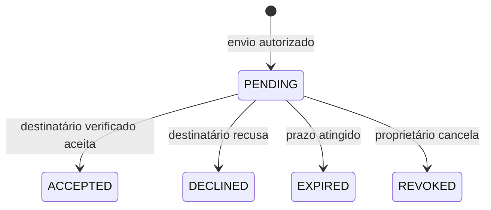
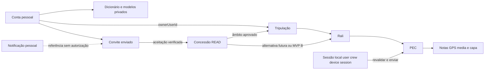

# Recce Studio — utilizadores, tripulações e acessos (TO-BE)

**Data:** 2 de novembro de 2026. **Estado:** PROPOSTA DOCUMENTAL — sem autorização de implementação. **Base consultada:** checkout `eb44ad4`, especificação AS-IS e brief de produto existentes. **Âmbito desta entrega:** análise e documentação; perfil FAST documental. Não foram alterados código, dados ou esquema, criadas contas, enviados convites, executadas migrações, suites de testes ou deploys.

Este documento regista a visão pedida e uma arquitetura conceptual para a concretizar. Não declara que o produto já tem as capacidades TO-BE. As propostas técnicas, nomes de entidades/endpoints e valores de política são sujeitos à especificação de cada futura feature.

**Legenda:** **[AS-IS]** facto confirmado no código/documentação atual; **[CONFIRMADO]** orientação expressa no pedido de produto; **[PROPOSTA]** recomendação para discussão/implementação posterior; **[PENDENTE Dxx]** decisão ainda não aprovada. O modelo de negócio continua hipotético, mesmo onde é usado para explorar requisitos.

## 1. Resumo executivo

**[CONFIRMADO] Tripulação como centro do trabalho, com contas pessoais e acessos controlados.** Uma pessoa pode criar conta e trabalhar sozinha, criar várias tripulações e convidar outras pessoas para consultar trabalho autorizado. Um navegador pode ser proprietário numa tripulação e convidado noutras, com pilotos diferentes, sem multiplicar contas. Um piloto pode participar em combinações equivalentes.

O MVP tem **proprietário** e **convidado de leitura**. Não contempla coedição, editor delegado ou permissões derivadas do papel desportivo. Concluir um rali não revoga acesso. O convidado pode consultar/exportar conteúdo autorizado, incluindo ralis concluídos, sem ganhar acesso às configurações pessoais do proprietário.

**[PROPOSTA]** Evoluir o backend existente com identidade estável de utilizador, tripulações, propriedade explícita, concessões de leitura, convites e notificações. Manter o isolamento atual e migrar recursos legados por mapeamento rastreável. Não converter automaticamente todos os membros antigos em proprietários, nem eliminar o modelo de equipa sem transição.

**Bloqueios de produto antes da abertura pública:** âmbito tripulação/rali, responsável de cada equipa legada, comportamento perante encerramento de conta do proprietário, retenção, representação partilhada do caderno e recuperação de sessões sem conta. O protótipo conceptual suporta discutir estas opções; não as transforma em decisões aprovadas.

## 2. Problema de produto e contexto regional

**[CONFIRMADO]** O produto serve preparação de reconhecimentos e cadernos de rally, incluindo provas regionais: ralis/PECs, GPS/áudio, notas por voz/manuais, revisão com media/mapa, sistema de notas e exportação PDF.

Uma dupla desportiva não é necessariamente uma equipa profissional permanente. Obrigar uma conta a uma única equipa dificulta separar trabalho com diferentes pilotos/navegadores. Em contrapartida, uma partilha demasiado ampla pode expor ralis e gravações de outra dupla. A colaboração inicial deve ser simples: uma pessoa opera/prepara, outra consulta o trabalho, sem necessidade de gerir uma organização empresarial.

**[AS-IS]** Hoje a conta tem uma referência de equipa e os recursos são autorizados nesse âmbito. Nome de piloto/copiloto é informação do perfil, sem papel técnico. Não existem registo público ativo, convites, sino de notificações, múltiplas tripulações selecionáveis ou papéis proprietário/leitor. A preferência pessoal não deve passar a ser um recurso partilhado apenas porque o utilizador adere a uma tripulação.

## 3. Objetivos e não objetivos

**Objetivos confirmados:** conta pessoal independente de equipa formal; várias tripulações por pessoa; primeiro rali sem convite obrigatório; responsável identificado; leitura partilhada com controlo backend; acesso persistente ao histórico; modelos pessoais privados; continuidade do offline e proteção de gravações; monetização separada de propriedade.

**Não objetivos do MVP:** coedição em tempo real, papel de editor intermédio, administração empresarial com hierarquias, ligação obrigatória a equipa federada, cópia integral do projeto para cada convidado, acesso público anónimo por link, marketplace de dados, sistema de faturação já definido ou migração destrutiva global. Gestão contratual/retencional avançada e transferência de propriedade não entram em produção sem decisões próprias.

## 4. Perfis de utilizador e cenários

| Cenário | Papel desportivo | Papel de acesso no recurso | Comportamento pretendido |
| --- | --- | --- | --- |
| Pessoa prepara primeiro rali sozinha | Piloto, navegador ou não indicado | Proprietário | Criar conta/tripulação e rali sem outra pessoa registada. |
| Navegador trabalha com dois pilotos | Pode ser navegador em ambas | Proprietário em duas tripulações | Alternar A e B sem misturar ralis, viaturas ou sessões de destino. |
| Piloto recebe convite | Piloto informado no perfil | Leitor apenas no âmbito aceite | Consultar notas, GPS, media e exportar caderno; sem alterações. |
| Pessoa prepara trabalho próprio e consulta trabalho alheio | Variável | Proprietário num contexto; leitor noutro | Ações calculadas por recurso, não um papel global da conta. |
| Dupla deixa de trabalhar junta | Nomes históricos mantêm significado | Acesso mantém-se até ação explícita, segundo política | Conclusão/arquivo não revogam; proprietário pode revogar concessão. |
| Nome do copiloto sem conta | Pessoa mencionada | Nenhum acesso técnico automático | Pode constar do caderno sem conta, convite ou credenciais. |
| Sessão local por enviar após mudança de contexto | Variável | Direito de escrever deve ser revalidado | Preservar dados e indicar impedimento, sem mudar destino para a tripulação ativa. |

Pessoa é o indivíduo referido funcionalmente; conta é a identidade autenticada. Não se propõe um registo global pesquisável de todas as pessoas. Nomes de tripulação não provam identidade ou consentimento de acesso.

## 5. Decisões confirmadas versus propostas pendentes

### 5.1 Compromissos de produto confirmados

| ID | Decisão |
| --- | --- |
| C01 | Conta pessoal sem equipa formal obrigatória; várias tripulações por pessoa. |
| C02 | Trabalho organizado por tripulação/rali/PEC; primeiro rali não exige convite. |
| C03 | Criador é inicialmente proprietário; convidado só lê. Sem coedição inicial. |
| C04 | Papel piloto/navegador não concede privilégios. |
| C05 | Convite explícito, consulta de âmbito e aceitação/recusa; notificação não autoriza. |
| C06 | Leitor consulta e exporta PDF, incluindo histórico autorizado; não altera/sincroniza/gera captura nesse projeto. |
| C07 | Conclusão, arquivo e reabertura do rali não retiram concessão de leitura. |
| C08 | Revogação explícita retira acesso remoto; ficheiros já descarregados não podem ser recuperados remotamente. |
| C09 | Dados pessoais/modelos privados permanecem no utilizador; não duplicar todo projeto para cada convidado. |
| C10 | Preservar isolamento, dados locais, idempotência e recuperação existentes. |
| C11 | Pagamento não atribui propriedade/administração; sem perda inesperada de dados por expiração comercial. |

### 5.2 Registo de decisões a validar

| ID | Questão | Recomendação ou alternativas, sem aprovação implícita | Bloqueia |
| --- | --- | --- | --- |
| D01 | Partilha por tripulação ou por rali? | Aprovado em 2026-11-10: por rali, apenas o rali concedido. | P04 usa concessões de teste. |
| D02 | Quem fica proprietário de cada equipa legada? | Processo aprovado para UAC-P03: manifesto explícito por IDs, bloquear equipas com dono/membros ambíguos e ensaiar isoladamente. Não escolher pela ordem de IDs, nomes ou primeiro login; sem conversão da beta nesta tarefa. | Cada mapeamento real e cutover continuam a exigir aprovação do responsável; membros adicionais sem política aprovada bloqueiam o contexto. |
| D03 | Saída, desativação e eliminação da conta do proprietário | Separar bloqueio de autenticação, gestão, consulta e eliminação de dados. Recomenda-se congelar escrita pendente de sucessão, sem promoção automática de convidado. | Autosserviço de encerramento/transferência e política de continuidade. |
| D04 | Transferência de propriedade | Transferência explícita para conta verificada, aceite pelo destinatário, preservando IDs; alternativa adiar e usar suporte controlado. | Feature de transferência e cenários de sucessão. |
| D05 | Retenção, período de recuperação e exportação | Duração, âmbito dos backups e eliminação física a definir; proibir limpeza automática por simples conclusão/expiração comercial. | Eliminação definitiva e fecho de conta/tripulação. |
| D06 | Conta inexistente, entrega e expiração de convite | Aprovado em 2026-11-10: entrega na aplicação após verificação do endereço, validade de 7 dias, um pendente por rali e endereço, e 10 novos convites por proprietário em 24 horas. | Flag desligada por omissão até à P06. |
| D07 | Estado de tripulação e arquivo do rali | Proposta: archiveAt separado de DRAFT/COMPLETED; tripulação arquivada suspende novas alterações sem revogar leitura. Detalhes de reabertura a aprovar. | Arquivo/gestão do histórico além dos concluídos atuais. |
| D08 | Consulta/exportação após expiração de subscrição | Preservar dados existentes e acesso de leitura autorizado; decidir quem paga novas criações, quotas, reativação e efeitos de contas suspensas. | Paywall/entitlements, nunca autorização básica. |
| D09 | Caderno visível ao convidado e configuração visual | Aprovado em 2026-11-10: versão publicada explicitamente pelo proprietário com estilos mínimos e aviso se ainda não existir publicação. | Leitura/exportação coerente do caderno partilhado. |
| D10 | Adoção de captura sem conta e registos locais antigos | Recuperação explícita com prova/contexto de posse e consentimento; casos ambíguos preservados/quarentenados. Não mudar dono pelo próximo login. | Adoção automática proibida; recuperação assistida/MVP offline público. |
| D11 | Uso de viaturas/imagens/sistema base entre várias tripulações | Aprovado para UAC-P02 em 2026-11-02: recursos próprios por nova tripulação, sem partilha ou cópia automática; sem biblioteca global implícita. | Migração do perfil/garagem legado continua reservada a P03; aprovação não reatribui dados antigos. |
| D12 | Sessões, verificação de conta e abuso | Política inicial UAC-P01 aprovada em 2026-11-02: email verificado antes do primeiro login novo; passwords 12–128 caracteres; sessão única de 8h; recuperação revoga sessão; verificação 24h e recuperação 30min; 5 pedidos por email/IP em 15min, por operação. SMTP por ambiente, fluxos públicos fechados até configuração, sem envio real nesta tarefa. | Decisão inicial registada em FEAT-018; restantes fases e decisões não ficam aprovadas por esta política. |

O documento usa os cenários A e B sem ativar ambos no MVP. Nenhuma exceção de rali privado é assumida como existente dentro de uma partilha de toda a tripulação.

## 6. Modelo de conta pessoal

**[CONFIRMADO]** Conta identifica utilizador e pode existir sem tripulação. Criar trabalho requer escolher/criar uma tripulação, que pode conter apenas o proprietário. Não exigir convite, piloto registado, subscrição ou perfil de empresa para a mera identidade da conta.

**[PROPOSTA]** Usar o ID imutável atual como identidade principal; email é atributo de contacto/verificação e pode evoluir, não chave de propriedade do offline. Informação mínima: ID, nome de apresentação, email normalizado, estado de verificação, credencial protegida, estado da conta e datas. Piloto/navegador ficam no contexto da tripulação/rali, não como privilégio global da conta.

Ciclo sugerido: registo → verificação de email → conta ativa; recuperação com prova de controlo do endereço → alteração de password → revogação de sessões segundo política aprovada. Login/recuperação devem ter respostas adequadas sem revelar existência de contas, limites de tentativas e proteção de reenvios. Tokens de verificação/reset com propósito único, prazo, uso único e armazenamento protegido; não reutilizar convite como reset ou sessão.

**[AS-IS]** Sessão é credencial opaca com prazo absoluto; novo login substitui a anterior, logout revoga a credencial. Não existe refresh token. Não é necessário trocar já para JWT ou serviço de identidade externo. **[PROPOSTA]** Preservar proteção atual, acrescentando operações explicitamente públicas ao allowlist e autenticação de utilizador sem obrigatoriedade de equipa. Seleção de tripulação não reemite privilégios no token nem dispensa autorização do recurso. Não colocar todos os futuros endpoints de conta numa exclusão genérica de autenticação sem revisão individual.

## 7. Modelo de tripulação

**[CONFIRMADO]** Espaço reutilizável entre ralis, com proprietário e dados do contexto. Nome do piloto/navegador pode ser apenas texto; associação opcional a uma conta não concede acesso. O proprietário pode gerir mais de uma tripulação; leitor pode receber acesso a uma e ser dono de outra.

**[PROPOSTA]** Tripulação tem ID estável, nome, ownerUserId, identificação desportiva, estado e datas; vínculo a antigo perfil quando migrada. Lista «As minhas tripulações» reúne as controladas; «Partilhadas» reúne apenas as concedidas. Seleção ativa é conveniência de UI, não autorização global nem destino implícito de todas as operações.

Criar primeira tripulação deve ser leve: nome e dados desportivos opcionais, com possibilidade de criar primeiro rali no mesmo percurso. Não criar uma segunda conta por cada dupla. D11 foi aprovada para novas tripulações: perfil associado próprio com recursos independentes, sem biblioteca global implícita. A transformação dos perfis/garagens legados continua reservada à P03; esta aprovação não reatribui dados antigos.

**[PENDENTE D07]** Estado de tripulação não é estado do convite ou rali. Arquivar não significa apagar, expulsar leitores ou mover ralis de origem. Uma alteração de nome não deve alterar IDs nem confundir autoria histórica; datas e contexto da passagem podem ser conservados em snapshots de exportação.

## 8. Modelo de propriedade

**[CONFIRMADO]** O criador é proprietário inicial e responsável por gerir a tripulação. **[PROPOSTA]** Um único proprietário ativo por tripulação no MVP. Rali tem pertença lógica à tripulação; propriedade administrativa deriva do ownerUserId dessa tripulação. createdByUserId em rali/PEC/registo serve de proveniência e não constitui privilégio paralelo. Assim, transferência explícita da tripulação não exige copiar todos os recursos nem criar donos divergentes em cada PEC.

Notas, media, GPS, capas específicas e configuração visual publicada pertencem ao projeto/PEC da tripulação. Dicionário pessoal, modelo visual privado e capa principal continuam privados do utilizador. Dados de nomes desportivos não substituem titularidade. Pagar um rali de terceiro não modifica ownerUserId.

| Evento | Regra confirmada ou proposta |
| --- | --- |
| Dupla deixa de colaborar | Não há perda automática de acesso por mudar nome de piloto ou concluir evento. Proprietário pode revogar; motivo e evento registados. |
| Proprietário desativa conta | [PENDENTE D03] Sem autenticação desse utilizador. Recomenda-se preservar dados, congelar novas escritas e manter consulta dos concessores válidos conforme política de conta, sem promoção de leitores. |
| Proprietário pede eliminação da conta | [PENDENTE D03/D05] Não executar cascata. Exigir resolver propriedade/retensão de cada tripulação; alternativa encerramento gerido com aviso e exportação. |
| Transferência | [PENDENTE D04] Proposta de pedido e aceitação com reautenticação; um dono antes/depois, transação e histórico. Convite de leitura não serve de transferência. |
| Rali/PEC apagados | [PENDENTE D05] Permissão de proprietário, confirmação e política de retenção explícita. Leitor perde consulta do recurso eliminado; grant não ressuscita dados. |
| Modelo pessoal apagado | Não deve eliminar snapshot partilhado já publicado nem notas da tripulação. Snapshot não passa a revelar outras preferências pessoais. |

Não confundir autoria operacional, controlo de acesso e titularidade jurídica dos conteúdos. Este documento define controlo funcional proposto; condições de utilização e responsabilidades sobre gravações/dados pessoais exigem decisões próprias, sem prazo legal inventado.

## 9. Modelo de convites e notificações

### 9.1 Fluxo e âmbito

**[CONFIRMADO]** Proprietário → Convidar → identificar utilizador/email → convite pendente → destinatário vê notificação → lê origem/âmbito → aceita ou recusa → apenas a aceitação válida cria concessão efetiva de leitura no backend.

**[PROPOSTA]** Entrada por email exato, sem diretório de contas pesquisável nem autocomplete que revele utilizadores. Ao selecionar um rali ou tripulação, a confirmação deve declarar literalmente o alcance: «Todos os ralis atuais e futuros desta tripulação» ou «Apenas este rali». D01 determina qual opção existe inicialmente. Metadados mínimos do convite podem ser mostrados ao destinatário antes de acesso; isso não permite ler notas, GPS ou ficheiros.

### 9.2 Máquina de estados do convite (proposta)

- Estados finais não regressam a PENDING. Reenvio após recusa/expiração/cancelamento cria novo convite e conserva histórico, sujeito a limites antiabuso.
- Aceitação exige conta autenticada com email de destino verificado, convite pendente e não expirado, proprietário ainda autorizado, âmbito existente e transação que crie no máximo uma concessão ativa. Identificação só por email/ID no body não prova destinatário.
- Quando o destinatário já for uma conta conhecida e verificada, vincular também o seu ID imutável sem revelar essa existência ao remetente. Mudança ou reutilização posterior do email não transfere o convite para outra conta; a política de reconfirmação do contacto deve ser definida em D06/D12. Normalizar email não significa juntar aliases de fornecedores ou contas distintas por heurística.
- Repetir aceitação devolve resultado idempotente apenas ao mesmo destinatário autorizado. Aceitar noutro login, convite expirado/cancelado ou alterar o âmbito por URL/body não cria acesso.
- Concorrência aceitar/cancelar deve ter um resultado serializado; não aceitar pelo estado que vinha numa notificação antiga. Backend verifica validade mesmo antes da rotina periódica marcar EXPIRED.
- Expirar convite aceite não expira concessão: o prazo limita aceitação, não duração da colaboração.
- Cancelar convite PENDING → REVOKED é distinto de retirar uma concessão já criada. Após aceitação, manter ACCEPTED como facto histórico e registar grant REVOKED separadamente; UI mostra «Convite aceite · acesso revogado». Não apagar o facto da aceitação.

### 9.3 Duplicados e destinatários sem conta

**[PROPOSTA]** No máximo um convite pendente equivalente por proprietário/âmbito/destinatário normalizado. Novo pedido equivalente reutiliza o pendente ou informa estado; não envia mensagens em cascata. Se já existe acesso, não o alarga silenciosamente por «reenviar». Trocar email/âmbito exige novo convite e cancelamento explícito do antigo.

**[APROVADO D06]** O convite fica associado ao endereço normalizado e o alerta aparece na aplicação quando a conta verifica esse endereço. A resposta de envio é a mesma para destinatários com ou sem conta. O proprietário pode indicar ao destinatário que deve abrir as notificações na aplicação. O envio de convites não usa email.

### 9.4 Notificações versus histórico

**[PROPOSTA]** Sino no cabeçalho → recebidas/não lidas/todas → detalhe de convite. Notificação tem destinatário, tipo, referência do evento, lidaEm e data; ler/dispensar não aceita convite nem concede direitos. A ação consulta o estado atual do convite no backend. Não introduzir eliminação do histórico de autorização ao apagar uma notificação.

Lista de convites enviados/recebidos é a fonte de estado operacional; notificações são alertas derivados. Auditoria de aceitação/revogação é registo separado, com retenção D05. Entrega de alerta deve tolerar retry sem duplicar evento; uma falha de email não pode originar grants extras ou mostrar como inexistente um convite já persistido. Capacidade de inbox e regras antiabuso precisam de limites aprovados.

## 10. Matriz de permissões do MVP

**[CONFIRMADO]** Tudo aplicado no backend. Propriedade/concessão calculadas no recurso alvo; frontend recebe capacidades para orientar a UI, nunca é a autoridade. Um leitor noutro contexto pode criar e gerir uma tripulação própria.

| Operação | Proprietário no âmbito | Convidado READ ativo no âmbito | Autenticado sem acesso / outra tripulação |
| --- | --- | --- | --- |
| Consultar resumo/PEC/notas/mapa | Sim | Sim | Não |
| Reproduzir imagens/áudio/vídeo autorizados | Sim | Sim | Não |
| Visualizar/exportar PDF partilhado | Sim | Sim, sem gravar preferências alheias | Não |
| Exportar XLSX ou descarregar GPS/raw media | Próprios, segundo função existente | [PROPOSTA] Só se aprovado como parte da consulta; PDF/media playback são garantias pedidas, não presumir todas as exportações brutas | Não |
| Criar/editar rali/PEC/notas | Sim se estado permite | Não | Não |
| Captar/sincronizar no projeto | Sim se estado permite | Não | Não |
| Importar/substituir/apagar media/notas | Sim se estado permite | Não | Não |
| Guardar capa PEC/configuração publicada | Sim se estado permite | Não | Não |
| Concluir/reabrir/arquivar | Sim conforme regras e D07 | Não | Não |
| Gerir tripulação/viaturas/dados partilhados | Sim | Consulta mínima necessária; não gestão | Não |
| Convidar/cancelar/revogar/transferir | Gerir acesso; transferência depende D04 | Não; pode recusar convite e [PROPOSTA] abandonar a própria concessão | Não |
| Alterar modelos/dicionário privados do proprietário | Só o próprio utilizador no contexto pessoal | Não | Não |
| Aceitar/recusar convite e ler inbox pessoal | Apenas convite próprio | Apenas convite próprio | Só convites próprios, sem ler projeto antes de aceitar |
| Eliminar definitivamente projeto/tripulação | Só após política D05 e confirmações | Não | Não |

**Filtros adicionais:** recurso concluído bloqueia escritas mesmo para proprietário; conta/estado de recurso ou retenção podem restringir mais. Acesso de leitura não deve provocar escrita indireta por endpoints GET, geração de defaults ou atualização de estatísticas. Pagamento é condição comercial adicional para certas escritas futuras, nunca substituto desta matriz.

## 11. Partilha por tripulação e por rali

| Critério | A — Tripulação, alternativa avaliada | B — Ralis específicos, aprovado |
| --- | --- | --- |
| Âmbito | Todos os ralis existentes e futuros dessa tripulação | Só ralis explicitamente indicados |
| Benefício | Menos gestão numa dupla estável; continuidade entre provas | Menor exposição e controlo por evento |
| Risco | Novo rali torna-se acessível sem novo convite; utilizador pode assumir privacidade | Esquecer nova partilha, repetição de convites e maior carga operacional |
| UI exigida | Aviso inequívoco de ralis futuros; contexto ativo sempre visível | Lista de ralis/seleção explícita e origem do acesso |
| Revogação | Retirar concessão da tripulação afeta todos os ralis abrangidos | Retirar concessão do rali não deve afetar outros grants |
| Arquitetura | Herança de leitura da tripulação para PECs/media/notas | Concessão no rali com herança para os seus recursos; não expor garagem/informação de outros ralis |

**[APROVADO D01]** A concessão abrange apenas um rali. Pertencer à tripulação como nome desportivo não dá acesso aos ralis.

**[PROPOSTA para evolução futura]** Concessões positivas sem ACL de exceções no MVP. Se A e B coexistirem no futuro, revogar uma concessão não elimina outra que ainda permite leitura: mostrar origem e acesso efetivo. «Remover todo acesso» deve revogar todas as origens selecionadas pelo proprietário de forma explícita. Mover rali para outra tripulação fica fora do MVP: mudaria âmbito, destinatários futuros e referências offline e requer feature própria, nunca um simples edit de crewId.

## 12. Regras de persistência e histórico

| Evento | Partilha e dados |
| --- | --- |
| Rali em preparação | Leitor ativo consulta; não escreve. |
| Rali concluído | Mesmos leitores continuam; conclusão não revoga. |
| Rali arquivado | Leitura/histórico continuam; estado de arquivo é novo, não AS-IS. |
| Rali reaberto | Leitor continua READ, sem promoção. |
| Convite pendente expira | Não cria concessão; dados já partilhados por outra origem não desaparecem. |
| Concessão revogada | Novas consultas/pedidos de ficheiro/exportação são recusados; não apagar rali nem dados privados de quem perdeu acesso. |
| Subscrição/compra expira | Não apagar dados existentes; consulta/exportação segundo D08 e concessões válidas. Não restaurar acesso revogado por motivo comercial. |
| Eliminação legítima | Aplicar retenção D05 e cessar acesso ao recurso; manter só histórico mínimo autorizado, sem «ressuscitar» conteúdo. |

**[CONFIRMADO]** Um único conjunto de recursos persistidos; convidados têm referências autorizadas, não réplicas completas em contas próprias. Um PDF já descarregado é uma cópia autónoma; o sistema não pode prometer apagá-lo remotamente. **[PROPOSTA]** Não criar cache offline de projetos partilhados no MVP. Bytes já recebidos, downloads e pedidos em curso têm limites de revogação; próximos pedidos, incluindo intervalos de media, têm de validar acesso atualizado. URLs temporários, se adotados, precisam de política explícita de validade; não prometer revogação instantânea de URL autónomo já emitido.

## 13. User journeys completos

### J01 — Primeiro rali, sem convidar ninguém

Registar conta → verificar email → entrar → criar tripulação simples, mesmo sem segunda conta → criar rali e PEC → reconhecer → guardar/sincronizar → Studio → caderno/PDF. Dados: identidade, nome da tripulação e do rali/PEC; nomes desportivos opcionais. Resultado: utilizador proprietário, sem partilha implícita. Erros de verificação/criação não geram múltiplas contas/espaços ao repetir. Dependências: UAC-P01/P02; criação comercial só após D08 se essa limitação vier a existir.

### J02 — Colaborar com outra pessoa

Proprietário seleciona tripulação/rali → Convidar por email → confirma âmbito → destinatário recebe sino ou orientação para registo → autentica/verifica endereço → detalhe do convite → Aceitar → Partilhados comigo → consultar notas/media/mapa/PDF. Recusar/expirar/cancelar não concedem acesso. A conta pode ser proprietária noutro contexto; UI mostra origem e READ no atual. Dependências: D01/D06/D09, autorização, concessões e notificações.

### J03 — Trabalhar com pilotos diferentes

Mesmo utilizador cria/abre A e B → identifica proprietário/contexto → cria rali dentro de A → convida apenas colega de A → troca para B → prepara outro rali. Nada de A aparece automaticamente em B, nem destino de sessões antigas muda com seleção ativa. Resultado: espaços reutilizáveis separados. URLs guardados são autorizados de novo, mesmo com outra tripulação selecionada.

### J04 — Consultar depois da prova

Leitor entra em Histórico → filtra origem/tripulação → abre rali concluído ou arquivado → revê e exporta PDF. Proprietário reabre rali para corrigir → leitor continua READ. Conclusão não envia evento de revogação; estado de leitura não depende de subscrição própria do convidado. Revogação explícita posterior retira novas consultas.

### J05 — Cancelar convite ou retirar acesso

Proprietário → Acessos → identifica pendente ou concessão ativa → Cancelar convite/Revogar acesso → confirma âmbito e efeito → destinatário vê estado atual. Pendente não pode ser aceite depois; aceitação e revogação concorrentes resolvem-se transacionalmente. Após revogação, link antigo/ficheiro/API não dá acesso. PDF anterior pode continuar na posse do destinatário. Não misturar eliminar notificação com revogar grant.

### J06 — Capturar offline e enviar em segurança

Proprietário autenticado escolhe tripulação/destino → captura guarda userId, crewId, PEC quando conhecida, deviceId e sessionId → pode trocar contexto visual sem mover gravação → volta online → sistema mostra destino original → revalida direito de sincronizar e estado → envia notas/GPS e áudio com idempotência → remove local só após sucesso confirmado. Se destino é só de leitura, acesso mudou ou rali foi concluído, envio é recusado e dados mantidos; não redirecionar silenciosamente.

### J07 — Mesmo dispositivo, utilizadores diferentes ou captura sem conta

Logout A → login B → B não vê/adota dados de A → login A permite retomar trabalho próprio após validação. Sessão sem conta permanece local/quarentenada → recuperação/adoção explícita apenas após D10, sem atribuição automática ao próximo utilizador. Falha de migração conserva formato/Blobs originais. Uma mudança de email não deve perder trabalho de userId já confirmado.

### J08 — Sessão/compra expirada e proprietário indisponível

Sessão de autenticação expira → reautenticar → revalidar recurso, sem perder gravação local. Direito comercial expira → consulta/exportação existentes mantidas segundo D08, novas escritas podem ser bloqueadas com causa clara. Conta do proprietário desativada/eliminada é outro processo: D03/D04/D05 determinam congelamento/sucessão, sem promover automaticamente leitor ou apagar todo histórico. Este último percurso não é considerado fechado enquanto essas decisões estiverem pendentes.

### J09 — Migrar equipa antiga

Inventário de recursos/contas e cópia consistente → confirmar responsável → preparar mapeamento equipa→tripulação e recursos → validar isolamento/contagens/media/recibos → cutover controlado desse contexto → proprietário e leitores veem dados existentes conforme aprovação → observar/rollback compatível se necessário. Sem responsável confirmado, não fazer cutover ou inventar propriedade; preservar acesso legado delimitado até resolução.

## 14. Modelo de dados conceptual

**[PROPOSTA]** Modelo mínimo, sem motor genérico de permissões empresariais. A relação muitos-para-muitos utilizador↔tripulação resulta da propriedade e das concessões; não da substituição de teamProfileId pela última tripulação selecionada.

| Entidade conceptual | Campos/relações essenciais | Invariantes |
| --- | --- | --- |
| UserAccount (evolução de AuthUserEntity) | ID imutável, email/verificação, nome, credencial, estado; sessões | Conta existe sem tripulação. Email não é chave mutável de posse. Não tem role global OWNER/READER. |
| Crew | ID, ownerUserId, nome, estado/datas, legacyTeamProfileId opcional | Um dono ativo por contexto; dono não é inferido por driverName/coDriverName. |
| CrewProfile / TeamProfile adaptado | crewId, nomes desportivos, logo, unidades, sistema base e garagem conforme D11 | Informação desportiva/viaturas não cria grants. Preservar registos legados antes de transformar. |
| CrewParticipant, se necessário | crewId, nome desportivo, papel, userId opcional | Participante não registado é possível. Association não autoriza por si. Não exigir esta tabela se campos atuais satisfizerem MVP. |
| Rally | ID existente, crewId, createdByUserId, estado, archivedAt proposto, metadata de carro | Exatamente uma tripulação dona; não pode usar carro estrangeiro. Sem mudança de tripulação no MVP. |
| PEC/Note/Asset/GPS | IDs existentes, hierarquia PEC→rali→tripulação | crewId derivável/consistente; recurso filho nunca se autoriza só pelo seu ID ou pelo parent fornecido no pedido. |
| AccessGrant | ID, recipientUserId, scopeType CREW/RALLY, scopeId, permission READ, ACTIVE/REVOKED, origem/datas | Exatamente um âmbito permitido; destinatário autenticado; ativo único equivalente; só modelo aprovado por D01 habilitado no MVP. Sem wildcard «todos do proprietário». |
| Invitation | ID, inviterUserId, destinatário/endereço verificado ou pendente, scope, READ, estado/prazo/datas, token protegido se houver link | Âmbito imutável por convite; aceitação liga ID da conta e grant de forma atómica/idempotente. Token não é permissão de leitura de projetos. |
| Notification | ID, recipientUserId, tipo, eventId/reference, criada/lida | Alerta derivado, sem autoridade; cada utilizador lê/marca só o próprio. Histórico de notificações não substitui auditoria. |
| AccessAuditEvent | ator, ação, âmbito/IDs mínimos, resultado/datas/correlação | Convite/aceitação/revogação/transferência/eliminação relevantes; sem tokens, passwords ou conteúdo integral de GPS/áudio. Retenção D05. |
| PersonalNotebook/Dictionary/Cover | userId estável e configurações existentes | Não convertidos em recursos de tripulação; migração de regras por email exige mapeamento verificado para userId. |
| BookPublication (se D09 aprovar snapshot) | PEC/rali, versão, dados contextuais e estilos mínimos publicados | Suficiente para leitura/exportação coerente; sem API de consulta ao modelo privado do dono. Escrita só pelo proprietário. |
| OfflineSession/SyncReceipt | creatorUserId, crewId, rallyId/pecId quando conhecidos, deviceId, sessionId estável, schemaVersion, estado/recibo | Contexto/destino imutáveis na repetição; autorização revalidada. Metadados do body não comprovam criador. |
| CommercialEntitlement (futuro) | beneficiário e âmbito, origem/validade/status de habilitação comercial | Não é grant de acesso nem propriedade; fora da identidade/autorização base. |

O diagrama representa alternativas, não ativação automática simultânea de dois modelos de partilha. Proprietário não precisa de grant READ redundante; o controlo deriva da propriedade validada. Destinatário do convite e nome do participante podem coincidir, mas são relações distintas.

## 15. Impacto na arquitetura atual

### 15.1 Comparação rastreável AS-IS → TO-BE

| Área e evidência atual | AS-IS confirmado | Evolução proposta e risco |
| --- | --- | --- |
| [AuthUserEntity](../../src/main/java/org/example/entity/AuthUserEntity.java), [ApiAuthInterceptor](../../src/main/java/org/example/controller/ApiAuthInterceptor.java), [TenantContext](../../src/main/java/org/example/controller/TenantContext.java) | Conta tem teamProfileId; interceptor exige equipa e coloca equipa/email no request. | Principal autenticado por userId separado do âmbito. Resolução/autorização de tripulação por operação. Não basta tornar teamProfileId nullable e remover a verificação. |
| [AuthController](../../src/main/java/org/example/controller/AuthController.java), [AuthService](../../src/main/java/org/example/service/AuthService.java), [sessões](../auth-sessions.md) | Registo HTTP proibido; serviço cria perfil; token opaco com expiração/revogação. | Abrir registo só com verificação/recuperação/antiabuso prontos; não criar equipa formal obrigatória. Preservar política de token até decisão D12. |
| [TeamProfileEntity](../../src/main/java/org/example/entity/TeamProfileEntity.java), [TeamProfileService](../../src/main/java/org/example/service/TeamProfileService.java) | Perfil agrega tripulação desportiva, carro ativo e sistema base; algumas consultas podem inicializar dados. | Adaptar perfil por Crew; autorização de gestão só owner; leitores recebem DTO mínimo e puro, sem criação de defaults em GET. |
| [RallyController](../../src/main/java/org/example/controller/RallyController.java), [PecService](../../src/main/java/org/example/service/PecService.java) | Repositórios filtram equipa; membros não têm papéis diferenciados. | Consultas com owner/grants e escrita owner; hierarquia do recurso determina crew. Manter bloqueios COMPLETED, IDs e origem. |
| [PecNoteController](../../src/main/java/org/example/controller/PecNoteController.java), [NoteExcelParserService](../../src/main/java/org/example/service/NoteExcelParserService.java) | Importação/sync podem substituir notas; permissões de equipa/estado. | Exigir owner também em align, offset, import, sync e eliminação. Não transformar «ler PDF» em autorização para criar/alterar notas. |
| [PecAssetController](../../src/main/java/org/example/controller/PecAssetController.java), [PecAssetService](../../src/main/java/org/example/service/PecAssetService.java), [FileStorageService](../../src/main/java/org/example/service/FileStorageService.java) | Media/imagens protegidos pelo contexto atual; armazenamento disco/S3. | Autorizar reads conforme âmbito de grant e writes owner; aplicar a intervalos/URLs/metadata e todos os tipos de imagem. Storage não decide acesso por prefixo fornecido pelo cliente. |
| [RecceBookCoverController](../../src/main/java/org/example/controller/RecceBookCoverController.java), [RecceBookTemplateController](../../src/main/java/org/example/controller/RecceBookTemplateController.java), [NotebookPreferencesController](../../src/main/java/org/example/controller/NotebookPreferencesController.java) | Capa PEC partilhada; modelo/capa principal pessoais; default pode usar modelo de quem consulta. | Capa de PEC continua recurso; não devolver modelos do proprietário ao convidado. D09 define publicação estável; guest GET/export não pode materializar/gravar capa ou preferências alheias. |
| [OfflineRecceSyncService](../../src/main/java/org/example/service/OfflineRecceSyncService.java), [OfflineRecceSyncEntity](../../src/main/java/org/example/entity/OfflineRecceSyncEntity.java) | Replay por sessão+equipa devolve receção anterior; contexto atual é equipa/email. | Revalidar autorização **antes** de devolver recibo de replay e em upload de áudio; mapear legado e limitar destino. Mudança de contexto não deve produzir nova receção da mesma sessão. |
| [OfflineRecceStoreService](../../frontend/src/app/modules/core/services/offline-recce-store.service.ts), [recuperação](../offline-sync-recovery.md) | Dono local por email/contexto offline; locks/retry/preservação de Blob. | Versionar schema e incorporar IDs estáveis/crew sem remover isolamento ou Blobs. Não reatribuir legado pelo próximo login. |
| [rotas](../../frontend/src/app/app.routes.ts), [auth guard](../../frontend/src/app/modules/core/guards/auth.guard.ts), [sidebar](../../frontend/src/app/modules/core/shared/components/sidebar/sidebar.component.ts) | Navegação online/offline e páginas de equipa única. | Seletor de contexto/origem, próprias/partilhadas/histórico e inbox. Guards/labels refletem capacidades; backend continua decisor. URLs antigas resolvidas com autorização atual. |

Não foi localizado um documento autónomo geral de arquitetura na pasta docs inventariada; usaram-se os documentos funcionais, de sessões/offline e as implementações acima, sem assumir um desenho técnico inexistente. O backend permanece Spring Boot/Maven na raiz e frontend Angular em frontend; a proposta não implica microserviços nem nova stack.

### 15.2 Endpoints conceptuais — não implementados

| Contrato sugerido | Acesso/efeito esperado |
| --- | --- |
| `POST /api/auth/register`, `/verify-email`, `/password-reset/request`, `/password-reset/confirm` | Operações públicas especificamente delimitadas, tokens por finalidade/limites; sem revelar existência da conta. |
| `GET /api/me`, operações de perfil/credenciais próprias | Principal autenticado sem equipa obrigatória; nunca alterar outro utilizador por userId no body. |
| `GET/POST /api/crews`, `GET/PATCH /api/crews/{id}` | Listar só próprias/acessíveis, criar crew própria, consulta/gestão conforme owner ou leitura aprovada. |
| `GET /api/crews/{id}/rallies`, `POST /api/crews/{id}/rallies` | Ler ralis abrangidos; criar só owner. Se B, não listar irmãos não partilhados. |
| `GET /api/rallies?relation=owned/shared&history=...` | Filtros de UI sempre subordinados à autorização, inclusive contagens/pesquisa/paginação. |
| `GET/POST /api/rallies/{id}/invitations` | P05. O proprietário lista os próprios envios e convida para READ apenas neste rali. |
| `GET /api/invitations/{id}`, `POST /api/invitations/{id}/accept` ou `/decline` | P05. O destinatário verificado consulta e decide sobre o próprio convite. |
| `POST /api/rallies/{rallyId}/invitations/{id}/cancel` | P05. O proprietário cancela um convite pendente que enviou para o rali. |
| `GET /api/crews/{id}/access` ou rali, `POST /api/access-grants/{id}/revoke` | Gestão owner; revogar grant não exige apagar projeto/conta ou reescrever convite aceite. |
| `GET /api/notifications`, `GET /api/notifications/unread`, `PATCH /api/notifications/{id}/read` | P05. Caixa e contagem pessoais. Ler o alerta não concede acesso ao rali. |
| `GET /api/shared-rallies`, `GET /api/shared-rallies/{rallyId}` e `GET /api/shared-rallies/{rallyId}/pecs/{pecId}` | Implementado na P04. Consulta READ sem selecionar uma tripulação como contexto de escrita. |
| `GET /api/shared-rallies/{rallyId}/pecs/{pecId}/book-publication`, `PUT /api/pecs/{pecId}/book-publication` | Implementado na P04. Leitor obtém a publicação ou 204. Proprietário da tripulação gerida publica uma versão nova. |
| Operações atuais `/api/pecs/{id}/...` e media | Preservar caminhos quando possível; resolver owner/grant/estado pelo recurso, não por equipa ativa enviada. |
| `POST /api/offline-recces/sync` e upload de áudio | Owner autorizado no destino em cada fase; binding/idempotência/versionamento explícitos. |
| Operações futuras de arquivo/transferência/eliminação | Apenas após D03–D05/D07, com reautenticação e contratos próprios; não incluir já num PATCH livre. |

Códigos e payloads finais serão definidos por feature. Princípios: 401 para autenticação, 403/404 conforme política consistente para acesso negado sem enumeração, conflito/estado antigo para transições inválidas, limites antiabuso explícitos. Não devolver detalhes de existência de recursos estrangeiros em erro.

### 15.3 Autorização e representação de leitura

**[PROPOSTA]** Uma política de aplicação centralizada responde a capacidades como readRally, manageRally, readAsset, syncToPec e manageAccess. Usar filtros de consulta e verificação da hierarquia; não copiar condicionais de botões como política. Identidade, concessão e estado são consultados no servidor; role e crewId fornecidos pelo browser não conferem direitos.

Para leitura B, só expor metadados mínimos da tripulação/carro relevantes para o rali, sem acesso ao diretório completo de viaturas/participantes nem outros projetos. Queries de listagem, estatísticas e GPS também são fronteiras de acesso, não apenas GET por ID.

**[APROVADO D09]** O proprietário publica uma versão com página, apresentação das notas e capas contextuais. O leitor vê e exporta essa versão. Se não existir publicação, a interface indica a indisponibilidade. A consulta e a exportação não gravam dados nem consultam modelos privados.

## 16. Segurança, privacidade e autorização

Requisitos TO-BE, a validar nas futuras features, sem alegar auditoria executada nesta tarefa:

1. **Menor privilégio:** deny por omissão; autenticar conta antes de resolver recursos; READ explícito. Ser nomeado copiloto, conhecer ID ou pagar não dá acesso.
2. **IDOR/hierarquia:** validar crew→rali→PEC→nota/media/convite em cada operação. Pai falso no URL/body, IDs cruzados, mudança de tripulação ativa e endpoints antigos não podem contornar controlo.
3. **Sessões:** manter expiração/revogação existentes; reset/troca de password e suspensão com política definida. Revogar grant não é logout global: deve retirar recurso mantendo outros trabalhos autorizados da mesma conta. Atualizar caches de concessões ou versão de acesso sem janela ilimitada de permissão obsoleta.
4. **Convites:** destinatário autenticado/verificado; token de ligação protegido, com finalidade/prazo/uso único. Sem token/email bruto em logs/analytics/URLs persistidas desnecessariamente; confirmação final por operação autenticada, proteção de pedidos de alteração de estado conforme transporte de sessão adotado. Aceitação/cancelamento concorrentes consistentes.
5. **Enumeração/abuso:** resposta de convite/reset sem confirmar conta; pesquisa por email exato sem listagem pública. Limitar login, registo, verificação, convites/reenvios e carga de inbox; mensagens ao owner não revelam contactos/contas de terceiros.
6. **Media e exportações:** propriedade/concessão em imagens de equipa/rali/carro, áudio, vídeo, GPS, metadados e downloads. Acesso direto ao armazenamento/URL não deve ser alternativa pública. Revalidar ranges; proibir service-worker/cache partilhado de dados privados; definir validade de URLs autónomos. Revogação não retira bytes já entregues.
7. **Privacidade:** expor ao leitor só nomes/contexto e informação necessários ao âmbito; não email privado, credenciais, modelo pessoal integral ou projetos irmãos. Convites pendentes revelam só metadados de decisão; notificação não contém notas/GPS.
8. **Operações destrutivas:** apenas owner, estado permitido, confirmação contextual, reautenticação quando adequado e controlo de concorrência/idempotência. Não implementar cascata antes do inventário/retensão D05; o AS-IS já tem alcance de limpeza por confirmar.
9. **Auditoria funcional:** criação/cancelamento/aceitação/recusa/revogação, mudança de proprietário, eliminação e alterações de âmbito com ator/ID/datas. Falha de notificação não apaga autorização nem auditoria; não guardar tokens, gravações ou passwords nos eventos.
10. **Offline:** isolamento por identidade estável e contexto de recurso; proteção contra sincronização de leitor, spoof de autoria e reenvio após revogação. Não cifrar ou reivindicar segurança física de IndexedDB como já existente; posse do browser tem limites conhecidos.
11. **Retenção/incidentes:** preservação não significa acesso eterno de alguém revogado; suspensão de conta, retenção por política e eliminação são processos separados, com decisões D03/D05. A aplicação não promete remover cópias descarregadas.
12. **Regressões:** conservar fronteiras de AUD-SEC-001 a006 e AUD-OFF-001 a003, indicadas como resolvidas no tracker. Esses resultados históricos não provam as novas capacidades; a baseline informa contexto, não autoriza saltar testes afetados.

## 17. Impacto no offline e sincronização

### 17.1 Associação e isolamento

**[PROPOSTA]** Toda nova sessão local tem creatorUserId estável (ou origem explicitamente sem conta), crewId conhecido quando criado num contexto, rali/PEC opcionais, deviceId, sessionId, schemaVersion e datas. Se destino ainda desconhecido, permanecer unassigned até o utilizador escolher **uma tripulação que controla**; não assumir a que estiver selecionada quando o envio começa.

Amostras, marcadores, Blob e referências são mantidos; identidade do utilizador não é inferida de um nome/email editável no payload. O servidor determina o ator e valida o destino real, independentemente dos campos apresentados pelo cliente. O rascunho pode sobreviver à expiração da sessão, logout ou falha remota, sem passar a pertencer à conta seguinte.

### 17.2 Regras em mudanças de contexto

| Situação | Resultado proposto obrigatório para segurança |
| --- | --- |
| Trocar tripulação ativa | Não mover rascunho, não alterar crewId/PEC de sessão já vinculada. Mostrar origem ao consultar e antes do envio. |
| A sai, B entra no mesmo dispositivo | B não lista/lê Blobs/altera/sincroniza/apaga sessões de A. Manter verificação durante operações pendentes, não só ao carregar lista. |
| A altera email | Sessão confirmada por userId mantém posse; legado por email só migra após associação verificada. |
| Sessão de autenticação expira | Conservar local, solicitar login da conta original e revalidar direito atual. |
| Destino agora só permite READ/foi revogado | Sync/upload recusados; dados mantidos e explicação. Não enviar para tripulação pessoal por fallback. |
| PEC/rali concluído/arquivado | Owner não contorna bloqueio por offline; manter sessão e oferecer correção/reabertura conforme política, sem alterações silenciosas. |
| Conta sem subscrição de escrita | Não apagar captura nem usar assinatura de outra conta; consulta e novas escritas seguem D08 separadamente. |
| Sessão sem conta/legado sem dono | Quarentena e recuperação D10; não adoção pelo próximo login. O contexto local atual não prova pessoa física. |

### 17.3 Idempotência e fases

**[AS-IS]** Sessão+equipa identifica receção e pode devolver resposta anterior antes de resolver novamente destino; áudio é fase posterior. **[PROPOSTA]** Tratar a vinculação a destino como imutável após primeira aceitação. Para novas sessões, considerar chave estável de criador autenticado/dispositivo/sessão com binding para crew/PEC; escolha final de índice depende da compatibilidade. Preservar chaves/recibos legados mediante mapeamento explícito, sem reaplicar marcadores por mudar teamId para crewId.

Antes de procurar/devolver replay em operação de sync, revalidar ator, direito de sincronizar e vínculo ao destino armazenado, não o alvo adulterado no body. Um ramo de «já existe» não pode revelar PEC estrangeira ou bypassar revogação. Mudança de destino no retry deve ser conflito explícito, sem criar outra PEC/duplicação. Consulta de estado de receção, se necessária sem escrita, é operação de leitura própria/autorizada e não fallback permissivo de sync.

Em upload de áudio revalidar novamente acesso/estado. Se acesso mudar depois de notas guardadas e antes de áudio, manter recibo e dados locais; não reescrever notas no retry nem remover Blob antes de sucesso confirmado. Preservar recovery de syncing para ready_to_sync, locks disponíveis, erro de Blob ausente e progresso de operação ativa. Não declarar que áudio ausente pode ser reconstruído.

### 17.4 Atualização do armazenamento local

Migração IndexedDB versionada, transacional quando possível e reiniciável: ler formato antigo, escrever metadados novos sem apagar dados originais até confirmação; não copiar ou reencodar áudio desnecessariamente. Não exigir apagar cache/IndexedDB para atualizar. Metadados mínimos de migração e rastreio não incluem gravações em logs. Sem mapeamento inequívoco, manter oculto/preservado em vez de atribuir outro dono. Rejeitar clientes incompatíveis para novos uploads sem impedir preservação/recuperação dos dados. Guiar atualização sem interromper gravação ativa.

## 18. Experiência de navegação proposta

**[PROPOSTA]** Manter dark theme, vermelho e estética motorsport com estrutura compacta, reutilizando componentes. Não multiplicar menus para cada combinação de pessoa/tripulação.

- **Área Ralis** com separadores «Os meus ralis», «Partilhados comigo» e «Histórico». Filtros por tripulação/origem; cartões indicam proprietário/leitura e estado. Histórico reúne concluídos/arquivados, próprios e partilhados ainda autorizados, sem duplicar o dado.
- **Tripulações** como área de seleção/gestão: próprias e acessíveis; detalhe com identidade desportiva, recursos permitidos e Acessos. Pode substituir gradualmente Perfil da Equipa, mantendo ligação legada enquanto necessário.
- **Cabeçalho** com tripulação/contexto atual, badge «Proprietário»/«Só leitura» e sino. Em leituras de rali isolado mostrar a tripulação de origem sem sugerir acesso ao resto.
- **Notificações** em painel/inbox; estados atuais e link para convite. Convites enviados e gestão de acessos ficam no contexto da tripulação/rali, não misturados com modelos pessoais.
- **Notas** continua configuração pessoal. Consulta de caderno partilhado mostra versão/publicação; CTA para alterar configurações do dono não existe para leitor.
- **Reconhecimentos Offline** conserva lista da conta e indica origem/destino; seletor de envio lista apenas destinos de escrita autorizados. Troca de contexto não altera gravações.

Primeiro uso: conta verificada → «Criar tripulação e primeiro rali», com criação simples e convite opcional depois. Proprietário vê ações de gestão; leitor vê consulta/exportação e motivo claro de leitura, sem formulário que só falha no submit. Deep links têm a mesma autorização que a navegação normal. Não esconder o estado de rali atrás do papel, nem vice-versa. Guardas de saída preservam captura/rascunhos e contexto ao mudar tripulação.

## 19. Hipóteses de monetização

**[HIPÓTESES, NÃO PREÇOS/REQUISITOS COMERCIAIS APROVADOS]** Registo pessoal aberto; leitores convidados sem necessidade de pagamento; criador pago habilitado a preparar os seus ralis; experimentar pagamento por rali e subscrição anual. Não há preços, período gratuito, quota de armazenamento, número de convidados ou regra de renovação definidos.

Separar: autenticação (quem é), autorização (a que tem direito), estado do recurso (o que pode mudar) e habilitação comercial (que operações novas estão incluídas). Uma compra não torna leitor owner e um leitor gratuito autorizado pode consultar/exportar. Expiração comercial não elimina dados nem revoga grants por conclusão da prova. É necessário decidir limites e política de read/export após expiração, inadimplência e suporte, antes de ligar billing a operações.

**[PROPOSTA]** Validar hipóteses com experiência de produto e métricas agregadas antes de integração de pagamentos. Não criar serviço de faturação, checkout real ou paywall nesta tarefa nem tornar features de identidade dependentes de valores comerciais ainda inexistentes.

## 20. Plano de migração e rollback

### 20.1 Preparação sem perda de dados

1. **Inventariar por contexto:** contas ligadas a cada TeamProfile, ralis/PECs/notas, viaturas/imagens, ficheiros físicos e referências, capas/modelos privados e receções offline. Confirmar esquemas usados nos ambientes reais; validação H2 anterior não prova migração PostgreSQL/produção.
2. **Identificar dono D02:** lista de candidatos e aprovação do responsável do contexto. Equipa com várias contas não fornece autoria inequívoca. Conta que criou dado tecnicamente ou consta como piloto não é promovida automaticamente.
3. **Mapeamento rastreável:** legacyTeamProfileId→crewId, conta→userId preservado, recursos→crew, recibos→binding; manifesto com contagens/IDs/checksums apropriados, estado por lote e ambiguidades. Preservar fontes e provas de decisão.
4. **Cópia consistente:** base+referências/media+configuração e manifesto, com restauro ensaiado em ambiente isolado antes de cutover. Não executar limpezas/cascatas para «resolver» órfãos; classificar e decidir retenção.

### 20.2 Expandir, migrar e ativar gradualmente

- Adicionar estruturas novas e campos nullable/compatíveis antes de os exigir. Conservar IDs atuais de ralis/PECs, URLs sempre que possível e dados pessoais. Não substituir todas as tabelas nem usar o primeiro login como migração.
- Backfill idempotente e reiniciável por equipa→tripulação, com checkpoints e sem reescrever media. Comparar contagens e acesso antes/depois. Modelos por userId mantêm-se; dicionário por email migra só com associação inequívoca, sem fundir contas.
- Testar leitura de recursos antigos através do novo autorizador em modo de observação controlada; divergências bloqueiam cutover, nunca originam fallback de allow. Evitar double-write genérico: quando inevitável, definir fonte de verdade, transação/journal e deteção de divergência.
- Cutover por contexto aprovado: congelar escritas durante a vinculação se necessário, validar dono/destinatários/permissões e mudar a fonte de autorização de forma atómica. Múltiplos membros antigos com escrita têm de receber tratamento explicitamente aprovado; não manter permissões antigas ocultas nem rebaixar sem decisão. Contextos ambíguos permanecem no circuito legado delimitado, sem nova partilha, até resolução.
- API antiga adaptada ao autorizador novo para contextos convertidos. Header/body de equipa ativa ou AuthUser.teamProfileId não pode reintroduzir escrita para leitores. Criar/aceitar convite nunca altera esse campo para os ligar à equipa do dono. Endpoints legados sem adaptação não ficam expostos a convidados.
- Múltiplas tripulações só são habilitadas no frontend quando todos os caminhos de criação/escrita/download/sync desse contexto são seguros. Migração local deve anteceder a possibilidade de enviar para vários contextos.
- Apenas após período de observação, prova de rollback compatível e resolução de clientes antigos se considera contrair campos legados. Essa remoção é decisão posterior, não requisito para lançar o MVP.

### 20.3 Rollback seguro

Antes de novos dados/grants: desligar flags de UI/rotas novas, reverter para versão compatível e conservar tabelas/manifesto, sem apagar dados de migração. Depois de novas tripulações, acessos ou revogações: **não voltar ao binário antigo que só entende equipa**, pois poderia expor dados ou recuperar permissões revogadas. Usar versão de compatibilidade que entende os dois modelos e mantém negações; se indisponível, suspender escritas/novas partilhas e preservar consulta autorizada conforme plano, em vez de alargar acesso.

Rollback de aplicação não desfaz automaticamente decisões de acesso. Não eliminar concessões/sessões/contas novas para caber no esquema antigo, nem reatribuir recurso para o tornar acessível. Restauro integral de backup é recuperação de desastre com decisão explícita sobre escritas posteriores; não é rollback rotineiro sem perda. Manter journal/mapeamento para reconciliar mudanças, testar restauro com media e comprovar que revogações não reaparecem.

## 21. Roadmap faseado

| Fase | Resultado proposto | Condições de saída |
| --- | --- | --- |
| 0 — Aprovar contratos | Resolver D01/D02 e política mínima de continuidade, publicação e recuperação; inventário/risco | Nenhum caminho crítico depende de adivinhar dono, âmbito ou retenção. Sem migração executada. |
| 1 — Fundações em beta controlada | Conta independente, crews, política de autorização e adaptadores, sem convites públicos | Contas sem crew funcionam; toda escrita/ficheiro com autorização; legacy isolado. |
| 2 — Migração e offline | Backfill/cutover por contexto e upgrade local compatível | IDs/dados/recibos/Blobs preservados e rollback compatível ensaiado; múltiplos destinos seguros. |
| 3 — Leitura partilhada | Representação pública do projeto, grants READ, convites/inbox e revogação | D01/D06/D09 aprovadas; negativos de autorização/E2E e revogação aprovados antes de habilitar convites. |
| 4 — Navegação e histórico | Próprios/partilhados/histórico, arquivo conforme D07 | Conclusão/arquivo/reabertura preservam concessões; origem/capacidade claras. |
| 5 — Ciclo de propriedade/conta | Transferência/encerramento/retensão aprovados | Sem órfãos silenciosos, eliminação/restauro com política e prova. |
| 6 — Experiência comercial | Hipóteses testadas, eventualmente habilitações comerciais | D08 e métricas/regras aprovadas; acesso/dados não dependem só de pagamento. |

As fases são portões de exposição, não autorização para lançar identidade pública antes das dependências de recuperação/abuso. Desenvolvimento de slices pode ocorrer antes de rollout; trabalho de offline e revogação não é adiado para depois de expor escrita multi-tripulação/partilha.

## 22. Features futuras com IDs provisórios

**Convenção:** `UAC-Pxx` são referências de planeamento deste documento, **não** IDs FEAT definitivos ou tickets abertos. Ao iniciar uma feature, `factory-feature` deve consultar os documentos existentes e alocar o próximo FEAT disponível; não reservar já números nem marcar nada como implementado.

| Referência | Feature | Dependências principais | Risco / complexidade qualitativa |
| --- | --- | --- | --- |
| UAC-P01 | Conta pessoal, registo verificado e recuperação | D12 e transporte de email/antiabuso | Alto / alta |
| UAC-P02 | Tripulações, propriedade e autorização por contexto | P01 em modo compatível; D11 | Alto / alta |
| UAC-P03 | Migração de equipa e compatibilidade | P02, D02, inventário/rollback | Crítico para dados / alta |
| UAC-P04 | Consulta READ e caderno publicado | P02/P03 no contexto, D01/D09 | Alto / alta |
| UAC-P05 | Convites e notificações | P01/P04, D01/D06 | Alto / média-alta |
| UAC-P06 | Gestão/revogação de acessos e rastreio | P04/P05; pronto antes da abertura dos convites | Alto / média |
| UAC-P07 | Navegação própria/partilhada/tripulações | P02/P04/P05; contexto migrado | Médio / média |
| UAC-P08 | Histórico, arquivo e persistência da leitura | P04/P07, D07 | Médio-alto / média |
| UAC-P09 | Identidade e destinos offline seguros | P01/P02/P03, D10; antecede ativação multi-contexto | Alto para dados / alta |
| UAC-P10 | Transferência, encerramento e retenção | P03/P06/P08, D03–D05 | Alto para dados / alta |
| UAC-P11 | Validação comercial e futuras habilitações | Identidade/autorização estabilizadas, D08 | Médio-alto / média (experiência); integração posterior por dimensionar |

Ordem de rollout recomendada: **P01/P02 em compatibilidade → P03 + P09 → P04 → P05 + P06 fechados em conjunto → P07/P08 → P10 → P11**. Uma feature não fica concluída por apenas desenhar botões ou adicionar entidade; critérios da secção23 e validação da24 fazem parte da entrega.

## 23. Critérios de aceitação por feature

Todos os critérios seguintes são **planeados, não executados**. Given/When/Then define o que terá de ser demonstrado numa implementação posterior; não é resultado de testes. Risco/complexidade de cada feature constam da secção22. Regras comuns: provar owner, leitor e terceiro sem acesso; negar mutações por API, não só esconder botões; preservar dados em falha; não introduzir regressões nas fronteiras existentes.

### UAC-P01 — Conta pessoal, registo verificado e recuperação

**Implementação — atualização de 2026-11-02:** entregue na [FEAT-018](../features/FEAT-018-conta-pessoal-registo-recuperacao.md), estado **IN_REVIEW**. Política inicial D12 e SMTP aprovados pelo utilizador; critérios P01-AC1–3 cobertos pelos critérios/testes da feature. TICKET_GATE focalizado **PASS**, com wrapper bruto **FAIL** pela auditoria anterior de defaults do utilizador de testes; RELEASE_GATE **BLOCKED** por essa falha, sem execução de release completo. Registo/recuperação permanecem desativados até configuração explícita de email. Este registo atualiza o estado desta fase; as declarações de proposta documental original não descrevem a implementação posterior. P02 e restantes fases não foram implementadas por esta entrega.

**Objetivo/descrição:** permitir identidade própria sem equipa obrigatória, com registo/verificação, autenticação e recuperação de acesso. **Pré-requisitos:** D12, política de password/sessão e transporte de verificação/recuperação definidos; compatibilidade com contas atuais.

- **P01-AC1 — Given** visitante sem tripulação, **When** regista e verifica o seu email, **Then** obtém conta pessoal e pode entrar sem criar equipa formal nem convidar alguém; IDs de contas existentes não mudam.
- **P01-AC2 — Given** pedido de recuperação, **When** prova controlo válido e altera password, **Then** aplica a política de revogação aprovada; token expirado/reutilizado/de outra finalidade não altera credenciais.
- **P01-AC3 — Given** pedidos para endereço existente ou não, **When** usa registo/reset/reenvio dentro e fora dos limites, **Then** respostas não expõem diretório de contas e limitação não cria contas/mandatos duplicados.

**Erros/limites:** email repetido/normalizado, link adulterado, email não verificado, transporte indisponível, sessão antiga, paralelismo e troca de conta durante verificação. Valores de prazo/limite precisam de aprovação, não ficar por omissão implícita. **Testes de autorização:** token de outra conta/finalidade, endpoint /me de terceiro, recuperação sem sessão/prova, bypass de verificação e regressões de logout/expiração. **Conclusão:** critérios e migração compatível de contas aprovados, testes dirigidos e gate de risco PASS, revisão aprovada; registo público só ativado com antiabuso e recuperação operacionais.

### UAC-P02 — Tripulações, propriedade e contexto autorizado

**Implementação — atualização de 2026-11-02:** [FEAT-019](../features/FEAT-019-tripulacoes-propriedade-contexto.md), **IN_REVIEW**, D11 aprovada. TICKET_GATE **PASS** após correções e reexecuções afetadas; RELEASE_GATE **BLOCKED** pelo bloqueio anterior de defaults seguros, sem release completo nesta fase. Backend77/77 e E2E33/33 aprovados, com revalidações finais documentadas na feature. Novas crews permanecem sob flag desativada por omissão; legado não migrado e offline multi-crew bloqueado até P03/P09. Não foram implementadas fases seguintes.

**Objetivo/descrição:** uma conta cria/controla várias tripulações, sem atribuir permissões por papel desportivo. **Pré-requisitos:** P01 ou adaptador de identidade equivalente; D11 e contrato de autorização central; grant futuro não requer já convites ativos.

- **P02-AC1 — Given** conta ativa sem tripulação, **When** cria duas tripulações e rali em cada, **Then** é proprietária de ambas, recursos têm contexto estável e nenhum convite é necessário.
- **P02-AC2 — Given** participante chamado piloto/copiloto sem grant, **When** tenta consultar/mutar recurso, **Then** o nome/vínculo desportivo não concede acesso.
- **P02-AC3 — Given** utilizador com acesso só a A, **When** troca header/body/seletor/IDs para B ou combina pai A e filho B, **Then** consultas, contagens e escritas não revelam nem alteram B.

**Erros/limites:** crew inexistente, owner inválido/inativo, criação repetida, troca de contexto durante pedido, carro de outra crew. **Testes de autorização:** todas as famílias de recursos, queries e ficheiros, papéis sobrepostos por conta, acesso por URL antiga e endpoint pessoal sem crew. **Conclusão:** fonte de verdade e adaptadores definidos, deny por omissão e bloqueios de estado demonstrados; criação multi-contexto permanece sob flag até P03/P09 compatíveis.

### UAC-P03 — Migração do legado e compatibilidade

**Implementação:** [FEAT-020](../features/FEAT-020-migracao-legado-compatibilidade.md). Ferramenta offline e compatibilidade implementadas e ensaiadas com H2 e media locais sintéticos. O mapeamento real de proprietários, o ensaio representativo do alvo e o cutover da beta continuam pendentes.

**Objetivo/descrição:** mapear equipa única para tripulação preservando relações, propriedade e dados. **Pré-requisitos:** P02; D02/D11; inventário, backups/restauro e política de membros legados aprovados.

- **P03-AC1 — Given** base e ficheiros de ensaio com contas/equipas múltiplas, **When** migração é executada e repetida/interrompida/retomada, **Then** mesmos IDs/referências/contagens e conteúdo verificável são preservados sem duplicar crews/recibos.
- **P03-AC2 — Given** equipa sem proprietário confirmado ou registos ambíguos, **When** prepara cutover, **Then** bloqueia esse contexto e conserva dados/acesso legado delimitado; não escolhe dono por nome, ordem ou login.
- **P03-AC3 — Given** contexto convertido com revogações e dados novos, **When** executa rollback compatível, **Then** não restaura permissões antigas nem perde novos recursos; rollback para binário permissivo antigo é recusado.

**Erros/limites:** órfãos, colunas ausentes, media ausente, colisões de email/IDs, interrupção em lotes, cliente antigo e divergência entre schemas. **Testes de autorização:** matriz antes/depois com terceiros e antigos membros, isolamento de preferências, segurança do adapter/v1 e revogações após rollback. **Conclusão:** manifesto assinado/aceite operacionalmente, reconciliação sem perdas injustificadas, restauro ensaiado em ambiente representativo e cutover limitado aprovado. Não bastam testes só em H2 para afirmar prontidão de produção diferente.

### UAC-P04 — Consulta READ e publicação do caderno

**Implementação:** [FEAT-021](../features/FEAT-021-consulta-read-caderno-publicado.md). A consulta usa concessões por rali e uma versão de caderno publicada por PEC. A atribuição de concessões continua limitada aos dados de teste.

**Objetivo/descrição:** consultar trabalho partilhado com resultado coerente sem acesso aos modelos privados. **Pré-requisitos:** P02 e contexto migrado P03; D01/D09 aprovadas. Grants podem ser preparados apenas em fixtures até convites/revogação estarem prontos.

- **P04-AC1 — Given** grant READ ativo, **When** abre rali/PEC/notas/mapa/media e PDF, **Then** consulta apenas o âmbito autorizado, incluindo rali concluído, sem persistir alterações por GET/export.
- **P04-AC2 — Given** leitor com modelos pessoais diferentes, **When** visualiza/exporta a publicação partilhada, **Then** o conteúdo/estilo aprovado do projeto não muda silenciosamente e o modelo/dicionário privado completo do proprietário não é devolvido.
- **P04-AC3 — Given** leitor, **When** envia diretamente create/edit/delete/align/offset/import/sync/upload/status/capa ou tenta caminhos alternativos, **Then** recebe negação e os dados permanecem iguais.

**Erros/limites:** publicação inexistente/desatualizada, recurso eliminado, ficheiro/intervalo indisponível, grant de rali sem grant de crew e scope falso. **Testes de autorização:** owner, leitor A e leitor/estranho B; assinaturas/media URL/ranges, listagens/estatísticas e efeitos secundários de GET. **Conclusão:** leitura/PDF cobrem percurso real e negativos de todas as escritas relacionadas, nenhuma fuga de configurações pessoais; role READ não depende de UI.

### UAC-P05 — Convites e notificações

**Implementação:** [FEAT-022](../features/FEAT-022-convites-notificacoes.md). Envio e cancelamento de pendentes no rali, caixa pessoal e aceitação READ. A entrega é na aplicação e a flag permanece desligada por omissão.

**Objetivo/descrição:** convidar, receber alerta e decidir sobre leitura num âmbito explicitado. **Pré-requisitos:** P01/P04, D01/D06, operação de revogação P06 pronta antes do rollout público.

- **P05-AC1 — Given** proprietário autorizado, **When** envia convite de leitura, **Then** pendente tem âmbito imutável claro; só destinatário verificado pode aceitar/recusar e aceitação cria um grant equivalente único.
- **P05-AC2 — Given** convite duplicado/expirado/recusado/cancelado, **When** repete envio ou aceitação, **Then** regras de duplicação/transição são aplicadas sem concessões adicionais ou extensão de acesso silenciosa.
- **P05-AC3 — Given** notificação antiga ou marcada lida, **When** abre/descarta o alerta, **Then** não recebe acesso por essa ação e o detalhe consulta o convite atual.
- **P05-AC4 — Given** email sem conta, **When** essa pessoa posteriormente verifica a conta certa e aceita dentro do prazo, **Then** o convite se liga a essa identidade sem criar conta antecipada nem revelar existência ao remetente.

**Erros/limites:** autor perdeu propriedade, domínio/normalização, link roubado/usado noutro login, entrega indisponível, limite/reenvio e corrida aceitar/cancelar. **Testes de autorização:** leitor não convida; destinatário falso, ID aleatório/estrangeiro, inbox alheia, owner de outra crew, token de finalidade errada e resposta antienumeração. **Conclusão:** máquina de estados/aceitação atómica/inbox idempotente e recuperação de entrega demonstradas; alerta não substitui grant.

### UAC-P06 — Gestão e revogação de acessos

**Objetivo/descrição:** distinguir cancelar convite e retirar concessão ativa, com rastreio. **Pré-requisitos:** P04/P05, origem de grants definida; contratos de cache/URLs e auditoria.

- **P06-AC1 — Given** pendente, **When** owner cancela, **Then** não pode ser aceite depois e o histórico distingue cancelamento de recusa.
- **P06-AC2 — Given** leitor com acesso ativo, **When** owner revoga, **Then** novos pedidos de dados/media/PDF/range são recusados e outros projetos autorizados da conta não são retirados indevidamente.
- **P06-AC3 — Given** convite previamente aceite, **When** grant é revogado/repetido, **Then** aceitação histórica é preservada, revogação é idempotente e notificação/estado não permitem recuperar grant antigo.

**Erros/limites:** múltiplas origens futuras, pedido concorrente, cache/URL já emitido, media já entregue e grant removido. **Testes de autorização:** convidado/terceiro não revoga outro acesso; owner só no seu âmbito; aceitar/cancelar concorrentes, replay offline e fase áudio após revogação. **Conclusão:** fronteira remota efetivamente revogada, limites de bytes já recebidos comunicados, eventos mínimos presentes e sem restauração de grants por rollback/reenvio.

### UAC-P07 — Ralis próprios, partilhados e seleção de tripulação

**Objetivo/descrição:** tornar contexto/origem/capacidade claros sem adicionar complexidade de organização. **Pré-requisitos:** P02/P04/P05 e contextos migrados; P09 antes de ativar destinos multi-contexto.

- **P07-AC1 — Given** utilizador dono de A e leitor de B, **When** alterna próprias/partilhadas/tripulação, **Then** lista e ações refletem papel por recurso e mostram origem, sem conceder escrita em B.
- **P07-AC2 — Given** novo utilizador, **When** cria primeiro rali, **Then** pode preparar tripulação simples sem enviar convite ou registar a segunda pessoa.
- **P07-AC3 — Given** deep link para B e contexto ativo A, **When** abre, **Then** recurso só é mostrado se autorizado e contexto apresentado não altera a origem ou os rascunhos.

**Erros/limites:** lista vazia, grant revogado com ecrã aberto, load parcial, guardar troca de contexto, desktop/móvel/teclado. **Testes de autorização:** filtros/contagens/rotas não revelam terceiros, alterações forçadas por API continuam negadas, perfis pessoais isolados. **Conclusão:** percursos owner/leitor/primeiro uso e recuperação disponíveis, acessibilidade/responsividade verificadas proporcionalmente; nenhuma permissão depende apenas do filtro da UI.

### UAC-P08 — Histórico, arquivo e persistência da leitura

**Objetivo/descrição:** concluir/arquivar não termina colaboração, com consulta do passado. **Pré-requisitos:** P04/P07, D07 aprovado; critérios de retenção não confundidos com arquivo.

- **P08-AC1 — Given** leitor de rali em preparação, **When** owner conclui/arquiva/reabre, **Then** leitura/PDF continuam permitidos e role continua READ.
- **P08-AC2 — Given** histórico próprio e partilhado, **When** consulta/filtra, **Then** origem/estado são claros e só recursos ainda autorizados aparecem.
- **P08-AC3 — Given** acesso explicitamente revogado ou dado eliminado segundo política, **When** usa link do histórico, **Then** não há bypass, embora o rali antes concluído estivesse acessível.

**Erros/limites:** arquivo repetido, reabertura, estados legados e sincronização pendente. **Testes de autorização:** alterações só owner, ciclos de estado não alteram grants, convidados não arquivam/reabrem e ralis irmãos continuam isolados. **Conclusão:** estados de recurso, convite, grant e retenção independentes e aprovados em regressões de fim-a-fim.

### UAC-P09 — Identidades e destinos offline

**Objetivo/descrição:** preservar reconhecimento e enviar só para contexto legítimo numa conta multi-tripulação. **Pré-requisitos:** P01/P02/P03; D10 para adoção sem conta, upgrade local/versionamento e contratos de recibos.

- **P09-AC1 — Given** sessão própria vinculada a A, **When** troca para B ou outro utilizador entra, **Then** sessão/Blob não mudam de dono/destino e outro utilizador não lê, altera, envia nem elimina.
- **P09-AC2 — Given** receção já aceite, **When** repete com outro destino ou após perder direito, **Then** não devolve metadados não autorizados nem duplica PEC/notas; dados locais são preservados e motivo indicado.
- **P09-AC3 — Given** notas recebidas e áudio por enviar, **When** falha/revoga acesso/reinicia browser, **Then** retry mantém ID/recibo/Blob, revalida fase e só limpa após sucesso total autorizado.
- **P09-AC4 — Given** IndexedDB legado ou sessão sem dono verificável, **When** atualiza/inicia outra conta, **Then** migração não atribui ao próximo login nem perde gravação; D10 aprovado é condição de qualquer adoção.

**Erros/limites:** sem Web Locks, abortos, áudio ausente, quota, troca de email, login durante GPS/start/upload, conta expirada e cliente antigo. **Testes de autorização:** store real, várias instâncias/contas/crews e pedidos backend falsificados, replay antes de autorizar, flags manipuladas e transação interrompida. **Conclusão:** regressões AUD-OFF-001/002/003 preservadas mais isolamento user/crew, migração sem perdas e casos de falha/sucesso parcial demonstrados; ausência de recuperação garantida é reportada, não disfarçada.

### UAC-P10 — Transferência, encerramento e retenção

**Objetivo/descrição:** gerir fim de colaboração/conta sem órfãos ou eliminação inesperada. **Pré-requisitos:** P03/P06/P08; D03/D04/D05 aprovadas, inventário de dependentes e capacidade de restauro.

- **P10-AC1 — Given** transferência aprovada por ambas as contas e reautenticação válida, **When** conclui, **Then** existe um único owner e recursos mantêm IDs/proveniência; não se copiam projetos para novo dono.
- **P10-AC2 — Given** owner com tripulações/dados, **When** pede desativação/eliminação, **Then** segue política aprovada e consequências explícitas, sem cascata silenciosa nem promoção automática de leitor.
- **P10-AC3 — Given** eliminação legítima e retenção aprovada, **When** solicita exportação/eliminação/restauro dentro das condições, **Then** recursos, media e acessos seguem essa política e a operação é rastreável.

**Erros/limites:** novo dono não aceita/perde conta, convite pendente antigo, alteração simultânea, múltiplas crews, pedidos repetidos, backups e escritas posteriores ao backup. **Testes de autorização:** só owner solicita transferência/eliminação, destinatário confirma só pedido próprio, ex-owner perde poderes conforme contrato, leitor não se autopromove; rollback não restaura owner/grants antigos. **Conclusão:** critérios testáveis baseados em política aprovada, restauro/cascatas reais ensaiados e comunicação dos limites de ficheiros descarregados; sem decisão não lançar fecho definitivo.

### UAC-P11 — Hipóteses comerciais e habilitações futuras

**Objetivo/descrição:** validar compra por rali versus anual sem confundir colaboração com pagamento. **Pré-requisitos:** D08, métricas/consentimentos aplicáveis e produto de identidade/acesso estabilizado. Primeiro entregável pode ser apenas experiência de produto sem transações.

- **P11-AC1 — Given** convidado READ sem pagamento, **When** consulta/exporta conteúdo autorizado, **Then** não exige subscrição própria para esse acesso.
- **P11-AC2 — Given** uma habilitação comercial, **When** é aplicada/expira, **Then** não cria owner/grant nem recupera acesso revogado; dados anteriores não são eliminados inesperadamente.
- **P11-AC3 — Given** política comercial aprovada de consulta/exportação após expiração, **When** estado comercial muda, **Then** essa política é verificável sem alterar identidade/isolamento e sem cobrar/limitar valores ainda não aprovados.

**Erros/limites:** identidade de pagador diferente do owner, renovação/falha/duplicação de evento, quotas indefinidas e eventual reembolso a especificar antes de billing. **Testes de autorização:** pagamento não promove leitor, acesso pago de terceiro é negado, expiração não apaga dados nem concede âmbito novo. **Conclusão:** hipóteses e critérios comerciais validados com evidência de produto; integração de pagamento exige feature posterior própria, sem inventar preços ou considerar checkout implementado.

## 24. Estratégia de testes e validação

**Nesta tarefa:** só análise e verificação documental de estrutura, referências e coerência. Não se executam factory-qa/factory-review, gates de software, criação de contas ou migrações. Não existe TICKET_GATE de implementação aprovado por este documento.

**Nas futuras implementações:** usar factory-feature, criar FEAT definitivo/documento próprio antes de código, depois factory-qa e factory-review segundo AGENTS. Perfil normal **STANDARD com testes rigorosos do limite afetado**; segurança não implica DEEP global por si. Migração sistémica/cutover ou preparação de release pode justificar DEEP após avaliação explícita. TICKET_GATE e RELEASE_GATE são independentes; baseline histórica não é prova de novas features.

### 24.1 Matriz mínima de prova

| Limite | Provas planeadas |
| --- | --- |
| Identidade | Registo sem crew, verificação/reset de finalidade única, expiração/logout, inatividade, múltiplos pedidos e abuso/enumeração. |
| Propriedade/âmbito | Owner A, leitor A, conta dona B, leitor B, sem grant, convidado pendente, acesso expirado/revogado; pai/filho cruzados e IDs falsos. |
| Endpoints | Ler versus todas as mutações existentes e novas; listagens, contagens, perfis/carros, GPS, capas, media/ranges, download e caminhos legados. |
| Convites | Todos os estados/transições, duplicados, conta ainda inexistente, conta errada, verificação, aceitar/cancelar concorrentes, limites/reentrega. |
| Notificações | Inbox isolada; lida/dispensada não altera autorização; alerta antigo consulta estado real; falha de transporte preserva convite/consistência. |
| Caderno | Leitura/exportação sem persistência indireta, publicação coerente entre contas, modelo privado não exposto, capas/notas/brand preservados. |
| Estados | Concluir/arquivar/reabrir não muda grants; revogar muda acesso, não estado do rali; comercial não é role. |
| Offline | IndexedDB real e upgrade, preservação Blobs/metadata, conta/crew trocadas durante operações, lock/fallback, retry e replay autorizado, áudio parcial, ausência de rede. |
| Migração/rollback | Fixtures com várias contas/órfãos, backfill repetido/interrompido, contagens/IDs/referências/media, dados novos pós-cutover, negações preservadas no rollback compatível. |
| UX/E2E | Primeiro rali sem convidado, convite/aceitação, leitor a consultar/PDF, revogação, duas tripulações sem misturar, histórico e captura offline; desktop/móvel/teclado e mensagens. |

### 24.2 Execução e evidência futuras

Começar por reprodução/checks dirigidos, testes unitários de política/estados, integração com persistência e autorização e E2E do percurso. Ensaios de migração/retensão com cópias isoladas, sem ações destrutivas em dados reais. Validar no tipo de base/armazenamento alvo antes de afirmar migração de produção. Incluir condições de concorrência relevantes sem exigir coedição como feature.

Preservar asserções e falhas. Guardar logs em `.factory-results/`, associar cada AC a comando/resultado e atualizar documento da feature; testes não executados são UNVERIFIED. Consultar [baseline](../ai/QUALITY_BASELINE.md) antes de reinvestigar falhas globais. Uma falha global conhecida não relacionada não amplia automaticamente a feature, mas continua a impedir release quando o gate obrigatório falha. Gate de ticket habitual via `node tools/run-quality-gate.mjs ticket AUTO`, com seleções FACTORY_MAVEN_TESTS/QUALITY_TARGET_SPECS e risco adequado; comando concreto é definido na feature, não executado aqui. Push/merge/deploy e migrações reais requerem instrução própria.

## 25. Riscos, decisões em aberto e dependências

| Risco crítico | Consequência | Condição a resolver antes da exposição afetada |
| --- | --- | --- |
| Partilha por crew assumida como aprovada | Exposição automática de ralis futuros sem entendimento do owner | D01 e texto de confirmação/âmbito aprovados antes de convites. |
| Proprietário legado adivinhado | Apropriação indevida ou perda de controlo de trabalho existente | D02 por contexto, manifesto e tratamento explícito de antigos membros. |
| Campo de equipa ativa usado como autorização | Escalada/leitura entre tripulações ou escrita de leitor | Principal por user, resolução de recurso, política e testes negativos P02/P04 em todos os caminhos. |
| Replay retorna antes de reautorizar | Metadados/recibo expostos ou sync após perda de acesso | Binding imutável, verificação anterior ao replay e em cada fase de áudio. |
| Rollback para backend de equipa única | Revogações anuladas ou novos contextos expostos | Versão compatível e estratégia após novas escritas, não downgrade cego. |
| Migração local troca email/dono ou limpa IndexedDB | Perda de gravações ou dados de A acessíveis a B | P09/versionamento/D10 e preservação de Blobs, sem adoção automática. |
| Modelos privados usados em exportação de convidado | Fuga de preferências/frases ou caderno diferente do esperado | D09 e contrato de publicação/read DTO sem escrita em GET. |
| Encerrar conta/cobrança dispara cascata | Ralis/media/histórico desaparecem ou ficam sem responsável | D03–D05/D08; separar autenticação, propriedade, retenção e comercial. |
| Leitura por ficheiro/metadata fora da política | API principal nega mas imagem/vídeo continua acessível | Revisão de todos os ficheiros/ranges/URLs/caches; não prometer revogar downloads existentes. |
| Identidade pública sem recuperação/antiabuso | Contas abandonadas, enumeração e spam de convites | D06/D12, verificação/reset/limites e transporte preparados antes de abertura pública. |

**Decisões prioritárias para aprovação de produto:** D01 (alcance), D02 (proprietários legados), D03–D05 (continuidade/retensão), D09 (caderno partilhado) e D10 (trabalho sem conta). D06/D12 precedem convites/registo públicos; D07 precede arquivo; D08 precede monetização; D11 precede transformação da garagem/perfil. Decisões podem ser tomadas por fase, sem exigir resolver preços para implementar identidade ou autorizar migração ambígua.

### Evidência e rastreabilidade consultadas

- [Regras do repositório](../../AGENTS.md), [AS-IS completo](PRODUCT_SPECIFICATION_AS_IS.md) e [brief funcional](PRODUCT_REVIEW_BRIEF.md): base de módulos, âmbitos e lacunas, não descrição de funcionalidades TO-BE existentes.
- [Sessões atuais](../auth-sessions.md), [recuperação/isolation offline](../offline-sync-recovery.md) e [preservação de gravação](../recce-recording-preservation.md): mecanismos a manter; não alegar cifragem local ou migração de identidade já existente.
- [Tracker de segurança/offline](../ai/ISSUES.md) e [baseline](../ai/QUALITY_BASELINE.md): estados/evidência históricos consultados, sem reauditoria nem nova execução.
- Implementações atuais e caminhos confirmados na secção15; [contratos de gates](../quality-gates.md) para a entrega posterior. Não foi introduzida dependência de outro repositório.

**Estado final do documento:** proposta pronta para decisões e decomposição; todos os AC de implementação são planeados. Nenhuma funcionalidade foi implementada, migração executada, notificação enviada ou dado real modificado. O próximo passo é aprovação das decisões necessárias ao primeiro slice e pedido explícito de implementação de uma feature individual.
